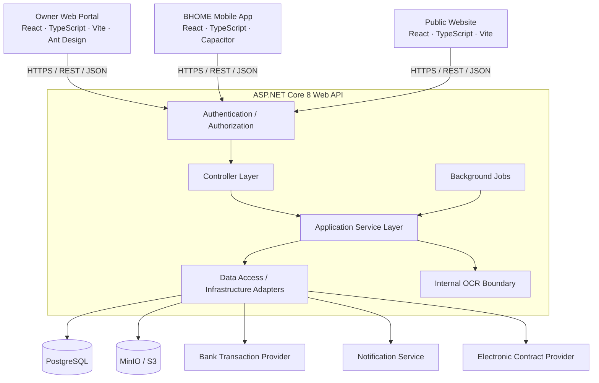
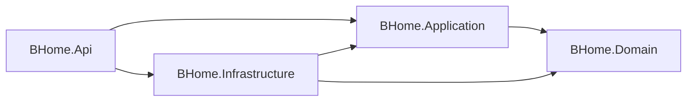

# BHOME architecture

This foundation implements the BHOME architecture described in Report 4 and the initialization
requirements. It is a single modular layered application. The finalized SRS and data model will
determine business entities and workflows. No business integration or OCR engine is simulated.

## System boundaries

Owner Web is the primary Owner management portal. One mobile app serves Owner, Staff and Tenant
through separate feature folders and role-aware routes. The public site exposes approved
information only; there is no Guest account, reservation, deposit, payment or signing workflow.
All clients are Vietnamese, format VND centrally and display business times in `Asia/Ho_Chi_Minh`.
Display localization is outside the domain layer.

## Backend dependency direction

All seven backend/test projects inherit `net8.0`. `global.json` selects the .NET 8 SDK feature
bands. Domain has no framework dependencies. Application holds orchestration, DTOs, policies and
ports and never references Infrastructure. Infrastructure implements persistence, Identity/JWT,
storage, job execution and provider boundaries. API is the composition root and owns transport,
authentication/authorization middleware, DTO mapping, validation and error handling.

Controllers never access `DbContext` or return EF entities. Use a focused application-owned data
access interface when a feature requires persistence; implement its query/command in Infrastructure.
Do not add a generic repository, unit-of-work wrapper, mediator or CQRS layer without a demonstrated
need. EF's scoped context already supplies tracking and transactional behavior.

## Modules and team ownership

Use matching `<Module>/` paths in Domain/Application, `Modules/<Module>/` in Infrastructure and
`Controllers/<Module>/` in API when new features arrive. The current infrastructure-wide boundaries
(`Persistence`, `IdentityAccess`, `Storage`, `Jobs`, `Integrations`) stay separate. See
[MODULES.md](MODULES.md) for the ten module names and the feature addition recipe.

Only real foundation files are created. Planned modules are documented rather than represented by
empty classes. Add focused DI extension methods as modules grow; `Program.cs` remains composition.

## Identity and authorization

ASP.NET Core Identity persists password hashes, security stamps, users and roles in PostgreSQL.
The initial migration seeds only the fixed Owner, Staff and Tenant roles from Domain constants.
No password, account or demo JWT is seeded. The existing-account login slice follows Controller
-> Application `LoginService` -> `ICredentialVerifier` -> Infrastructure Identity/EF. Identity verifies
passwords with lockout enabled; the service validates stored roles before calling `IAccessTokenIssuer`.
Invalid credentials, lockout, roleless/unsupported-role accounts and accounts requiring a second factor
receive the same generic denial. No second-factor challenge flow is implemented. Account provisioning,
tenant activation and the final SRS login identifier remain separate requirements.

JWT bearer authentication validates signature, issuer, audience, lifetime and HS256 algorithm.
The signing key must contain at least 32 random bytes; startup rejects missing/example keys. Access
tokens last 15 minutes by default (maximum configured lifetime: 60 minutes), include no sensitive
identity data and are not logged. Rotation, revocation/security-stamp checking and refresh sessions
belong to the real identity feature; a role change does not revoke an already-issued JWT immediately.

API fallback authorization requires authentication. Public controllers must explicitly opt into
`AllowAnonymous` and return approved, non-sensitive DTOs. Role policies are registered from central
constants. Resource authorization is a second check after the role check:

- Owner must own the resource's chain (`OwnerUserId` equality), not every chain in the deployment.
- Staff must have an authoritative assignment for the resource's owner and Location.
- Tenant must own the server-loaded tenancy resource.

`ResourceAccess` implements this decision boundary. Its resource scope must be constructed from
server-side data, never request-supplied owner/tenant IDs. `IStaffLocationAccess` deliberately denies
access until the finalized assignment model exists. This generic scope check does not grant every
operation to all three roles: each use case first restricts the allowed roles, then checks scope.
Its required `allowedRoles` argument ensures a multi-role user cannot satisfy an Owner/Staff-only
operation through their Tenant scope. List queries must apply equivalent predicates in SQL before
pagination, not filter afterward.

Frontend route guards are UX only. Session tokens stay in memory. A secure mobile token-store
contract exists but has no insecure persistence fallback. Native Keychain/Keystore persistence and
browser refresh/login behavior must be reviewed when implemented.

## Data storage

`Infrastructure/Persistence/BHomeDbContext` is an Identity EF context with Npgsql. The migration
contains Identity and job infrastructure tables only. `BHomeDbContextFactory` supports EF tooling
without starting HTTP, jobs, or integrations. Use reviewed EF migrations; no `EnsureCreated` or
automatic startup migration is used. Apply migrations explicitly during development/release.

Use module-specific Fluent API configurations discovered through `ApplyConfigurationsFromAssembly`.
Add explicit foreign keys, lengths, nullability, useful indexes and unique constraints. Use database
uniqueness to enforce provider-reference and idempotency rules. Use UTC timestamptz for instants,
date types for calendar dates, decimal for money and explicit units/precision. Effective-dated records
need start/end validity and non-overlap rules where the finalized model requires them. Add an explicit
concurrency token (for example PostgreSQL `xmin` mapped as a row version) to mutable contested records;
handle `DbUpdateConcurrencyException` through an application conflict mapped to HTTP 409.

An optional `AuditableEntity` stamps created/updated instants in sync and async SaveChanges. Timestamps
are not a full audit trail. Implement immutable actor/action/resource/correlation audit entries for
security, financial, contract and maintenance changes inside their business transactions. Define
retention/access rules before storing sensitive history. Keep EF sensitive-data logging disabled.

## Object storage and OCR

Application depends only on `IObjectStorage`. `MinioObjectStorage` provides cancellable private
upload, download-to-stream and delete operations, with environment-configured endpoint, bucket,
TLS and credentials. Buckets are provisioned separately and remain private. Future upload services
must authorize resource scope, generate opaque keys, bound size, validate actual file type and apply
retention rules; never accept arbitrary keys from a public client. No public download URL is exposed.

Internal `IOcrService` accepts a temporary input stream and returns an `OcrProposal` for meter or
CCCD extraction. The shipped adapter explicitly reports unavailable until an engine is selected.
Human confirmation is mandatory before a proposal becomes official business data. There is no
automatic write of a proposal into tenancy or billing records.

CCCD images must not enter permanent object storage, job payloads, logs, crash dumps or analytics.
The request/application owns and disposes the input stream in `finally`/`using`. A future OCR engine
must use memory or a restricted temporary file removed in `finally` on success, failure and
cancellation, with orphan cleanup after crashes. Only confirmed necessary fields and required
verification metadata may eventually be persisted. Mask sensitive fields in authorized views.

## Jobs, failures and idempotency

`IBackgroundJobQueue` and `IBackgroundJobHandler` are scheduler-independent application contracts.
Infrastructure supplies a PostgreSQL queue and hosted worker: unique `(Name, IdempotencyKey)`,
atomic enqueue, row claims with `FOR UPDATE SKIP LOCKED`, a two-minute lease, a one-minute
cooperative execution deadline, bounded exponential backoff with jitter, four attempts and a
durable Failed state. Each execution has a DI scope, structured logs and cancellation.

Jobs default to disabled until migrations, handlers and operations are ready. No HTTP request
waits for job execution. There are no business handlers or automatic recurrence schedules yet.
This is at-least-once delivery. A lease cannot prevent a stalled handler from overlapping a later
attempt if it ignores cancellation. Handlers must cooperate with the deadline and enforce durable
business idempotency/transactional uniqueness. They must not start unawaited work.

The queue uses the scoped context's explicit transaction, allowing business changes and job enqueue
to commit together (a small transactional outbox pattern without another product). A failed
notification delivery never rolls back an already committed business transaction. Failed jobs need
manual review and controlled replay with the same business key. Retain completion/deduplication
records according to business retry windows; never purge them blindly.

Financial/contract mutations and callbacks require a unique provider reference, authenticated
callbacks, atomic transition/ledger writes and persisted deduplication in one transaction. A timeout
after an external success is ambiguous: query provider status or enter pending review, never blindly
repeat a financial effect. Owner manual bank verification remains a future audited application use
case. See [job operations](../development/BACKGROUND_JOBS.md).

## External services

Exactly three provider categories have application ports and replaceable Infrastructure adapters:
`IBankTransactionProvider`, `INotificationProvider`, `IElectronicContractProvider`. The adapters
log their unavailable capability and throw `IntegrationUnavailableException`. API maps this to
503; no transfer, delivery, signature or OCR output is fabricated.

Choose concrete providers later. Reserve configuration sections for their URLs/credentials, but do
not make up their HTTP APIs now. Add focused typed HTTP clients, timeouts and bounded transient-read
retry policies at that boundary once actual contracts are known. Do not retry non-idempotent POSTs
without provider-supported keys/status reconciliation. Do not scatter retries through controllers.
Preserve references and evidence, minimize notification payloads, and never store private signing
keys or implement signing/certification algorithms. Provider credentials stay outside source.

## HTTP errors and observability

Routes use `/api/v1`, camelCase JSON, DTOs, `[ApiController]` validation and ProblemDetails. Central
exception handling returns generic 500/503 responses with a correlation ID and no exception detail.
Status-code middleware formats empty 401/403/404 responses as problems. Never map all arbitrary
exceptions to 400; expected validation/conflict/not-found outcomes should be explicitly modeled by
future application contracts. See [API conventions](../api/API_CONVENTIONS.md).

Correlation middleware validates an incoming GUID or generates one, returns `X-Correlation-ID`,
and adds a structured logging scope. JSON console logs record method/status/duration, not request
bodies, query strings, tokens or sensitive extracted fields. Exception logs record a safe type code;
framework exception/database-command logging categories are suppressed to avoid unsafe payloads.
Do not enable HTTP body logging. Add safe error/event codes and restricted audit events as features
arrive. `/health/live` has no dependencies; `/health/ready` currently checks database connectivity
only, not schema version, job capability, object storage or providers. Readiness is not a guarantee
that a particular business integration is available. Expand scoped health checks with real features.

## Configuration and deployment

`appsettings.json` contains safe defaults; Development adds local CORS origins and non-TLS local
storage. Real credentials use environment variables or user-secrets. `.env` is ignored and consumed
by Compose; the optional startup helper loads only recognized backend names into its process.
Client `.env.local` contains a public API URL only. Production requires explicit hosts, HTTPS URLs,
CORS origins, trusted certificates and scoped storage credentials. HTTPS redirection/HSTS default
on; terminate TLS and configure trusted proxy forwarding explicitly before proxy deployment.

Compose is development-only and binds data service ports to loopback, with named volumes and
health checks. API/Web Dockerfiles prepare application artifacts but do not deploy them. No
Kubernetes, cache, message broker or scheduler product is needed. See the deployment README.

## Testing and decisions beyond Report 4

xUnit tests cover fixed roles, resource isolation, actual JWT/RBAC middleware, sanitized errors,
correlation, dependency direction and controller boundaries. NSubstitute mocks assignment ports.
WebApplicationFactory tests do not require a personal database. A Docker-tagged Testcontainers suite
applies real migrations to isolated PostgreSQL and exercises readiness/durable enqueue deduplication.
Vitest/Testing Library cover client startup, API failures/config and route guards. CI builds/tests
all layers and validates formatting/Compose, without deployment.

Additional decisions and reasons:

| Decision                             | Reason                                                                                                                                                   |
| ------------------------------------ | -------------------------------------------------------------------------------------------------------------------------------------------------------- |
| Four projects, one deployed API      | Physical separation enforces the Report 4 layers without microservices.                                                                                  |
| npm workspaces and one root lockfile | One reproducible install and common tooling across three clients.                                                                                        |
| Small `packages/client-core`         | Keep role contracts, locale, auth state and API errors consistent; no shared business/UI framework.                                                      |
| Vite for mobile web assets           | Capacitor wraps the same build used for browser development.                                                                                             |
| No generated native folders          | Add intentionally once native platform owners, plugins and signing strategy are chosen.                                                                  |
| PostgreSQL-backed hosted worker      | Durable retry foundation reuses the required database, no scheduler dependency; recurrence is future work.                                               |
| Explicitly unavailable adapters      | Prevent fake external success while final providers/engine remain unspecified.                                                                           |
| Identity and job migration only      | Avoid inventing the unfinished business schema.                                                                                                          |
| Pinned MinIO source build            | Official community distribution is source-only; local development does not rely on removed registry images.                                              |
| Memory-only access tokens            | Avoid insecure browser/native token persistence before real session requirements are implemented.                                                        |
| No application DI wrapper yet        | Application has no registration framework dependency; compose its small foundation from Infrastructure/API until real modules need focused registration. |

Upstream references: [.NET 8 integration testing](https://learn.microsoft.com/aspnet/core/test/integration-tests?view=aspnetcore-8.0),
[Vite prerequisites](https://vite.dev/guide/), [Capacitor environment](https://capacitorjs.com/docs/getting-started/environment-setup),
[MinIO source distribution](https://github.com/minio/minio#source-only-distribution).
