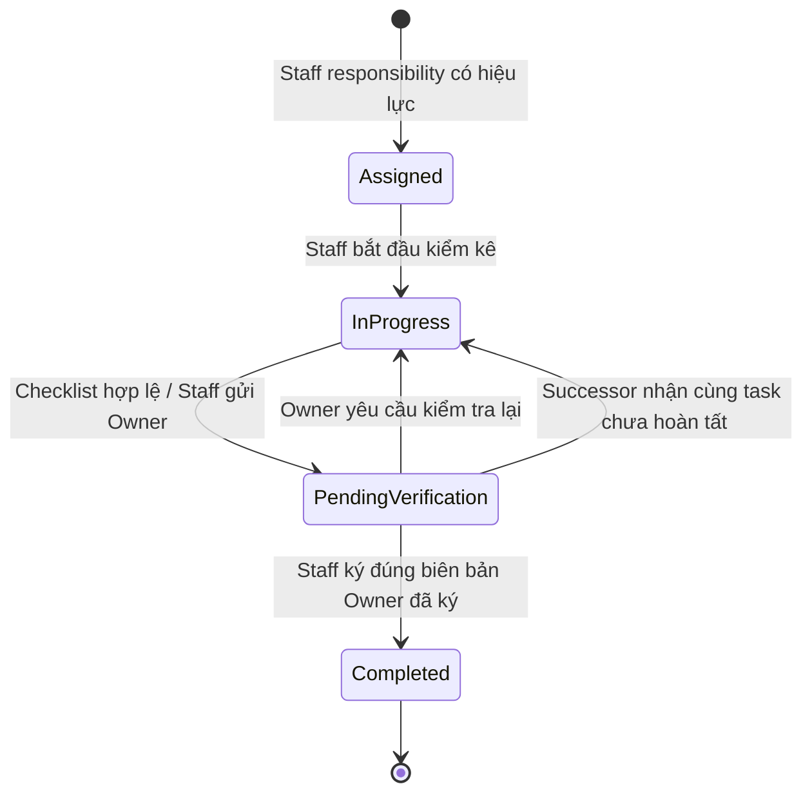
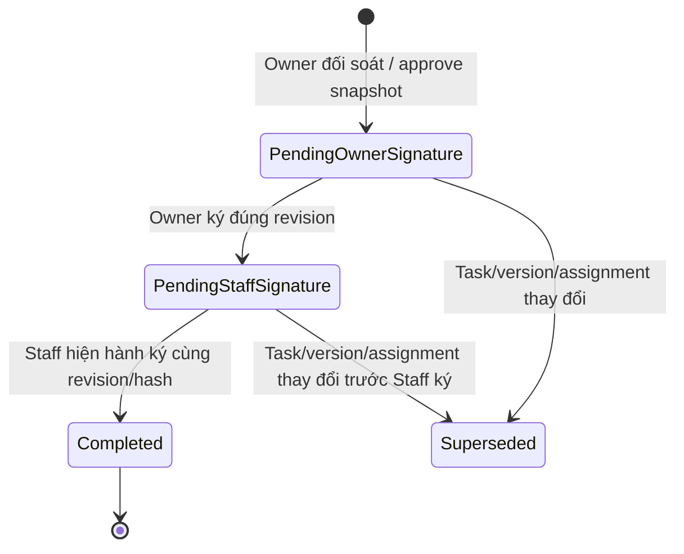
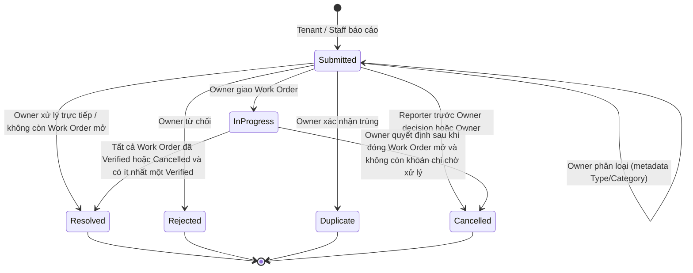
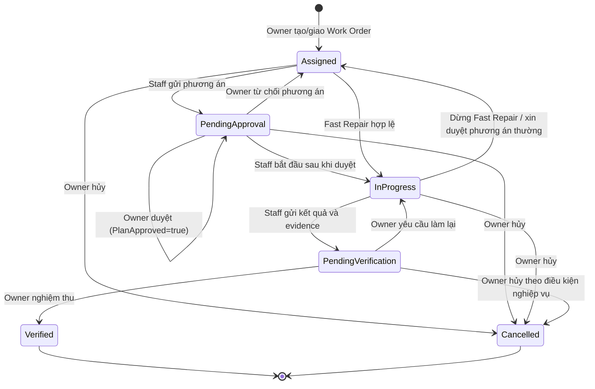

# Mô hình nghiệp vụ và trạng thái: BF-07, kiểm kê & bàn giao tài sản cơ sở

**Ngày chốt:** 23/11/2026  
**Phạm vi:** BF-01, BF-02, BF-07; UC-08..12, UC-26..30, UC-17; GBR-01..03, GBR-11..12; DBR-01.  
**Mục đích:** Một nguồn tham chiếu thống nhất cho Backend, Owner Web, Staff Mobile và Tenant Mobile. Tài liệu này mô tả trạng thái nghiệp vụ; không tạo thêm enum/status mới.

## 1. Quy tắc tổ chức nghiệp vụ

Không gộp các đối tượng sau thành một vòng đời:

| Đối tượng | Vai trò | Có phải sự cố BF-07 không? |
|---|---|---|
| `LocationAssetHandover` Operational Task | Staff kiểm tra tài sản đã được Owner xác nhận và tiếp nhận trách nhiệm quản lý tài sản cơ sở | Không |
| `IncidentReport` | Báo cáo một vấn đề bất thường tại Location/Room/Asset | Có |
| `MaintenanceWorkOrder` | Công việc sửa chữa/bảo trì được giao cho Staff | Là hồ sơ xử lý liên quan, không phải Incident |
| Proactive Maintenance Work Order | Công việc bảo trì do Owner chủ động tạo | Không; `IncidentId = null` |
| `MaintenanceCompensation` / Invoice / Deposit settlement | Quyết định và thu khoản bồi thường sau xử lý | Không; là nghiệp vụ tài chính phát sinh có điều kiện |

Một báo cáo thiếu/hỏng phát hiện trong checklist có thể tạo Incident và liên kết `IncidentId` vào đúng item kiểm kê. Liên kết này không biến checklist thành Work Order và không tự tạo Work Order. Owner vẫn phải tiếp nhận, phân loại và giao Work Order theo quy trình BF-07.

## 2. Kiểm kê và bàn giao tài sản cơ sở

### 2.1. Nguồn dữ liệu checklist

Checklist Staff chỉ lấy **tài sản vật lý tại phòng/khu vực chung đã được Owner kiểm kê và xác nhận**, không lấy toàn bộ catalog, `DesiredAssets` chưa xác minh hoặc asset chưa được Owner attestation.

- Tài sản phòng phải khớp cấu hình phòng hiện hành, `RoomInventoryChecklistReview` có item đã xác nhận, `AssetVerification(Status=Verified, source=OwnerAttestation)` và Asset vật lý còn Active, đúng phòng, loại, tên, số lượng và đơn vị.
- Tài sản khu vực chung phải có `CommonAssetInventoryVerification(Status=Verified)` khớp fingerprint cấu hình hiện hành và Asset vật lý.
- Một nhóm tài sản tại một phòng có một Asset ID và một số lượng. Không sinh Asset ID riêng cho từng chiếc trong nhóm.
- Phòng được Owner xác nhận không có tài sản có thể có một dòng `Quantity=0` để chứng minh quyết định đó; đây không phải tài sản để Staff tự thêm.
- Phòng/khu vực chung chưa được Owner xác nhận được trả về riêng qua `PendingOwnerRooms` / `PendingOwnerCommonAssets`; không tạo dòng checklist giả và không cho Staff gửi kiểm kê khi còn pending.
- Tài sản kế thừa từ biên bản bàn giao Tenant chỉ được đánh dấu tự động khi đúng tài sản/nhóm và số lượng đã tồn tại trong baseline Owner-confirmed, hợp đồng Tenant hiện hành hợp lệ và biên bản Tenant đã được các bên xác nhận. Item kế thừa là read-only, được tính trong snapshot và tiến độ; **không được tạo thêm tài sản hoặc thay thế bước Owner xác nhận**. Tài sản khu vực chung không kế thừa từ bàn giao Tenant.
- N?u Staff ph?t hi?n t?i s?n k? th?a b? thi?u/h?ng, t?o Incident ri?ng v? ch? g?n IncidentId v?o item; kh?ng ghi ?? checked/condition/note hay source Tenant g?c.
- N?u Staff ph?t hi?n t?i s?n k? th?a b? thi?u/h?ng, t?o Incident ri?ng v? ch? g?n IncidentId v?o item; kh?ng ghi ?? checked/condition/note hay source Tenant g?c.
- Khi thay Staff, các item đã kiểm tra được giữ lại nếu physical identity, Asset ID, số lượng, tên, khu vực và nguồn kế thừa vẫn khớp. `PriorStaffTaskId` / `PriorStaffUserId` giữ provenance. Staff mới có thể yêu cầu kiểm tra lại item đã kế thừa từ Staff trước; không bắt kiểm kê lại toàn bộ.

### 2.2. Vòng đời Operational Task

Một Location chỉ có tối đa một `LocationAssetHandover` task đang mở. Task là công việc thuộc Location, không phải công việc sở hữu bởi assignment. Task ID được tạo khi phát sinh task đầu tiên; khi trách nhiệm Staff thay đổi, hệ thống chuyển assignment trên **cùng task đang mở**, không tạo task thứ hai.

| Trạng thái task | Ý nghĩa | Hành động chính của Staff |
|---|---|---|
| `Assigned` | Công việc được giao cho Staff hiện hành | Bắt đầu kiểm kê |
| `InProgress` | Đang kiểm tra các item Owner-confirmed và ghi nhận vấn đề | Xác nhận đủ/nguyên vẹn; ghi nhận thiếu/hỏng/không thể kiểm tra; gửi checklist khi hợp lệ |
| `PendingVerification` | Checklist đã gửi; chờ Owner đối soát/ra quyết định | Chờ Owner; nếu Owner ký biên bản thì đọc PDF và ký nhận |
| `Completed` | Owner và Staff đã ký cùng một revision/snapshot | Chỉ xem/lưu hồ sơ lịch sử |
| `Cancelled` | Trạng thái đóng theo các quy tắc task hiện có; không dùng thay cho rework | Không thao tác |

`progress`/`blockers` là event lịch sử của Operational Task, không phải bước ký biên bản. Với LocationAssetHandover, tiến độ chính được thể hiện bằng checklist; vấn đề thiếu/hỏng cần liên kết Incident cụ thể.

### 2.3. Điều kiện Staff gửi checklist

Backend là nguồn quyết định cuối cùng. Chỉ cho phép gửi khi:

1. Task đang `InProgress` và Staff là người phụ trách hiện hành, assignment có hiệu lực, nhân sự còn active.
2. Payload checklist đầy đủ và không thiếu item so với `TotalCount`.
3. Mọi item đã được kiểm tra hoặc kế thừa hợp lệ; không còn `PendingOwnerRooms` / `PendingOwnerCommonAssets`.
4. Item `Missing` / `Damaged` có ghi chú và `IncidentId` liên kết đúng Location/Room/Asset; item `NotAccessible` có ghi chú.
5. Baseline Owner-confirmed và bằng chứng kế thừa Tenant vẫn khớp tại thời điểm submit.
6. Version hiện hành được kiểm tra lại; lệnh cập nhật có idempotency key. Conflict phải yêu cầu tải lại/đối chiếu, không ghi đè dữ liệu mới.

### 2.4. Vòng đời biên bản và chữ ký

Biên bản là snapshot bất biến theo revision, lưu manifest, snapshot hash, PDF hash và sự kiện ký append-only trong Location history. Chữ ký là xác nhận của phiên đăng nhập đã xác thực đối với đúng revision/hash; không phải chữ ký số bằng chứng thư do BHOME tự cấp.

| Trạng thái report | Ý nghĩa | Người cần hành động |
|---|---|---|
| Chưa có report | Staff chưa gửi hoặc Owner chưa lập biên bản | Staff gửi checklist hoặc Owner đối soát |
| `PendingOwnerSignature` | Owner đã đối soát/lập snapshot, chưa có Owner signature | Owner |
| `PendingStaffSignature` | Owner đã ký; chờ đúng Staff của report đọc PDF và ký nhận | Staff có `StaffId` khớp và còn trách nhiệm hiện hành |
| `Completed` | Cả hai bên ký cùng revision/hash; task hoàn tất | Không còn hành động ký |
| `Superseded` | Task version/assignment/responsible Staff thay đổi trước Staff ký | Không được ký bản cũ; tiếp tục task hiện hành |

**Không đồng nhất trạng thái task với trạng thái report.** Trong lúc `task.Status=PendingVerification`:

- Chưa có report: Staff thấy “Đã gửi kiểm kê – chờ Owner đối soát và lập biên bản”.
- Report `PendingOwnerSignature`: Staff thấy “Chờ Owner ký xác nhận”.
- Report `PendingStaffSignature`: Staff thấy “Owner đã ký – chờ bạn đọc PDF và ký nhận”. Không hiển thị “Chờ Owner kiểm tra”.
- Report `Completed`: Staff thấy “Bàn giao hoàn tất”.
- Report `Superseded`: Staff thấy “Biên bản cũ đã thay thế”; không cho ký bản cũ.

### 2.5. Rework và thay đổi người phụ trách

- Owner rework chọn item cụ thể và ghi lý do tối thiểu 10 ký tự. Chỉ các item được chọn mới được reset; nếu item Tenant-inherited bị tranh chấp, item đó trở thành item Staff kiểm tra trực tiếp, còn source Tenant và PDF revision cũ vẫn giữ trong lịch sử.
- Rework chuyển task `PendingVerification -> InProgress`, tăng version, xóa result tổng hợp cũ và yêu cầu Staff gửi lại. Report cũ trở thành `Superseded` theo version; revision mới chỉ được tạo sau lần approve tiếp theo.
- Khi assignment kết thúc mà chưa có Staff signature, task chưa hoàn thành vẫn mở nhưng Staff cũ mất quyền đọc/ghi; khi assignment mới có hiệu lực, cùng task được chuyển sang Staff mới. Giữ checklist, notes, Incident links, evidence và history; nếu task đang `PendingVerification`, đưa về `InProgress` để successor kiểm tra và gửi lại.
- Staff cũ không được đọc/act trên checklist, report chưa ký hoặc report hiện hành sau khi hết trách nhiệm. Owner giữ quyền đọc/điều phối.
- Khi biên bản đã `Completed`, task hoàn tất không bị chuyển cho successor. Assignment mới có thể tạo task mới; Staff cũ được đọc report/PDF đã ký bởi chính mình ở chế độ read-only, không được ký lại hoặc đọc task/report của Staff mới.
- Không tạo task trùng cho một Location; job reconcile phải idempotent. Không ép kiểm kê lại các item đã xác nhận và còn khớp.

## 3. BF-07: Incident và Work Order

### 3.1. Incident lifecycle

`IncidentStatus`: `Submitted`, `InProgress`, `Resolved`, `Rejected`, `Duplicate`, `Cancelled`.

Phân loại (`Type`, `Category`, `OwnerDecisionAt`) là metadata, không phải trạng thái mới. Incident chỉ được resolve sau khi các Work Order cần thiết đã được xác minh, hoặc theo nhánh Owner-direct resolution hợp lệ. Duplicate phải trỏ tới Incident cùng Location/Room/Asset/common area và giữ nguyên lịch sử gốc.

### 3.2. Work Order lifecycle

`WorkOrderStatus`: `Assigned`, `PendingApproval`, `InProgress`, `PendingVerification`, `Verified`, `Cancelled`.

- Duyệt phương án là metadata (`ApprovedProposalVersion`, `ApprovedById`, `ApprovedAt`); trạng thái vẫn `PendingApproval` cho tới khi Staff bắt đầu.
- Staff đề xuất inspection result, solution, duration, estimated cost và materials. Owner quyết định approve/reject. Không cho thực hiện phương án cần duyệt trước khi Owner duyệt.
- Fast Repair chỉ được dùng khi nhóm được Owner bật, policy version còn hợp lệ, estimated cost bằng 0, không dùng vật tư và thời gian hợp lệ. Fast Repair vào thẳng `InProgress`; nếu không đáp ứng thì Staff dừng và quay về `Assigned` để xin duyệt phương án thường.
- Staff submit cần evidence hoàn tất. Owner verify ghi actual cost/result, cập nhật Asset state và Maintenance History; rework trả Work Order về `InProgress`.
- Vendor là phương thức thực hiện/thuộc tính của Work Order, không phải một state machine khác.
- Staff có thể đề xuất Asset hiện có hoặc Asset mới nếu Work Order chưa có Asset. `AssetProposalPending` là trạng thái chờ quyết định; Owner accept/reject. Chỉ khi accept mới gắn/tạo Asset cho Work Order; `IncidentReport.AssetId` ban đầu và bằng chứng báo cáo không bị ghi đè.
- Sự cố tái diễn sau khi Incident đã đóng phải tạo Incident mới; không mở lại và ghi đè lịch sử Incident cũ.

### 3.3. Emergency

- Incident severity là `Normal` hoặc `Emergency`; không có một IncidentStatus riêng cho Emergency.
- Khi Tenant báo Emergency, hệ thống thông báo Owner và Staff đủ điều kiện tại Location. Staff cần acknowledge trước khi ghi emergency action. Nếu Staff là người gửi Emergency, hệ thống ghi nhận acknowledge tại thời điểm tạo.
- Emergency action là event append-only có actor/time/note/evidence và requested cost nếu có. Owner quyết định requested cost; chỉ khi approve mới ghi MaintenanceExpense. Requested cost không phải phê duyệt tự động hay chi phí thực tế cuối cùng.
- Emergency không bỏ qua Owner review/Work Order/verification. Hướng dẫn an toàn phải ưu tiên liên hệ dịch vụ khẩn cấp công cộng khi có nguy cơ tới tính mạng.

### 3.4. Bảo trì chủ động và chi phí/bồi thường

- Proactive Maintenance do Owner tạo, có Location, Room/common area, Asset tùy chọn, mô tả, expected outcome, deadline và Staff được giao. Đây là Work Order `Source=Proactive`, `IncidentId=null`; đi theo Work Order lifecycle, không tạo Incident giả.
- `MaintenanceExpense` là chi phí vận hành gắn với nguồn cụ thể (Work Order, emergency action hoặc Owner direct activity), không lưu tổng chi phí không có nguồn.
- Bồi thường chỉ do Owner quyết định sau khi Work Order `Verified`, có `ActualCost`, phòng hợp lệ và bằng chứng 1–5 ảnh. Amount là số VND nguyên dương và không vượt ActualCost.
- `CollectionMethod=Invoice`: tạo hóa đơn AD_HOC đã Final; trạng thái bồi thường ban đầu `InvoiceIssued`, khi có tiền ghi nhận thì view trả `PaymentRecorded`.
- `CollectionMethod=Deposit`: trạng thái ban đầu `DepositPending`. Chỉ được deduct khi backend xác nhận `MoveOutReady` và số dư cọc khả dụng đủ; sau deduct là `Deducted`. Owner có thể cancel khi chưa thu. Không khấu trừ trước move-out hoặc khấu trừ lặp.
- Bồi thường/khấu trừ cọc không phải bước mặc định của mọi Incident; nếu không có quyết định Owner thì không phát sinh.

## 4. Ma trận quyền

| Tác vụ | Owner | Staff hiện được giao / đang có trách nhiệm | Staff cũ | Tenant |
|---|---|---|---|---|
| Tạo Incident | Theo quyền quản trị hiện có | Có, trong Location được phân công | Không còn quyền theo Location cũ | Có, trong phạm vi Room/Contract của mình |
| Xem Incident | Quản lý trong phạm vi Owner | Theo Location và permission hiện hành | Không được đọc dữ liệu Location đã hết trách nhiệm trừ hồ sơ được phép lưu lịch sử riêng | Chỉ Incident của mình và activity Tenant-visible |
| Phân loại / assign / reject / duplicate / resolve | Có | Không | Không | Không |
| Emergency acknowledge / action | Xem và quyết định | Staff đủ điều kiện tại Location; action sau acknowledge (trừ người Staff tạo report đã auto-ack) | Không | Không |
| Work Order plan approve / verify / rework / cancel | Có | Không | Không | Không |
| Work Order inspect / propose / start / progress / blocker / submit | Có thể xem/điều phối | Chỉ Staff được giao đúng Work Order và còn quyền Location | Không | Không |
| Propose Asset link | Xem/ra quyết định | Staff được giao Work Order | Không | Không |
| Compensation / Invoice / Deposit decision | Owner-only | Không | Không | Thanh toán hóa đơn hoặc xem kết quả của mình theo quyền Tenant |
| Xem checklist / sửa item / upload evidence / submit handover | Có, bao gồm reconcile/rework | Chỉ Staff phụ trách hiện tại, assignment hiệu lực và employment active | Không đọc/ghi checklist hoặc report chưa ký/current | Không |
| Owner ký biên bản | Có | Không | Không | Không |
| Staff ký biên bản | Không ký thay Staff | Chỉ StaffId trên report, đang phụ trách hiện tại, đúng revision/hash | Không được ký lại | Không |
| Đọc report/PDF đã hoàn tất | Có | Staff signer/current Staff theo quyền | Chỉ report/PDF đã ký bởi chính mình, read-only | Không |

**Backend bắt buộc kiểm tra quyền cho mọi read/write:** task detail, checklist GET/PUT, task history, evidence metadata/upload/download, report GET, PDF GET, sign, incident/work-order detail/history/evidence và mọi thao tác theo ID. UI ẩn nút không thay thế server authorization. Khi không đủ quyền, dùng 403/404 theo policy hiện có và không tiết lộ dữ liệu khác Location.

## 5. Quy tắc hiển thị UI

1. Một màn hình phải nói rõ: đang ở bước nào, ai đang chờ hành động, và hành động tiếp theo là gì.
2. Một trạng thái chỉ có một CTA chính. Từ chối, trùng, hủy, đóng trực tiếp và các thao tác hiếm nằm trong “Thao tác khác”, kèm lý do và điều kiện.
3. Không trộn trạng thái Operational Task với trạng thái biên bản. Đặc biệt, `PendingVerification + PendingStaffSignature` phải hiển thị “Owner đã ký – chờ Staff ký nhận”, không hiển thị “Chờ Owner kiểm tra”.
4. Checklist tách rõ tài sản Staff tự kiểm tra, item kế thừa Tenant tự xác nhận và các phòng/tài sản đang chờ Owner. Không tạo item từ catalog chưa xác nhận.
5. Chỉ hiện phần chi phí, Emergency, Vendor, Asset proposal, evidence hoặc history khi có liên quan; không render các card rỗng.
6. Ẩn UUID, SHA-256 và mã kỹ thuật khỏi luồng thao tác thường ngày. Hash/version vẫn được gửi và xác minh phía sau; revision và số lượng tài sản có thể hiển thị cho người ký.
7. Tenant chỉ thấy tiến trình và nội dung công khai cần thiết; không lộ ghi chú nội bộ, quyết định chi phí, thông tin Staff/vendor hoặc metadata kỹ thuật.

## 6. Traceability và kiểm thử nghiệm thu

| Phạm vi | Source / code | Acceptance tối thiểu |
|---|---|---|
| Location task, Owner-confirmed baseline, Tenant inheritance, successor | `docs/development/location-asset-inventory-task.md`; `LocationAssetInventoryTaskFactory`; `CompactLocationAssignments`; `LocationAssetInventoryService`; `LocationAssetHandoverService` | Chỉ item Owner-confirmed; inherited chỉ khớp baseline; một open task/Location; successor giữ task/progress/evidence/history; former Staff bị từ chối |
| Task/report signature states | `OperationalTaskService`; `LocationAssetHandoverService`; `LocationAssetHandoverSigningTests` | Owner approve -> Owner sign -> Staff sign đúng revision/hash; rework/successor làm report cũ Superseded; không ký bản cũ |
| Former Staff signed-report archive | `LocationAssetHandoverArchiveController`; `LocationAssetHandoverService.ArchiveAsync/ArchiveRevisionAsync/ArchiveDocumentAsync`; `LocationAssetHandoverSigningTests` | Actor l?y t? session; ch? list/detail/final PDF revision ?? c? Owner + ch?nh Staff k?; kh?ng truy c?p task/checklist/evidence/current report/successor |
| Former Staff signed-report archive | `LocationAssetHandoverArchiveController`; `LocationAssetHandoverService.ArchiveAsync/ArchiveRevisionAsync/ArchiveDocumentAsync`; `LocationAssetHandoverSigningTests` | Actor l?y t? session; ch? list/detail/final PDF revision ?? c? Owner + ch?nh Staff k?; kh?ng truy c?p task/checklist/evidence/current report/successor |
| BF-07 Incident / Work Order | `AGENTS.md` §BF-07; `docs/api/INCIDENT_MAINTENANCE.md`; `IncidentService`; `IncidentRecords` | Normal report -> classify/assign -> propose/approve -> execute/evidence -> verify/rework -> resolve; duplicate/reject/cancel giữ lý do |
| Emergency / Fast Repair / Asset link / Vendor | `IncidentService`; `FastRepairAndAssets`; `IncidentActions` | Emergency ack/action/cost decision; Fast Repair 0 VND/no materials/fallback; Asset proposal Owner decision; Vendor không tạo lifecycle riêng |
| Proactive / compensation | `CompensationService`; `MaintenanceWorkOrder`; Owner maintenance APIs | Proactive `IncidentId=null`; compensation chỉ sau Verified; Invoice vs Deposit; Deposit chỉ deduct khi MoveOutReady và đủ số dư; idempotent |

### Regression tests nên có

- Location inventory: 0/partial/all checked; pending Owner room/common blocker; Missing/Damaged thiếu note hoặc Incident link; NotAccessible thiếu note; stale version; duplicate idempotency key; Tenant-inherited matching row read-only; không nhân đôi Asset group; zero-asset Owner confirmation.
- Responsibility: same open task ID sau successor; gi? checked item/note/Incident link/evidence/history v? provenance qua nhi?u l?n ??i Staff; former Staff kh?ng ??c/ghi unsigned/current checklist/report/PDF/evidence/history; ch? ??c archive revision/PDF ?? k? b?i ch?nh m?nh; Owner v?n ??c.
- Handover: PendingOwnerSignature, PendingStaffSignature, Completed, Superseded; Owner và Staff ký đúng revision/hash; rework chỉ reset item chọn; completed report vẫn immutable.
- BF-07: full Normal flow; Emergency acknowledge/action/cost; proactive `IncidentId=null`; Fast Repair 0 VND và fallback; Asset link existing/new accept/reject; Vendor; compensation Invoice/Deposit; move-out gate; rework; recurrence tạo Incident mới.

**Test status:** ?? b? sung CompactPostgres end-to-end regression cho Staff A k? report, assignment/employment k?t th?c, Staff B nh?n task m?i v? ho?n t?t; A ch? ??c ???c archive/PDF c?a A, kh?ng ??c task/report c?a B. Test ???c discovery nh?ng hi?n SKIP v? m?i tr??ng ch?a c?u h?nh `BHOME_COMPACT24_TEST_ADMIN`; ch?a c? runtime PASS.

## 7. Nguồn tham chiếu

- `AGENTS.md` §4 (authorization), §BF-02, §BF-07, §testing/change control.
- `docs/api/INCIDENT_MAINTENANCE.md` (API/state/permissions BF-07).
- `docs/development/location-asset-inventory-task.md` (checklist và task factory; được cập nhật đồng bộ với tài liệu này).
- `src/backend/BHome.Domain/IncidentMaintenance/IncidentRecords.cs`.
- `src/backend/BHome.Application/IncidentMaintenance/IncidentService.cs`, `CompensationService.cs`, `FastRepairAndAssets.cs`.
- `src/backend/BHome.Infrastructure/Persistence/Compact24/LocationAssetInventoryTaskFactory.cs`, `CompactLocationAssignments.cs`.
- `src/backend/BHome.Infrastructure/StaffOperations/LocationAssetHandoverService.cs`.
- `src/mobile/src/services/locationAssetInventory.ts`, `locationAssetHandover.ts` và các màn hình Staff Mobile tương ứng.
