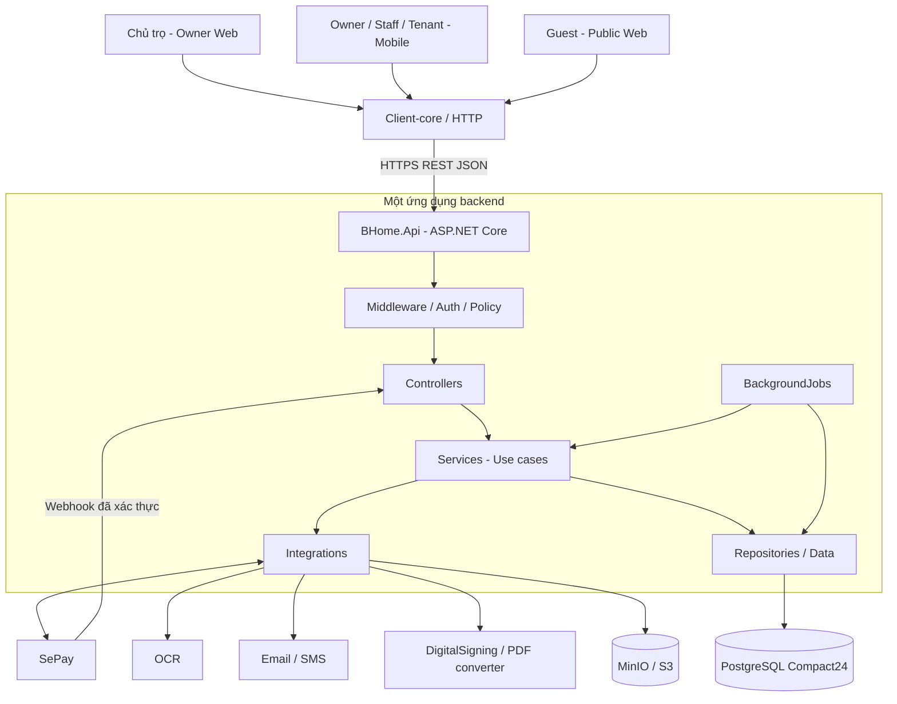
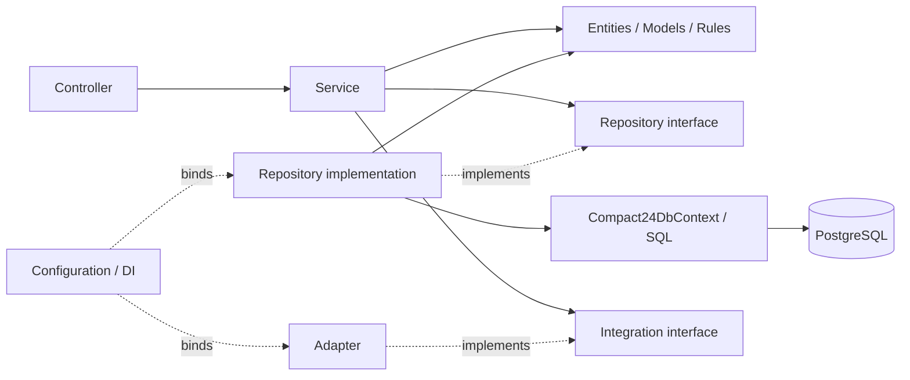
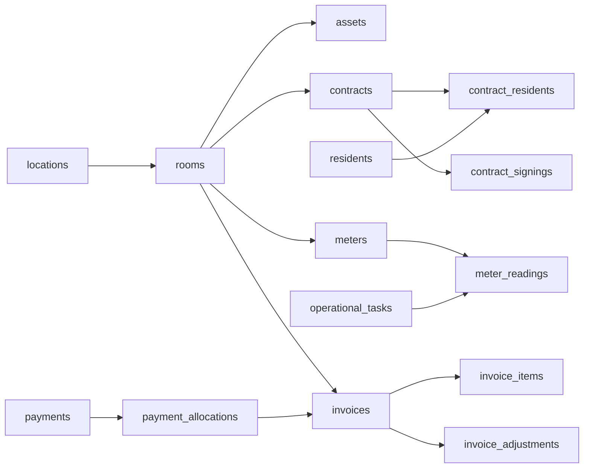
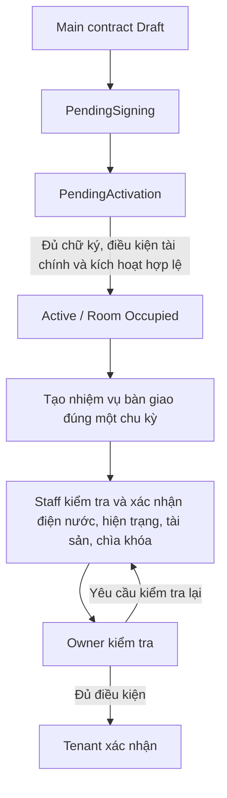
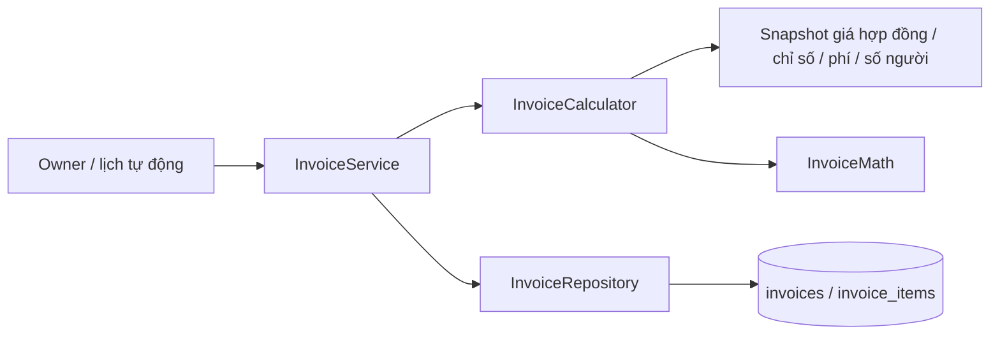

# Kiến trúc hệ thống BHOME — Hướng dẫn dành cho team

> Baseline source: member/THuy, commit 1129a5ae (merge develop tại 2f4a6aca), ngày 29/11/2026. Tài liệu mô tả mã nguồn hiện tại, không thay thế SRS, không khẳng định tất cả chức năng đã được nghiệm thu hoặc triển khai lên Staging/Production.

## 1. Kiến trúc tổng quan

BHOME là nền tảng quản lý và vận hành chuỗi nhà trọ. Kiến trúc Backend là **Modular Monolith + Layered Architecture trong một project nghiệp vụ**. Các module được phân chia theo chức năng, các tầng theo trách nhiệm; không phải microservices và không có một database riêng cho mỗi module.

| Thành phần     | Công nghệ                                   | Trách nhiệm                                                                        |
| -------------- | ------------------------------------------- | ---------------------------------------------------------------------------------- |
| Owner Web      | React, TypeScript, Vite, Material UI        | Quản trị cơ sở, phòng, hợp đồng, nhân viên, hóa đơn, tài chính                     |
| Mobile         | Expo, React Native, Expo Router, TypeScript | Giao diện theo vai trò Owner, Staff, Tenant                                        |
| Public Web     | React, TypeScript, Vite                     | Thông tin công khai; các luồng ẩn danh có endpoint riêng và phạm vi được phê duyệt |
| Shared client  | packages/client-core                        | HTTP client, DTO TypeScript, hooks, mã lỗi dùng chung                              |
| Backend        | ASP.NET Core 8, EF Core 8, Npgsql           | API REST, phân quyền, nghiệp vụ, giao dịch, jobs                                   |
| Database       | PostgreSQL, Compact24                       | 24 bảng nghiệp vụ vật lý, quan hệ và snapshot JSONB                                |
| Storage        | MinIO/S3                                    | Tệp riêng tư, ảnh minh chứng, PDF hợp đồng                                         |
| DigitalSigning | Subsystem .NET riêng                        | Ký tài liệu, kiểm tra tính toàn vẹn PDF                                            |
| Tích hợp       | SePay, email/SMS, OCR, chuyển đổi tài liệu  | Adapter và xử lý kết quả theo cấu hình môi trường                                  |



Luồng chính: người dùng thao tác trên giao diện → gửi HTTP → Backend xác thực và kiểm tra quyền → thực thi nghiệp vụ → lưu dữ liệu → trả DTO → giao diện cập nhật. Backend là nguồn sự thật của trạng thái, giá trị tiền và kết quả thanh toán.

## 2. Cấu trúc repository

```text
SEP490-G92-BHOME/
├── src/
│   ├── backend/
│   │   ├── BHome.Api/            # Project runtime nghiệp vụ
│   │   ├── BHome.sln             # Solution đầy đủ
│   │   ├── BHome.CI.slnf         # Phạm vi test CI
│   │   └── BHome.Student.slnf    # Solution filter học/đọc code
│   ├── digital-signing/          # Subsystem ký tài liệu
│   ├── owner-web/
│   ├── mobile/
│   └── public-web/
├── packages/client-core/         # Code TypeScript dùng chung
├── tests/                        # Unit, integration, client và deployment tests
├── tools/                        # Công cụ migration, seed, kiểm tra offline
│   └── BHome.LegacyPersistence/
├── scripts/                      # Chạy local, kiểm tra và hỗ trợ triển khai
├── deploy/                       # Docker, VPS, cấu hình triển khai
├── docs/                         # Yêu cầu, thiết kế, hướng dẫn
├── .github/workflows/            # CI/CD
└── docker-compose.yml
```

**Thay đổi quan trọng sau refactor:** BHome.Application, BHome.Domain và BHome.Infrastructure không còn là các project runtime riêng trong src/backend. Nội dung của chúng nằm trong BHome.Api. Namespace CLR cũ vẫn được sử dụng để giữ tương thích với kiểu dữ liệu, migration và serializer. Không tạo lại các project cũ chỉ vì thấy namespace cũ trong code.

BHome.sln vẫn có các project test, công cụ và DigitalSigning riêng; điều này không mâu thuẫn với kiến trúc single-project của Backend nghiệp vụ.

## 3. Phân tầng Backend

Mọi đường dẫn trong mục này tính từ src/backend/BHome.Api/.

| Thư mục                                | Vai trò                                                       | Ví dụ                                                   |
| -------------------------------------- | ------------------------------------------------------------- | ------------------------------------------------------- |
| Controllers                            | Route, HTTP binding, role/policy, gọi use case                | Billing/InvoicesController.cs                           |
| Services                               | Điều phối nghiệp vụ, validation, quyền, trạng thái, công thức | Billing/InvoiceService.cs, Billing/InvoiceCalculator.cs |
| Interfaces, DTOs                       | Hợp đồng service/repository và dữ liệu trao đổi               | DTOs/Billing/InvoiceContracts.cs                        |
| Entities                               | 24 entity vật lý chuẩn                                        | Billing/Invoice.cs, TenantContracts/Contract.cs         |
| Enums, Models, Common                  | Enum, snapshot, value, sự kiện, quy tắc dùng chung            | Enums/TenantContracts/ContractEnums.cs                  |
| Repositories                           | EF/native SQL, transaction, khóa, lịch sử                     | Contracts/ContractRepository.cs                         |
| Data                                   | DbContext, mapping, migration, guard dữ liệu                  | Data/Compact24/Compact24DbContext.cs                    |
| Integrations                           | Adapter storage, OCR, ký, thông báo, thanh toán               | Contracts/ContractSigningRouter.cs                      |
| BackgroundJobs                         | Worker, scheduler, xử lý tự động                              | Billing/BillingAutomationEngine.cs                      |
| Configuration                          | Composition root và đăng ký DI                                | DependencyInjection.cs, ApiFoundation.cs                |
| Middleware, IdentityAccess, Attributes | Kiểm soát request, lỗi, định danh và hạ tầng quyền            | Middleware/ApiExceptionHandler.cs                       |



Sơ đồ mô tả phụ thuộc logic, không phải tham chiếu giữa bốn assembly riêng. Controller không tự tính tiền hoặc truy vấn database. Service nắm quy tắc nghiệp vụ; repository đảm bảo persistence, concurrency và atomicity. DI đăng ký implementation tại Configuration/DependencyInjection.cs; Program.cs cấu hình pipeline HTTP, xác thực, phân quyền, health checks.

## 4. Module nghiệp vụ và nơi tìm code

| Module logic                 | Chức năng                                  | Điểm vào tìm kiếm                                                                                |
| ---------------------------- | ------------------------------------------ | ------------------------------------------------------------------------------------------------ |
| IdentityAccess               | Đăng nhập, phiên, quyền                    | AuthController, LoginService                                                                     |
| PropertyManagement           | Cơ sở, phòng, tài sản, giá                 | PropertyControllers, PropertyService                                                             |
| Operations / StaffOperations | Nhân viên, phân công, công việc            | OperationalTasksController, OperationalTaskService                                               |
| Contracts / TenantContracts  | Giữ chỗ, hợp đồng, bàn giao, trả phòng     | ContractsController, ContractService (partial), ContractHandoverDraftService                     |
| Billing                      | Công tơ, hóa đơn, lịch tự động, điều chỉnh | CaptureController, InvoicesController, InvoiceCalculator                                         |
| PaymentsDebt                 | Tiền cọc, thanh toán, công nợ, hoàn tiền   | SePayController, PaymentRepository                                                               |
| IncidentMaintenance          | Sự cố, sửa chữa, bảo trì                   | Tìm Controllers/IncidentMaintenance và Services/IncidentMaintenance                              |
| Finance                      | Chi phí, tài sản vốn, báo cáo, kịch bản    | ExpenseRepository, FinancialScenarioRepository                                                   |
| Notifications                | Inbox và gửi thông báo                     | BackgroundJobs/Notifications, Repositories/Notifications                                         |
| PublicInformation            | Dữ liệu được phép công khai                | Controllers/Operations/OperationsControllers.cs (PublicInformationController), OperationsService |

Không coi mỗi module là một service triển khai độc lập. Các use case xuyên module sử dụng service/repository hiện có và giữ ranh giới giao dịch.

## 5. Database Compact24

Mapping chuẩn nằm ở Data/Compact24/Compact24NativeModel.cs và Compact24DbContext.cs. DDL tham chiếu: [BHOME_24_TABLES.sql](../database/2026-11-03/compact-24/BHOME_24_TABLES.sql). Migrations runtime nằm tại Data/Compact24/Migrations/.

| Nhóm         | Bảng vật lý                                                                            | Entity tương ứng                                                            |
| ------------ | -------------------------------------------------------------------------------------- | --------------------------------------------------------------------------- |
| Identity     | users, refresh_tokens, staff_employments                                               | User, RefreshToken, StaffEmployment                                         |
| Property     | locations, rooms, assets                                                               | Location, Room, Asset                                                       |
| Contracts    | residents, contracts, contract_signings, contract_residents                            | Resident, Contract, ContractSigning, ContractResident                       |
| Maintenance  | incident_reports                                                                       | IncidentReport                                                              |
| Tasks        | operational_tasks                                                                      | OperationalTask                                                             |
| Billing      | meters, meter_readings, billing_policies, invoices, invoice_items, invoice_adjustments | Meter, MeterReading, BillingPolicy, Invoice, InvoiceItem, InvoiceAdjustment |
| Payment      | payments, payment_allocations, refund_requests                                         | Payment, PaymentAllocation, RefundRequest                                   |
| Finance      | expenses, financial_scenarios                                                          | Expense, FinancialScenario                                                  |
| Notification | notifications                                                                          | Notification                                                                |



Đây là sơ đồ quan hệ nghiệp vụ rút gọn, không thay thế ERD đầy đủ hoặc định nghĩa FK.

- JSONB lưu snapshot, lịch sử, metadata có kiểu; ví dụ handover, move_out và history của contracts, task_data của operational_tasks. ContractHandover và ContractMoveOut là model nghiệp vụ, không mặc định là bảng riêng.
- Một entity có thể có thuộc tính tương thích nghiệp vụ và thuộc tính vật lý được mapping khác nhau. Trước khi viết LINQ, kiểm tra mapping; không truy vấn alias không được EF map.
- Không ghi đè lịch sử khi cập nhật snapshot; giữ version, khóa, idempotency và audit. Không sửa migration đã phát hành hay xóa dữ liệu để test.
- BHome.LegacyPersistence chỉ dành cho import/fixture offline; không tham chiếu từ API hoặc đăng ký archive context vào runtime.
- Xem [bản đồ 24 entity và mapping chi tiết](COMPACT24_ENTITY_MAPPING.md).

## 6. Frontend: tìm màn hình và API

| Client     | Điểm bắt đầu                     | Cách tổ chức                                              |
| ---------- | -------------------------------- | --------------------------------------------------------- |
| Owner Web  | src/owner-web/src/app/router.tsx | features, pages, components, hooks, services              |
| Mobile     | src/mobile/src/app/              | Expo Router, features, screens, components, services, lib |
| Public Web | src/public-web/src/app/          | features, layouts, services                               |
| Shared     | packages/client-core/src/        | HTTP, kiểu dữ liệu, hooks và errorMessages.json           |

Ví dụ Owner Web /invoices → features/invoices/pages/InvoicesPage.tsx. Mobile bàn giao → features/contracts/handover/MoveInDraftHandoverPanel.tsx. Kiểm tra các import thực tế để tìm hook/service, không đoán endpoint từ tên màn hình.

Khi đổi DTO/API phải xem cả ba client và client-core. Frontend không tự chuyển trạng thái hợp đồng, hóa đơn hoặc thanh toán khi Backend chưa xác nhận. Route guard ở frontend chỉ hỗ trợ UX, không thay thế quyền Backend.

## 7. Các luồng cần nắm khi làm việc và bảo vệ

### 7.1. Hợp đồng và bàn giao vào phòng



Điểm đọc: Controllers/Contracts/ContractsController.cs → Services/Contracts/ContractService.cs, ContractHandoverDraftService.cs → Repositories/Contracts/ContractRepository.cs, ContractHandoverRepository.cs, HandoverDraftRepository.cs.

Main mới chỉ tạo nhiệm vụ bàn giao khi Active và Room Occupied; không tạo lại cho gia hạn. Không bỏ điều kiện hợp đồng chỉ để ghi được chỉ số. Owner inbox có bộ lọc cơ sở, phòng, stage và phân trang; lọc phía server trước khi đếm/trả trang.

### 7.2. Ghi điện nước thủ công và ảnh minh chứng

Mobile meterService → POST /api/v1/capture/meter-tasks/{id}/confirm → CaptureController → CaptureService → Repositories/Ocr/CaptureRepository.ConfirmMeterAsync.

OCR công tơ tạm tắt mặc định; Staff phải chụp và tải ảnh minh chứng, nhập chỉ số thực tế rồi xác nhận. Áp dụng cho đầu kỳ, định kỳ và trả phòng. Backend kiểm tra nhiệm vụ, quyền cơ sở, ảnh, kỳ/ngày, công tơ, baseline, phiên bản khi sửa và hợp đồng phù hợp. Initial của Main yêu cầu Active, đúng phòng, đã đến ngày bắt đầu thuê. Ảnh/file được lưu riêng tư, chỉ số và liên kết bằng chứng được ghi trong database. OCR CCCD không thay đổi.

### 7.3. Hóa đơn tháng



Endpoint: POST /api/v1/invoices/drafts, POST /api/v1/invoices/{id}/refresh, POST /api/v1/invoices/{id}/finalize. Tìm Services/Billing/InvoiceCalculator.cs, InvoiceMath.cs, ContractBillingPrices.cs, FixedChargeCalculation.cs và Repositories/Billing/InvoiceRepository.cs.

InvoiceMath.Amount tính rate × quantity, phân bổ theo ngày ở thực tế nếu loại phí không theo công tơ và policy yêu cầu, sau đó làm tròn VND theo cấu hình. Đây chỉ là công thức một khoản, không phải toàn bộ hóa đơn; calculator còn xác định các dòng phí, snapshot, coverage và dữ liệu thiếu. Không lấy giá phòng mới để tính lại khoản đã chốt trong hợp đồng/hóa đơn.

### 7.4. Thanh toán và trả phòng

SePay gửi webhook vào /api/v1/integrations/sepay/webhook (có các route theo mode/owner). Backend kiểm tra nguồn, đối soát, chống xử lý lặp, phân bổ khoản tiền và cập nhật trạng thái hợp lệ. QR trên FE không chứng minh đã thanh toán.

Trả phòng: yêu cầu/đồng thuận theo luồng hợp đồng → Owner duyệt → Staff kiểm tra → Owner xử lý kết quả và đề xuất chi phí → xử lý phản hồi/quyết toán phù hợp. Các trường hợp cưỡng chế, nhiều người thuê, công nợ, tiền cọc và hoàn tiền có nhánh nghiệp vụ riêng; đọc ContractLifecycleService.cs, ContractFinalInspectionService.cs, ContractMoveOutInspectionDraftService.cs và repository liên quan trước khi sửa. Không suy ra mọi trường hợp đều dùng cùng một đường ký/xác nhận.

### 7.5. Tác vụ nền và thời gian

BackgroundJobs/Billing/BillingAutomationEngine.cs, BillingAutomationWorker.cs, BillingInvoiceAutomation.cs điều phối chu kỳ giao ghi chỉ số, hạn ghi, hóa đơn nháp/chính thức và thông báo theo lịch cấu hình. BackgroundJobs/PostgresJobWorker.cs xử lý hàng đợi theo cơ chế hiện có; các job khác phụ trách hết hạn hợp đồng, thông báo, bảo trì, SePay và dọn file.

Demo Clock thay đổi thời gian nghiệp vụ theo cấu hình và quyền, không đồng nghĩa thay đổi thời gian máy hoặc thời hạn bảo mật. Đọc Common/DemoBusinessClock.cs và Controllers/Development/DemoClockController.cs. Giữ quy tắc idempotency, business date Việt Nam và UTC cho timestamp lưu trữ.

## 8. Phân quyền, tích hợp và bảo mật

| Vai trò | Phạm vi                                                           |
| ------- | ----------------------------------------------------------------- |
| Owner   | Quản trị chuỗi và các quyết định được cấp quyền                   |
| Staff   | Nghiệp vụ vận hành trong cơ sở được phân công còn hiệu lực        |
| Tenant  | Dữ liệu và thao tác thuộc quan hệ thuê được phép                  |
| Guest   | Chỉ dữ liệu công khai hoặc luồng ẩn danh được cho phép tường minh |

Request được kiểm tra authentication, role/action permission, resource scope và trạng thái nghiệp vụ. Không tin userId/locationId/tenantId từ payload mà không đối chiếu phía server. Không commit .env, JWT key, OTP secret, thông tin ngân hàng hay ảnh CCCD thật.

ContractSigningRouter chọn cơ chế Owner session, OTP khi được bật hoặc simulation theo cấu hình, có đường xử lý session tương ứng. Các phương thức MySign/UPLOAD_PROOF đã retired khỏi luồng hiện tại; không khôi phục vì thấy lịch sử/mã offline. Ký điện tử phải giữ bằng chứng, tính toàn vẹn tài liệu và điều kiện kích hoạt. Không suy diễn đây là chứng nhận pháp lý của mọi chế độ ký.

## 9. Môi trường phát triển và CI

| Môi trường | Mục đích                                                                   |
| ---------- | -------------------------------------------------------------------------- |
| Local      | Phát triển, database và storage riêng; API mặc định HTTP 5240 / HTTPS 7240 |
| Staging    | Kiểm thử tích hợp, cấu hình provider và triển khai riêng                   |
| Production | Môi trường chạy chính thức, cấu hình và dữ liệu tách biệt                  |

Đọc [hướng dẫn thiết lập môi trường](../development/BHOME_TEAM_ENVIRONMENT_SETUP.md) và [README](../../README.md) trước khi khởi động. Node 22.13+ thuộc nhánh 22.x, .NET SDK 8 và Docker Linux engine theo cấu hình repo. Không chạy script reset database trên dữ liệu đang dùng.

Lệnh phổ biến tại root (sau khi cấu hình môi trường và dependencies):

```powershell
dotnet restore src/backend/BHome.sln
dotnet build src/backend/BHome.sln -c Release --no-restore
npm.cmd ci
npm.cmd run dev --workspace src/owner-web
npm.cmd run mobile:staging
npm.cmd run dev --workspace src/public-web
```

Lệnh mobile:staging kết nối Staging, không phải API local. Kiểm tra base URL trước khi debug. Khi cần local dùng hướng dẫn môi trường và mobile:dev tương ứng.

CI tại .github/workflows/ci.yml chạy build, format, test discovery, full backend test với PostgreSQL cô lập, regression/evidence gates; FE chạy lint, format, workspace tests, build và các kiểm tra tương ứng. BHome.CI.slnf không phải toàn bộ solution; PlanIntegrationTests là bộ black-box opt-in riêng. Không chạy full suite vào DB nghiệp vụ.

```powershell
dotnet format src/backend/BHome.sln --verify-no-changes --no-restore
dotnet test src/backend/BHome.CI.slnf -c Release --no-build --settings tests/backend/ci.runsettings --logger trx --results-directory .artifacts/team-ci-trx -m:1
```

Lệnh test trên yêu cầu chuẩn bị dependency images, PostgreSQL disposable và các biến/log SQL đúng workflow; chỉ riêng exit code dotnet test chưa chứng minh evidence gate đạt. Xem script Capture-BackendDiscovery.py, Verify-StagingRegressions.py, Verify-BackendTrx.py. Không bỏ test để ép CI xanh. Lần merge baseline đã qua build/format và các kiểm tra mục tiêu; không suy ra full CI của merge đã PASS.

## 10. Quy trình đọc và sửa code cho team

1. Xác định actor, màn hình và yêu cầu BF/UC/GBR/DBR có liên quan; đối chiếu SRS và quyết định mới nhất.
2. Tìm route FE, hook/service, payload và endpoint thật. Dùng Ctrl+P để tìm file, F12 để theo lời gọi.
3. Đọc Controller rồi Service: quyền, input, trạng thái, nhánh thành công/lỗi, idempotency.
4. Theo repository/interface tới mapping và bảng/JSONB thực tế; xác định transaction và version.
5. Sửa đúng tầng, giữ API/DTO, dữ liệu lịch sử và quyền; cập nhật test liên quan.
6. Chạy test mục tiêu, format/build, sau đó CI khi cần. PR ghi rõ thay đổi và kiểm tra đã thực hiện.

**Ví dụ debug HTTP 409:** mở Network → request lỗi → Response → lấy code và correlationId. Đối chiếu Middleware/ApiExceptionHandler.cs, packages/client-core/src/errorMessages.json và service/repository. Chẳng hạn active_contract_initial_required là điều kiện hợp đồng của chỉ số đầu kỳ, evidence_not_available là ảnh không còn hợp lệ. Không kết luận chỉ từ status 409; so sánh phiên bản deployed với local.

## 11. Tài liệu đọc tiếp và cập nhật

- [Kiến trúc dành cho sinh viên](STUDENT_ARCHITECTURE.md): quy ước phân tầng và ví dụ tính tiền.
- [Bản đồ Backend](../business-flows/BACKEND.md) và [Frontend](../business-flows/FRONTEND.md): trace từng nghiệp vụ.
- [Compact24 entity mapping](COMPACT24_ENTITY_MAPPING.md): bảng, mapping, giới hạn persistence.
- [Kiến trúc lịch sử](ARCHITECTURE.md): bối cảnh thiết kế cũ, không dùng sơ đồ project cũ để tái tạo cấu trúc.
- [Quy tắc repository](../../AGENTS.md): các ràng buộc nghiệp vụ, bảo mật, kiểm thử.

Khi thay đổi cấu trúc, module, data mapping, tích hợp hoặc quy trình chạy, cập nhật tài liệu này cùng PR. Nếu mô tả và source khác nhau, xác minh source trước, ghi nhận khác biệt và cập nhật tài liệu; không tự thay đổi nghiệp vụ để khớp tài liệu.
