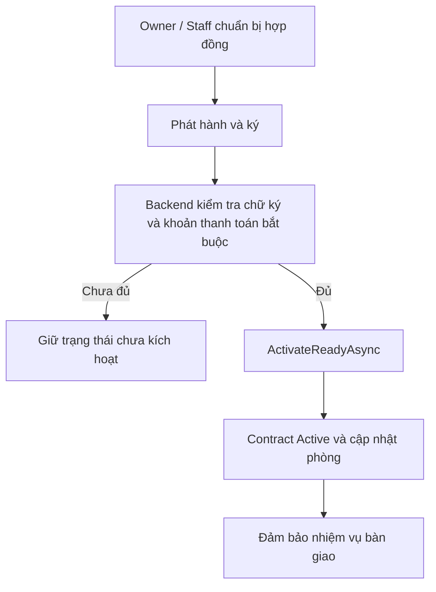
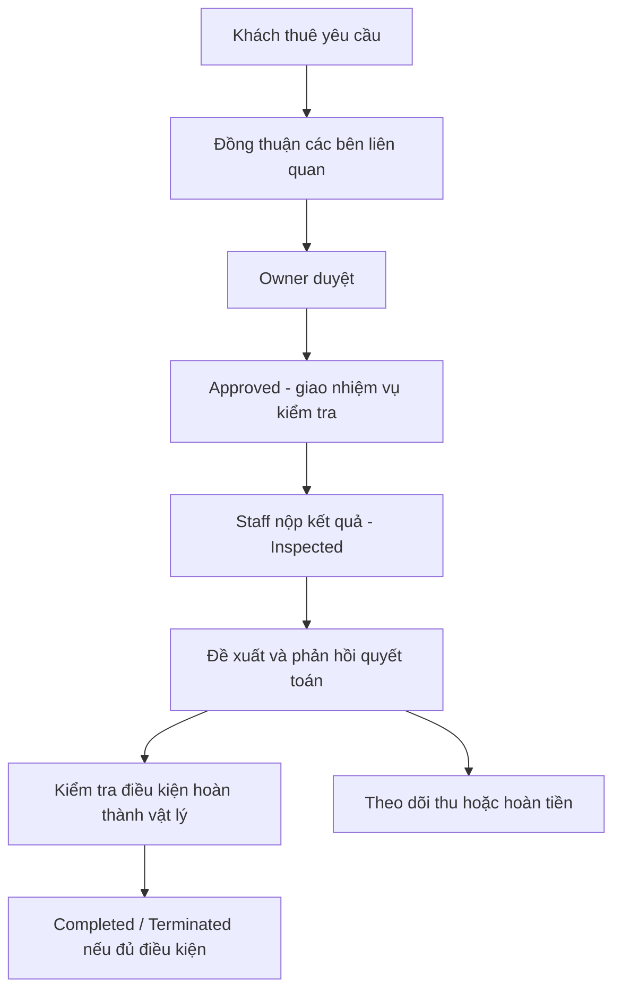
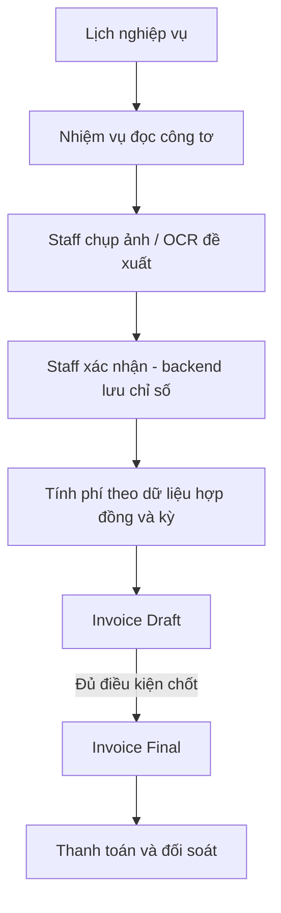

# Bản đồ backend BHOME cho nhóm đồ án

Tài liệu tra cứu mã nguồn tại nhánh refactor từ develop (`f3be1bfe`). Mở controller trước, tìm tên hàm service được gọi, rồi tìm implementation repository. Đây là mô tả code hiện hành, không thay thế SRS hay tự quyết định nghiệp vụ mới.

## 1. Cách đọc backend

Mọi đường dẫn dưới đây tính từ `src/backend/`. `BHome.Api/Controllers` nhận HTTP, xác thực role/policy và chuyển DTO; `BHome.Application` thực thi nghiệp vụ; `BHome.Domain` chứa entity/enum/quy tắc; `BHome.Infrastructure` triển khai repository, PostgreSQL, file riêng tư, tích hợp và job. `BHome.Infrastructure/DependencyInjection.cs` (`AddInfrastructure`) đăng ký Compact24 trực tiếp cho API hiện tại. Legacy `BHomeDbContext` và các adapter vẫn được dùng bởi `tests/backend/BHome.IntegrationTests/Fixtures/LegacyPersistenceRegistration.cs`. Không suy luận rằng mỗi entity EF là một bảng vật lý: Compact24 lưu cả dữ liệu native và JSONB. Xem `Persistence/Compact24/Compact24Records.cs` để tra entity → bảng/cột JSON; một số ledger dùng SQL riêng trong repository.

Quy ước bảng dưới: endpoint có tiền tố chung `/api/v1`; `{id}` là ID của tài nguyên tương ứng. `Application` và `Infrastructure` là hai project cùng tên BHome. Mỗi hàng chỉ chỉ ra điểm vào quan trọng, không liệt kê toàn bộ API phụ.

## 2. Tài khoản, cơ sở, nhân viên (BF-01/02)

| Màn hình / actor                | Endpoint chính                                                                                                | Điểm đọc code                                                                                                                                                                                                            | Dữ liệu và chốt kiểm tra                                                                                                            |
| ------------------------------- | ------------------------------------------------------------------------------------------------------------- | ------------------------------------------------------------------------------------------------------------------------------------------------------------------------------------------------------------------------ | ----------------------------------------------------------------------------------------------------------------------------------- |
| Đăng nhập (mọi role)            | `POST /auth/login`, `/auth/refresh`, `/auth/logout`                                                           | `IdentityAccess/AuthController` → `Application/IdentityAccess/LoginService.LoginAsync` → `Infrastructure/IdentityAccess/IdentityCredentialVerifier`, `IdentitySessionService.RefreshAsync/RevokeAsync`, `JwtTokenIssuer` | `users`, `refresh_tokens`; kiểm tra thông tin đăng nhập, vòng đời phiên, quyền theo role.                                           |
| Chủ trọ quản lý phòng, giá      | `GET /rooms/{id}/prices`, `PUT /rooms/{id}`                                                                   | `PropertyManagement/PropertyControllers` → `Application/PropertyManagement/PropertyService.ResolvePricesAsync/SaveRoomAsync` → `Infrastructure/Modules/PropertyManagement/Persistence/PostgresPropertyRepository`        | `locations`, `rooms`, `billing_policies`, `assets`; kiểm tra permission, location, version, quy tắc thay đổi trạng thái phòng.      |
| Chủ trọ quản lý nhân viên/cơ sở | `/staff`, `/staff-location-assignments`                                                                       | `Operations/OperationsControllers` và `LocationsController` → `OperationsService`, `ILocationAssignments` → `CompactOperationsRepository`, `CompactLocationAssignments`                                                  | `staff_employments`, `locations.staff_assignments`; hiệu lực phân công và phạm vi cơ sở.                                            |
| Công việc vận hành              | `POST /operational-tasks`, `POST /operational-tasks/{id}/start`, `/progress`, `/submit`, `/verify`, `/rework` | `StaffOperations/OperationalTasksController` → `Application/StaffOperations/OperationalTaskService.ActAsync` (hành động) → `Infrastructure/Modules/StaffOperations/Persistence/PostgresOperationalTaskRepository`        | `operational_tasks` và evidence/history; `AccessAsync` kiểm tra nhân viên phụ trách/được giao, permission và các chuyển trạng thái. |

Nơi đọc quyền chung: `Application/IdentityAccess/ResourceAccess.cs`, `PermissionAccess.cs`; nơi lưu trách nhiệm hiện tại: `Infrastructure/Persistence/Compact24/CompactLocationAssignments.cs`. Công việc tạo theo lịch: `Infrastructure/Modules/Operations/RecurringOperationsJob.cs`; công việc kiểm kê/bàn giao dùng thêm các service chuyên biệt trong `Application/StaffOperations` và `Infrastructure/StaffOperations`.

## 3. Giữ chỗ, hợp đồng chính và bàn giao (BF-03/04)

Điểm vào chính `ContractsController`, service `Application/Contracts/ContractService` được chia theo partial class theo nghiệp vụ. Đọc file `ContractService.cs` để thấy `Actor`, `Role`, `Load`, `Mutate`, `Replay`, `Remember`, `ChangeRoomStatus`: truy cập và ghi trạng thái tập trung, kiểm tra lại trong giao dịch theo phòng, giữ idempotency key. Không bỏ guard chỉ vì controller đã có `[Authorize]`.

`ContractSigningService.cs` chứa luồng ký hợp đồng và tải tài liệu đã ký; `ContractLifecycleService.cs` chứa yêu cầu, duyệt, kiểm tra, quyết toán và hoàn thành trả phòng. Đây vẫn là các phần của cùng lớp `ContractService`, không thêm service DI. Ký biên bản bàn giao nằm riêng tại `ContractHandoverSigningService.cs`.

| Bước                                 | Endpoint / method                                                                                                                                                                                                                   | File tiếp theo                                                                                                                                                                            |
| ------------------------------------ | ----------------------------------------------------------------------------------------------------------------------------------------------------------------------------------------------------------------------------------- | ----------------------------------------------------------------------------------------------------------------------------------------------------------------------------------------- |
| Owner/Staff tạo giữ chỗ              | `POST /contracts/holdings` → `CreateHoldingAsync`                                                                                                                                                                                   | `ContractHoldingService.cs`                                                                                                                                                               |
| Owner duyệt/kích hoạt/hủy giữ chỗ    | `POST /contracts/{id}/holding-approval`, `/holding-activation`, `/holding-cancellation` → `ApproveHoldingAsync`, `ActivateHoldingAsync`, `CancelHoldingAsync`                                                                       | `ContractHoldingService.cs`, `HoldingCancellation.cs`, `Infrastructure/Contracts/CompactContractHoldingLedger.cs`                                                                         |
| Chuyển sang hợp đồng chính           | `POST /contracts/{id}/holding-conversion` → `ConvertHoldingAsync`                                                                                                                                                                   | `ContractHoldingService.cs`                                                                                                                                                               |
| Chuẩn bị và phát hành hợp đồng chính | `GET /contracts/main-drafts/preparation`, `POST /contracts/main-drafts`, `POST /contracts/main-drafts/{id}/release` → `MainDraftService.PrepareAsync/SaveAsync/ReleaseAsync`; API `POST /contracts` → `ContractService.CreateAsync` | `MainDraftService.cs`, `Infrastructure/Contracts/MainDraftData.cs`, `ContractRepository.cs`; giữ snapshot giá/điều khoản trong `ContractChargeSnapshot.cs`.                               |
| Ký hợp đồng                          | `POST /contracts/{id}/signing` → `RequestSigningAsync`                                                                                                                                                                              | `ContractSigningService.cs`, `ContractSigningMethods.cs`, `Infrastructure/Contracts/ContractSigningRouter.cs` (nhánh theo phương thức cấu hình).                                          |
| Kích hoạt                            | `GET /contracts/{id}/activation-readiness`, `POST /contracts/{id}/activate` → `ReadinessAsync/ActivateAsync`                                                                                                                        | `ContractService.cs`, `Infrastructure/PaymentsDebt/MainInitialPaymentLedger.cs`, `MainContractActivationJob.cs`; backend kiểm tra ký và thanh toán, chuyển trạng thái phòng theo quy tắc. |
| Staff lưu và nộp bàn giao            | `POST /contracts/{id}/handover/draft`, `/handover/draft/submit` → `SaveHandoverDraftAsync/SubmitHandoverDraftAsync`                                                                                                                 | `ContractHandoverDraftService.cs`, `Infrastructure/Contracts/HandoverDraftRepository.cs`, `ContractHandoverRepository.cs`.                                                                |
| Owner duyệt / yêu cầu kiểm tra lại   | `POST /contracts/{id}/handover/draft/ready`, `/handover/draft/reinspection` → `ReadyHandoverDraftAsync`, nhánh reinspection trong cùng partial                                                                                      | `ContractHandoverDraftService.cs`; kiểm tra trạng thái bản nháp, checklist và evidence trước khi sẵn sàng ký.                                                                             |
| Tenant ký bàn giao                   | `POST /contracts/{id}/handover/draft/tenant-sign/session` → `SignTenantHandoverInSessionAsync`                                                                                                                                      | `ContractHandoverSigningService.cs`; kiểm tra tenant thuộc hợp đồng, trạng thái tài liệu/chữ ký. Các route ký khác vẫn tồn tại; không xóa theo suy đoán UI.                               |

Bảng vật lý: `contracts` (gồm `handover`, `move_out`, `settlement`, documents/history), `contract_signings`, `contract_residents`, `rooms`, `operational_tasks`, `payments`, `payment_allocations`. `ContractHandoverRepository` tạo/tìm nhiệm vụ bằng `ContractHandoverTaskIds.MoveIn/MoveOut` (`Application/StaffOperations/TaskContracts.cs`), cũng là identity được `OperationalTaskService` sử dụng phân loại và kiểm quyền. ID giữ nguyên SHA-256 trên chuỗi contract-move-in/out và 16 byte đầu, để các nhiệm vụ đã có vẫn được nhận diện.

Hai điểm gọi sinh bàn giao vào phòng cùng sử dụng `ContractHandoverRepository.EnsureMoveInTaskAsync`: khi lưu hợp đồng Main mới (`ContractRepository.Add` ghi ứng viên, `InTransactionAsync` gọi sau khi lưu) và khi kích hoạt (`ContractService.ActivateReadyAsync`). Cả hai đi qua `PrepareRoomMoveInAsync` dưới khóa giao dịch Location/Room: chọn nhiệm vụ vật lý chuẩn theo chu kỳ thuê, giữ lịch sử đã kiểm tra/ký, hủy nhiệm vụ trùng còn nguyên trạng, không tạo lại chỉ vì gia hạn. `EnsureInventoryTaskAsync` và `EnsureMeterBaselinesAsync` là các công việc nội bộ hỗ trợ luồng này; không suy ra rằng việc có một màn hình bàn giao nghĩa là database chỉ có một bản ghi task. Nhiệm vụ chính bắt đầu `Assigned`, được Staff bắt đầu, nộp để Owner duyệt; `ReadyHandoverDraftAsync` kiểm tra và ký Owner trước Tenant. Các route `/handover` cũ và biên bản đã xác nhận vẫn có đường đọc/kiểm tra riêng.

### Luồng chính từ ký đến kích hoạt

Lưu ý: Develop còn điểm đảm bảo nhiệm vụ ở `ContractRepository` lúc tạo hợp đồng. Sơ đồ trên là đường kích hoạt chính, không khẳng định nhiệm vụ chỉ được tạo sau Active ở baseline này.

## 4. Trả phòng và quyết toán (BF-04/06)

1. Tenant `POST /contracts/{id}/termination-requests` → `ContractService.RequestTerminationAsync` (`ContractLifecycleService.cs`); đồng thuận phòng `POST /contracts/{id}/move-out/consent` → `ConfirmRoomTerminationAsync` (`RoomMoveOutConsent.cs`). Khi đủ đồng thuận, hợp đồng chính của yêu cầu nhóm (`PrimaryContractId`) chuyển `Requested`; các hợp đồng liên kết vẫn `AwaitingConsent`. Owner duyệt `POST /contracts/{id}/move-out/approve` trên hợp đồng chính của nhóm → `ApproveTerminationAsync` → `ApproveConsentedRoom`, kiểm lại thành viên/version và chuyển các hợp đồng liên kết sang `Approved`, bảo đảm task cho từng hợp đồng; hoặc từ chối qua `RejectTerminationAsync`. Nhánh legacy chỉ được duyệt thiếu snapshot đồng thuận nếu đúng một hợp đồng và một người yêu cầu hợp lệ. Owner có đường `POST /contracts/{id}/expiry-move-out` cho hợp đồng thực sự hết hạn; Staff có route `forced-move-out` với guard riêng. Không đồng nhất ba luồng này.
2. Staff cập nhật `PATCH/PUT /contracts/{id}/move-out/inspection-draft` → `SaveMoveOutInspectionDraftAsync` (`ContractMoveOutInspectionDraftService.cs`); nộp kiểm tra `POST /contracts/{id}/move-out/inspection` → `InspectAsync` (`ContractLifecycleService.cs`, `ContractFinalInspectionService.cs`). So sánh điện/nước, hiện trạng, tài sản, chìa khóa theo dữ liệu mở đầu; không tự tính hư hỏng từ baseline thiếu.
3. Owner lập đề xuất `POST /contracts/{id}/move-out/receivables/proposal` → `SettlementReceivablesService.SendProposalAsync`; Tenant phản hồi `POST .../proposal/tenant-feedback` → `RespondToProposalAsync`. `SettlementReceivablesController` gọi service trong `MoveOutChargeProposal.cs` và `MoveOutChargeProposalSettlement.cs`; repository `MoveOutChargeProposalRepository.cs`, `SettlementReceivablesRepository.cs`. Kiểm tra phạm vi tenant, phiên bản/đề xuất và idempotency; chỉ xử lý tài chính từ trạng thái đã chấp nhận hợp lệ. Đọc thêm `SettlementFinalUtilities.cs`, `SettlementFinalFixedCharges.cs`, `SettlementBankAllocations.cs`, `SettlementFinancialClose.cs` để hiểu các khoản và ledger.
4. Khoản còn phải thu đi qua đối soát tiền (mục 6); yêu cầu hoàn tiền đi qua `POST /tenant/refund-requests` và Owner `POST /owner/tenant-refund-requests/{id}/decision` → `TenantRefundPetitionService` trong `Application/Finance/TenantRefundPetitions.cs`. Không coi việc tạo QR, bấm đồng ý hay gửi đơn hoàn là tiền đã thực nhận/hoàn tất.
5. Đọc `ContractVerifiedMoveOutCompletion.cs` và `ContractService.CompleteAsync` (`ContractLifecycleService.cs`, `POST /contracts/{id}/move-out/complete`) để xem điều kiện đóng hợp đồng và phòng. Tách ranh giới hoàn thành kiểm tra vật lý với chốt tài chính; không gộp hai trạng thái thành một hoặc bỏ kiểm tra các hợp đồng khác còn ở phòng.

Bảng: `contracts.move_out/settlement/history`, `operational_tasks`, `meter_readings`, `payment_allocations`, `payments`, `refund_requests`, `rooms`.

Đây là đường chính; hết hạn/forced move-out, từ chối, yêu cầu xem xét lại và hợp đồng khác cùng phòng có nhánh riêng. Không suy luận thu/hoàn tiền đã hoàn thành chỉ từ trạng thái Completed của kiểm tra vật lý.

## 5. OCR, điện nước và hóa đơn (BF-05, JOB-09)

| Bước                                  | Endpoint / code                                                                                                                                                                                            | Dữ liệu và guard                                                                                                                                                                                                                    |
| ------------------------------------- | ---------------------------------------------------------------------------------------------------------------------------------------------------------------------------------------------------------- | ----------------------------------------------------------------------------------------------------------------------------------------------------------------------------------------------------------------------------------- |
| Staff chụp công tơ                    | `POST /ocr/meter-tasks/{taskId}` → `OcrWorkflowService.MeterAsync`; thuật toán trong `Infrastructure/Ocr/LocalOcrService.cs`, `MeterRecognitionFusion.cs`                                                  | Kết quả OCR là đề xuất; không phải giá trị đã xác nhận.                                                                                                                                                                             |
| Staff lưu ảnh và xác nhận             | `PUT /capture/meter-tasks/{id}/evidence`, `POST /capture/meter-tasks/{id}/confirm` → `CaptureService.UploadEvidenceAsync/ConfirmMeterAsync` → `Infrastructure/Ocr/CaptureRepository.cs`, `CaptureScope.cs` | `meters`, `operational_tasks`, `meter_readings`; kiểm quyền, định danh công tơ, giá trị trước và mục đích đọc.                                                                                                                      |
| Lịch tự động                          | `/billing-automation` (xem/lưu lịch); job `Infrastructure/Modules/Billing/BillingAutomationWorker.cs` → `BillingAutomationEngine.ExecuteAsync`                                                             | Cấu hình tại `locations.operating_settings`, task/attempt/execution trong `operational_tasks`; lịch, kỳ, khóa sinh tránh trùng. `run-now` và `manual-meter-tasks` là điểm gọi thủ công, không cần đưa vào demo luồng tự động chuẩn. |
| Hóa đơn nháp/chốt                     | `POST /invoices/drafts`, `/invoices/{id}/refresh`, `/invoices/{id}/finalize` → `InvoiceService.GenerateAsync/RefreshAsync/FinalizeAsync`; job gọi nghiệp vụ invoice qua `BillingInvoiceAutomation.cs`      | `invoices`, `invoice_items`, `billing_policies`, `meter_readings`; kiểm kỳ, dữ liệu bắt buộc, snapshot và version.                                                                                                                  |
| Tenant xem hóa đơn                    | `GET /invoices/current-period` → `InvoiceService.CurrentTenantPeriodAsync`; `GET /tenant/meter-readings` → `TenantMeterReadings.cs`                                                                        | Chỉ phạm vi tenant được phép; repository `InvoiceRepository.cs`, `TenantMeterReadingsRepository.cs`.                                                                                                                                |
| Tenant yêu cầu điều chỉnh/Owner duyệt | `POST /invoices/{invoiceId}/adjustment-requests`, `POST /invoice-adjustments/{id}/approve` hoặc `/reject` → `AdjustmentService`, `AdjustmentDecisions.cs`                                                  | `invoice_adjustments`; bảo toàn hóa đơn đã final, ghi điều chỉnh riêng.                                                                                                                                                             |

Muốn hiểu công thức: đọc `Billing/ContractBillingPrices.cs`, `FixedChargeCalculation.cs`, `PersonMonthOccupancy.cs`, `Infrastructure/Billing/FixedChargeCoverage.cs`, `MeterBillingCoverage.cs`; không sửa giá hợp đồng đã chốt bằng cách đọc giá phòng mới một cách tùy tiện.

OCR CCCD tách biệt: `POST /ocr/identity/{residentId}/{side}` → `OcrWorkflowService.IdentityAsync`; `POST /capture/residents/{id}/confirm` → `CaptureService.ConfirmIdentityAsync`; `Infrastructure/Ocr/IdentityProtection.cs` bảo vệ dữ liệu xác nhận; `residents` chứa trạng thái xác minh. Không lưu ảnh CCCD như ảnh công tơ.

OCR không trực tiếp xác nhận chỉ số; hóa đơn Final cũng không đồng nghĩa đã thanh toán.

## 6. Thanh toán, nợ và hoàn tiền (BF-06)

- `GET /invoices/{id}/transfer-instructions` (ReceivingAccountsController) → `TransferInstructionsService`; API tương ứng khoản cọc `/contracts/{id}/deposit-payment/transfer-instructions` → `ContractDepositInstructionsService`. QR/transfer instructions chỉ là hướng dẫn chuyển khoản.
- `POST /integrations/sepay/webhook` (có route theo mode/owner) → `SePayController` kiểm tra webhook → `Application/PaymentsDebt/SePay/SePayService.ReceiveAsync`, `ReconcileAsync` → `Infrastructure/PaymentsDebt/SePayRepository.cs`, `PaymentRepository.cs`. Xem `SePayWebhookSecurity.cs`, `SePayOwnerConnections.cs` cho xác thực và mode. Không bỏ kiểm tra nguồn callback, số tiền, mã tham chiếu và chống xử lý lặp.
- Owner đối soát thủ công qua `/payment-transactions` → `PaymentService`; lịch sử/nợ qua `/payment-history`, `/debts` → `DebtsController.cs`. Các ledger chuyên biệt trong `MainInitialPaymentLedger.cs`, `DepositReceiptAllocation.cs`, `SettlementBankAllocations.cs`, `ReceiptExcessDisposition.cs` xử lý từng loại nguồn; không dùng một phép cộng trực tiếp để thay thế ledger.
- Hoàn tiền qua `RefundService`, `TenantRefundPetitions.cs` → `Infrastructure/Finance/RefundRepository.cs`, `TenantRefundPetitionRepository.cs`, `DepositRefundSource.cs`; kiểm số tiền còn khả dụng, người thụ hưởng, version và bằng chứng giao dịch đã thực hiện.

Bảng chính: `payments`, `payment_allocations`, `invoices`, `refund_requests`; ledger hợp đồng gắn `contracts`. Bất biến: chỉ backend xác nhận tiền, không ghi Paid từ frontend; phân bổ không vượt số tiền đã xác minh, lịch sử giữ nguyên.

## 7. Sự cố, sửa chữa, báo cáo, thông báo (BF-07, FE-07/08/09)

| Actor / mục đích                  | Endpoint / method                                                                                                                                                                             | Repository, dữ liệu                                                                                                                                                                                                   |
| --------------------------------- | --------------------------------------------------------------------------------------------------------------------------------------------------------------------------------------------- | --------------------------------------------------------------------------------------------------------------------------------------------------------------------------------------------------------------------- |
| Tenant/Staff báo sự cố            | `POST /incidents` → `IncidentService.SubmitAsync`; Owner `POST /incidents/{id}/review` → `ReviewAsync`, `/work-orders` → `AssignAsync`                                                        | `Infrastructure/Modules/IncidentMaintenance/Persistence/IncidentRepository.cs`; `incident_reports`, `operational_tasks`; kiểm quyền, room/asset, evidence và idempotency.                                             |
| Staff xử lý khẩn cấp              | `POST /incidents/{id}/acknowledge`, `/emergency-actions` → `AcknowledgeAsync/EmergencyEntryAsync`; Owner `/emergency-actions/{entryId}/cost-decision`                                         | `IncidentService.cs`; history và notification, quyền chi phí thuộc Owner.                                                                                                                                             |
| Staff/Owner xử lý work order      | `/work-orders/{id}/proposal`, `/plan-decision`, `/start`, `/submit`, `/verify` → `ProposeAsync`, `PlanAsync`, `ActAsync`, `VerifyAsync`                                                       | `IncidentService.cs`; `operational_tasks` (task_type WORK_ORDER), `expenses`; trạng thái Assigned → PendingApproval → InProgress → PendingVerification → Verified, các nhánh rework/cancel theo service.              |
| Owner báo cáo tài chính           | `GET /financial-reports` → `FinancialReportService.ReadAsync`; `POST /financial-scenarios/analyze` → `FinancialScenarioService.AnalyzeAsync`                                                  | `Infrastructure/Finance/FinancialReportRepository.cs`, `FinancialScenarioRepository.cs`; tổng hợp `payments`, `payment_allocations`, `expenses`, `refund_requests`, `invoices`; scenario không thay đổi dữ liệu thật. |
| Tenant/Owner/Staff nhận thông báo | `/notifications` → `NotificationsController`; `Infrastructure/Modules/Notifications/NotificationEventPublisher.PublishPendingAsync`, `CompactNotificationWriter`, `NotificationChannelWorker` | `notifications` và delivery history; kiểm người nhận, khử trùng, retry theo kênh.                                                                                                                                     |
| Guest xem thông tin công khai     | `/public` → `Operations/OperationsControllers.cs`, `OperationsService`, `CompactOperationsRepository.PublicBulk.cs`                                                                           | Chỉ dữ liệu công khai được phép từ phòng/cơ sở; không dùng API nội bộ hoặc hồ sơ tenant.                                                                                                                              |

## 8. Job và cách kiểm tra khi demo bị lệch

`Application/Jobs/IBackgroundJobQueue.cs` → `Infrastructure/Persistence/Compact24/CompactJobPersistence.EnqueueAsync` (được `AddInfrastructure` đăng ký làm cả queue và persistence) → `Infrastructure/Jobs/PostgresJobWorker`. `PostgresJobQueue` chỉ được fixture legacy đăng ký. Lịch theo nghiệp vụ nằm cạnh module: `Contracts/ContractExpiryScheduler.cs`, `ContractExpiryProcessor.cs`, `Modules/Billing/BillingAutomationScheduling.cs`, `Modules/Operations/RecurringOperationsJob.cs`, `PaymentsDebt/SePayJobs.cs`, `Modules/Notifications/NotificationEventPublisher.cs`. Xem job registration trước khi kết luận job nào đang chạy. `Application/Common/DemoBusinessClock.cs` phân biệt thời điểm hệ thống và ngày nghiệp vụ demo; không thay toàn bộ `GetUtcNow` bằng giờ demo vì timestamp bảo mật/phiên có thể dùng thời gian thật.

Checklist khi đọc một thao tác: role/location → API/controller → hàm service → điều kiện trạng thái/version/idempotency → repository/transaction → bảng và history → dữ liệu trả FE. Tìm test tương ứng ở `tests/backend/BHome.IntegrationTests/Compact24`, `PaymentsDebt` và `tests/backend/BHome.UnitTests`; đặc biệt `Compact24AssetHandoverTests.cs`, `Compact24MoveInDraftTests.cs` kiểm tra các identity nhiệm vụ. Đừng coi các tên test trong tài liệu là kết quả đã chạy.

### Vì sao chưa gộp thêm toàn bộ các service?

Một số tên `Legacy`/`Compact24`, route ký, ledger, read path song song hoặc partial class nhìn giống nhau nhưng có consumer, DI, dữ liệu lịch sử, semantics khác hoặc điều kiện theo mode. Ví dụ các hàm `Validate` của Contract/Payment/Task/Property/Operations khác nhau về quy tắc constructor, annotation, xử lý null và mã lỗi; thay tất cả bằng một hàm mới sẽ không còn là refactor bảo toàn hành vi. Chỉ xóa khi kiểm chứng consumer và regression tương ứng. Đây là bản đồ định hướng, không phải audit đầy đủ từng dòng của 451 file.

## 9. Ranh giới refactor và tiêu chí nghiệm thu theo module

Các quyết định dưới đây dựa trên đối chiếu mã nguồn tại nhánh refactor sau khi merge develop `76dcbbab` (HEAD trước đợt sửa `93d309af`). Tiêu chí nghiệm thu là hành vi cần giữ nguyên, không phải báo cáo test đã chạy.

| Module                          | Đã tập trung / chủ động giữ riêng                                                                                                                                                                                                                                                                                                                                                                                                                                                                                          | Tiêu chí nghiệm thu                                                                                                                                                                                         |
| ------------------------------- | -------------------------------------------------------------------------------------------------------------------------------------------------------------------------------------------------------------------------------------------------------------------------------------------------------------------------------------------------------------------------------------------------------------------------------------------------------------------------------------------------------------------------- | ----------------------------------------------------------------------------------------------------------------------------------------------------------------------------------------------------------- |
| Identity / phân quyền           | `StaffEmploymentEligibility` dùng chung nhánh Compact24/legacy active-user; giữ nhánh task/billing có role join riêng. Legacy adapter có consumer trong `LegacyPersistenceRegistration`.                                                                                                                                                                                                                                                                                                                                   | Không mở rộng quyền theo role, cơ sở, ngày hiệu lực; không mất đường đọc dữ liệu legacy.                                                                                                                    |
| Property / Location setup       | `SetupWorkspaceService` dùng chung kiểm tra evidence và khóa định danh; `PropertyService.PolicyScopeChanged` tập trung so sánh phạm vi biểu phí. Giữ `LocationSetupService.RoomRent/SaveRoomRent/CreateRoom/CompleteAsync` cùng luồng cấu hình: chọn giá hiện hành/tương lai, pin provenance, tạo phòng và replay khác nhau. Giữ quy tắc JSON của `SharedDataValidator` khác Web JSON mặc định.                                                                                                                            | Không đổi khóa giá phòng, quy tắc version, ưu tiên giá phòng/loại phòng/cơ sở, hiệu lực và dữ liệu hợp đồng đã chốt; `PropertyServiceTests`, `SetupDecimalSerializationTests`, `LocationSetupTests`.        |
| Contract / bàn giao             | `ContractService` chia partial ký hợp đồng/trả phòng; `ContractHandoverDraftService` giữ state machine, còn `ContractHandoverDocumentService` chứa `HandoverDraftPdfAsync`, `HandoverViewWithPartiesAsync`, `CopyHandoverDraftEvidenceAsync`, `UploadHandoverDraftEvidenceAsync` được di chuyển nguyên văn. `ContractHandoverRepository.FindMoveInTaskForUpdateAsync` dùng chung truy vấn tracked theo ID ở submit/reopen/complete; giữ truy vấn đọc có thêm điều kiện contract/room/kind, và nhánh forced move-out riêng. | Giữ chứng cứ, hash, giới hạn upload, quyền đọc, phiên bản, lịch sử PDF, idempotency và hành vi task theo chu kỳ thuê; `Compact24MoveInDraftTests`, `Compact24AssetHandoverTests`, `HandoverChecklistTests`. |
| OCR / Billing                   | Chia sẻ đo foreground và cấu hình YOLO tương đương; giữ cách chọn khoảng trắng, ngưỡng, tensor, checksum và cấu hình luồng riêng. Không gộp invoice draft/final/adjustment hay meter initial/periodic/final.                                                                                                                                                                                                                                                                                                               | Cùng kết quả OCR, xác nhận bằng backend, kỳ và giá snapshot không đổi; `OcrWorkflowTests`, `InvoiceApiTests`, `UtilityTariffInvoiceTests`.                                                                  |
| Payments / Finance              | `CommandFingerprint` có hai định dạng riêng, giữ nguyên default JSON và dấu phân cách thao tác; giữ hash generic, Web JSON tùy biến, HMAC và ledger riêng. Không gộp refund tiền cọc với refund tiền dư hoặc đề xuất trả phòng.                                                                                                                                                                                                                                                                                            | Replay với dữ liệu cũ, không double allocation, không đánh dấu paid từ client, không đổi số tiền/đối soát; `SePaySecurityTests`, `RefundModeTests`, `TenantRefundPetitionTests`, `PaymentDebtTests`.        |
| Incident / task / notification  | Dùng chung fingerprint thao tác, giữ authorize khi replay và thứ tự khóa. `IncidentFiles`/`TaskEvidenceFiles` cleanup khác bản ghi, cách xác định cơ sở, mã lỗi; publisher hoàn tiền cọc/tiền dư khác nguồn và người nhận nên giữ riêng.                                                                                                                                                                                                                                                                                   | Không đổi trạng thái, thông báo, quyền, lịch sử và evidence; `IncidentTests` và regression Staff/notification hiện có.                                                                                      |
| Jobs / persistence / operations | Dùng `CompactJobPersistence.Key` cho cùng `job:` source key; `Compact24DbContext.CreateSqlCommand` giữ connection/current transaction. Không đổi SQL, tham số, trạng thái job, lease, lịch tự động hay migration; giữ adapter legacy phục vụ fixture.                                                                                                                                                                                                                                                                      | Giữ khóa đã lưu, không sinh job trùng, cùng thứ tự transaction và quyền truy cập; `BillingAutomationRuntimeTests` và integration Compact24.                                                                 |

Các file lớn còn lại không được chia chỉ để giảm số dòng: `PropertyService` tập trung guard, audit và các thao tác cùng repository; `LocationSetupService` điều phối transaction cấu hình; `ContractHandoverRepository` điều phối task theo chu kỳ và dữ liệu lịch sử. Tách DI/service ở các điểm này cần chứng minh lại thứ tự lock, rollback, scope và replay. Không thêm API, sửa migration/PDF renderer hoặc nới test để đạt mục tiêu refactor.
