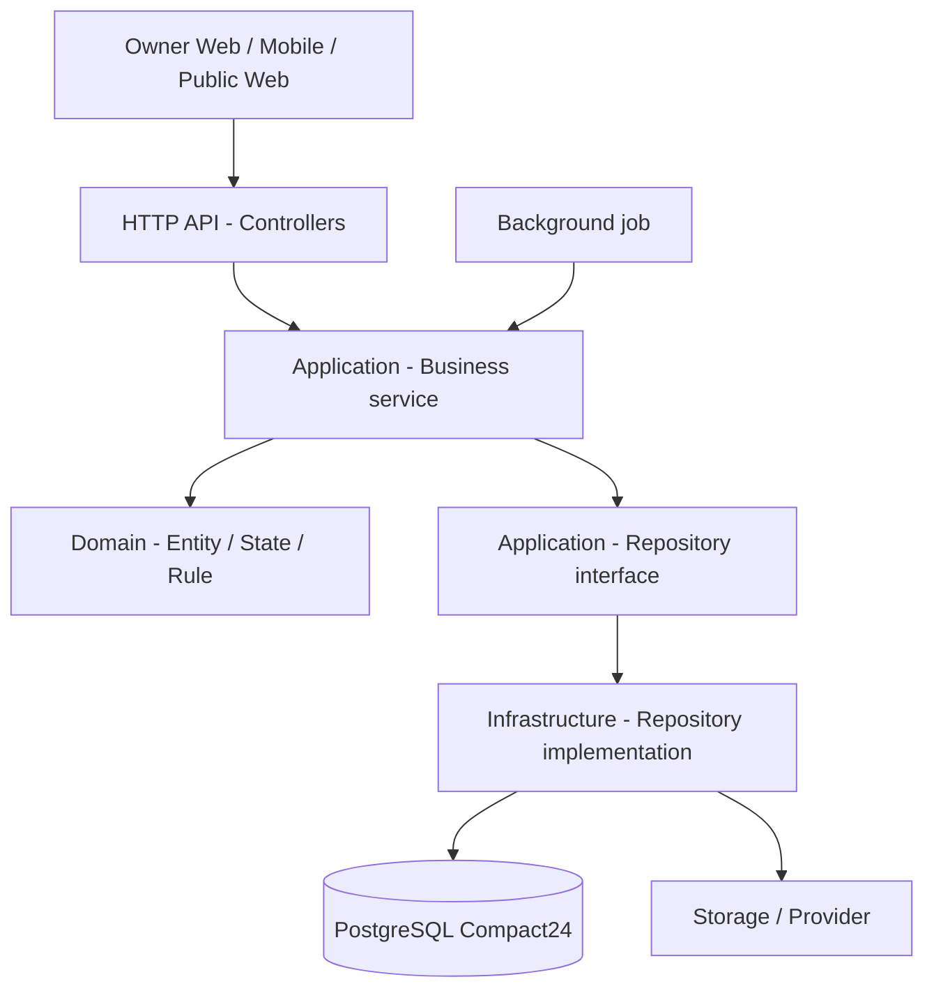

# BHOME - Bắt đầu đọc mã nguồn

Đây là mục lục dành cho cả nhóm, không phải báo cáo tiến độ hay bản thay thế Report 3. Mã nguồn và quyết định nghiệp vụ đã được duyệt là căn cứ khi có sai khác. Các đường dẫn bên dưới dùng code Develop tại `f3be1bfe` và các thay đổi bảo toàn hành vi trên nhánh refactor.

## 1. Đọc theo vai trò, không đọc theo số lượng file

| Bạn cần hiểu gì?                             | Bắt đầu ở đâu?                    |
| -------------------------------------------- | --------------------------------- |
| Toàn bộ hệ thống, Backend và dữ liệu         | [BACKEND.md](BACKEND.md), mục 1   |
| Định tuyến, màn hình và cách gọi API         | [FRONTEND.md](FRONTEND.md), mục 1 |
| Tài khoản, cơ sở, phòng, phân công nhân viên | Backend mục 2; Frontend mục 2-3   |
| Giữ chỗ, hợp đồng, ký, kích hoạt, bàn giao   | Backend mục 3; Frontend mục 2-3   |
| Trả phòng, khấu trừ, quyết toán              | Backend mục 4; Frontend mục 2-3   |
| OCR, điện nước, hóa đơn                      | Backend mục 5; Frontend mục 2-3   |
| SePay, công nợ, hoàn tiền                    | Backend mục 6; Frontend mục 2-3   |
| Sự cố, bảo trì, báo cáo, thông báo           | Backend mục 7; Frontend mục 2-3   |
| Job tự động, thời gian demo                  | Backend mục 8                     |
| Khách truy cập website công khai             | Frontend mục 4                    |

## 2. Kiến trúc cần nắm trước khi đọc code

Đây là hướng đi khi lần theo một request, không phải chiều dependency biên dịch. Application không tham chiếu trực tiếp Infrastructure; DI chọn implementation. Owner Web dùng React/TypeScript/MUI/Vite, Mobile dùng Expo/React Native, Public Web dùng React/Vite. Cả ba gọi API .NET 8. Database thực tế là Compact24; không mặc định mỗi entity tương ứng một bảng.

## 3. Thực hành đọc một nghiệp vụ

Ví dụ Staff lưu kiểm tra bàn giao: mở `src/mobile/src/features/contracts/MoveInDraftHandoverPanel.tsx`, tìm lời gọi lưu bản nháp; truy vết API `POST /api/v1/contracts/{id}/handover/draft` trong `ContractsController`; đọc `ContractService.SaveHandoverDraftAsync` ở `ContractHandoverDraftService.cs`; sau đó đọc `HandoverDraftRepository.cs` và test `Compact24MoveInDraftTests.cs`. Phân biệt ghi bản nháp, gửi kiểm tra, ký và lưu bản xác nhận. Đừng xem một lần lưu thành hoàn tất bàn giao.

Khi tự đọc bất kỳ chức năng nào, trả lời bằng code thật:

1. Ai được thao tác và đối tượng phải thuộc phạm vi nào?
2. Màn hình gọi endpoint nào, DTO chứa dữ liệu gì?
3. Service kiểm tra trạng thái, version, quyền và dữ liệu bắt buộc ở đâu?
4. Repository ghi bảng/cột nào, trong giao dịch nào? Khi lỗi hoặc gọi lặp, điều gì xảy ra?
5. Trạng thái mới và dữ liệu giao diện lấy ở đâu? Test nào chứng minh hành vi?

## 4. Tài liệu nào cần dùng?

| Mục đích           | Nguồn ưu tiên                                                                                                                                                              |
| ------------------ | -------------------------------------------------------------------------------------------------------------------------------------------------------------------------- |
| Yêu cầu được duyệt | [Report 3 - SRS](../reports/BHome_Report-3_Software%20Requirement%20Specification.docx), quyết định thay đổi đã được duyệt; quy tắc nguồn tại [AGENTS.md](../../AGENTS.md) |
| Thiết lập máy      | [Team environment setup](../development/BHOME_TEAM_ENVIRONMENT_SETUP.md), [README gốc](../../README.md)                                                                    |
| Tra API            | [API index](../api/README.md), controller thực tế; inventory cũ có ngày chốt, không coi là danh sách hiện hành                                                             |
| Thiết kế và schema | [MODULES](../architecture/MODULES.md), [Database migration workflow](../database/DATABASE_MIGRATION_WORKFLOW.md), DI và migration hiện hành                                |
| Refactor           | [Roadmap và audit](../architecture/REFACTOR_ROADMAP.md)                                                                                                                    |

Các báo cáo kiểm thử, handoff và audit theo ngày trong `docs/development`, `docs/testing` và thư mục gốc là hồ sơ lịch sử, không cần đọc tuần tự. Không xóa vì cũ: chúng có thể chứa bằng chứng kiểm thử, quyết định hoặc thông tin triển khai. Bắt đầu từ mục lục này; chỉ mở hồ sơ lịch sử khi cần truy nguyên.

## 5. Nghiệm thu khả năng làm chủ của nhóm

Mỗi thành viên chọn một luồng mình phụ trách, trình bày không cần AI: actor, endpoint, service/method, dữ liệu, trạng thái, một nhánh lỗi, một test, và thực hiện demo. Sau đó tự sửa một thay đổi nhỏ trong phạm vi được giao, chạy kiểm thử và giải thích diff. Đây là tiêu chí con người; build/test pass không tự chứng minh thành viên đã hiểu mã.

## 6. Đối chiếu phạm vi Report 3

Đã đọc bảng Actor–Feature–Use Case và Business Flow trong file Report 3 được Git quản lý. Bảng sau là chỉ mục học tập theo số UC thật, không phải kết quả nghiệm thu từng UC.

| UC        | Nghiệp vụ                                                         | Bản đồ code                  |
| --------- | ----------------------------------------------------------------- | ---------------------------- |
| 01–03     | Đăng nhập, đăng xuất, hồ sơ cá nhân                               | Backend 2; Frontend 1–3      |
| 04–07     | Cơ sở/phòng, tài sản, giá, lịch sử chiếm dụng                     | Backend 2, 5; Frontend 2     |
| 08–12     | Nhân viên, ca làm, phân công và thực hiện nhiệm vụ                | Backend 2, 8; Frontend 2–3   |
| 13–17     | Hồ sơ người ở, giữ chỗ, hợp đồng chính, phụ lục/gia hạn, bàn giao | Backend 3; Frontend 2–3      |
| 18–19     | Theo dõi tạm trú, hết hạn/gia hạn/chấm dứt                        | Backend 3–4, 8; Frontend 2–3 |
| 20–21, 24 | Ghi công tơ, hóa đơn, điều chỉnh                                  | Backend 5; Frontend 2–3      |
| 22–23, 25 | Đối soát ngân hàng, công nợ và lịch sử thanh toán                 | Backend 6; Frontend 2–3      |
| 26–30     | Báo sự cố, khẩn cấp, phân công, sửa chữa, nghiệm thu              | Backend 7; Frontend 2–3      |
| 31–34     | Đầu tư, chi phí, báo cáo, hoàn vốn và What-if                     | Backend 7; Frontend 2        |
| 35–36     | Gửi và xem thông báo                                              | Backend 7–8; Frontend 2–3    |
| 37–38     | Owner công bố; Guest xem thông tin công khai                      | Backend 7; Frontend 2, 4     |

Report 3 hiện liệt kê BF-01 đến BF-07 và JOB-01 đến JOB-09. Không tự suy luận chức năng mới từ tên các JOB trong tài liệu cũ; đối chiếu registration và code chạy thật. Đặc biệt UC-37 là công bố thông tin, UC-38 là xem thông tin; điều này khác cách một số hướng dẫn lịch sử gọi UC-37 là Guest. Giữ phạm vi Public Web chỉ đọc, không thêm giữ chỗ/thanh toán công khai. Mọi khác biệt SRS và hành vi thực tế phải được ghi nhận, không tự sửa nghiệp vụ trong refactor.
