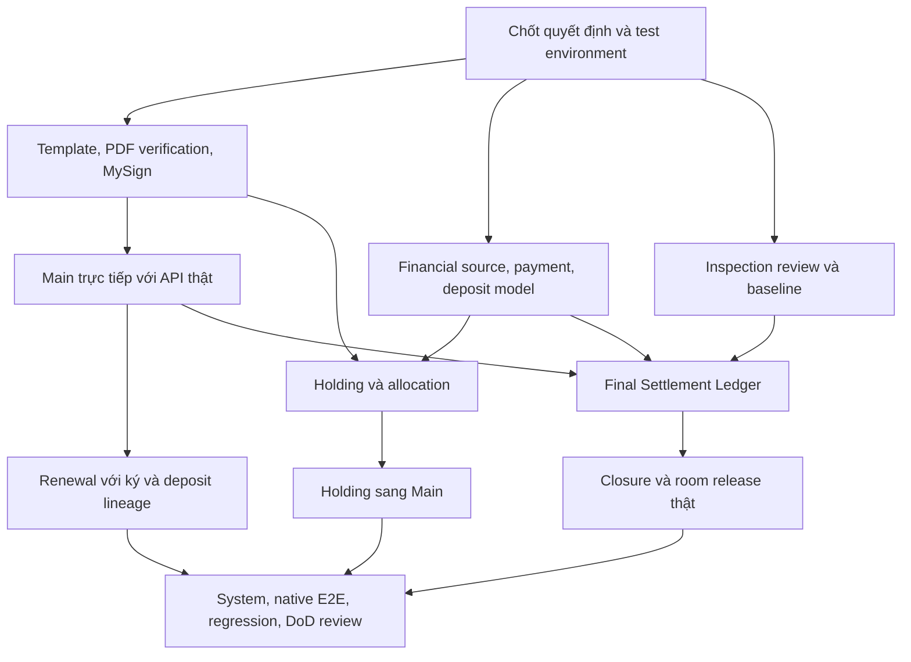

# D011/D012 — Gap Analysis và kế hoạch hoàn thiện DoD

> Cập nhật sau phân tích: [DIGITAL_SIGNING_COMPLETION.md](DIGITAL_SIGNING_COMPLETION.md).
> Người yêu cầu đã phê duyệt iText và bộ ký PDF đã được nối vào backend chính.
> Q-S1/S3 và phần trust profile của Q-S2 vẫn mở; G03 không còn bị chặn bởi registration PDF,
> nhưng chưa có mẫu PDF được duyệt hoặc bằng chứng ký MySign thật.

Ngày đối chiếu: 30/10/2026. Phạm vi: BF-03B/BF-04A, UC-15/16/19, FE-03.
Trạng thái: **phân tích và đề xuất, chưa phê duyệt thiết kế bổ sung**.

Lượt này chỉ thêm tài liệu này; không sửa code, cấu hình, schema hoặc migration,
không chạy giao dịch thật, không commit/push/merge. Working tree trên `member/QHuy`
đã có thay đổi từ lượt ổn định; không coi các thay đổi đó là sản phẩm mới của lượt này.
Các tên API, DTO, entity mới bên dưới là đề xuất để review, không phải API/schema đã tồn tại.

**Kết luận:** phần điều phối và bảo vệ trạng thái đã có, nhưng D011/D012 chưa đạt DoD
cho ba luồng hoàn chỉnh với tích hợp thật. Backend PASS không chứng minh đã ký bằng
MySign thật, phân bổ Holding thật hoặc hoàn tất quyết toán/hoàn tiền thật.

## 1. Nguồn và giới hạn bằng chứng

Đã đối chiếu:

- [AGENTS.md](../../AGENTS.md), nhất là mục 2–5, 6–11: thứ tự nguồn, quyền,
  provider ngoài, tài chính, transaction, kiểm thử và báo cáo trung thực.
- [SRS v1.3](../reports/BHome_Report-3_Software%20Requirement%20Specification%20%282%29.docx):
  I.2.3.2 BF-03B; I.2.4.1 BF-04A; I.3.2–3.3; I.4.2/4.4;
  II.2 UC-15/16/19; III.3 FE-03; JOB-02/05; V.1 GBR; Open Questions Register 3.1.
- [Report 4](../reports/Report-4_Software%20Design%20Specification%20%285%29.docx):
  layered backend; bảng thiết kế `contracts`, `contract_signings`, `security_deposits`;
  phần Contract Termination and Move-out Settlement; Reliability & Recoverability
  3.1–3.2. Phần sequence/design còn chưa đầy đủ, không coi bảng mẫu là schema hiện hữu.
- [API_CONVENTIONS.md](../api/API_CONVENTIONS.md),
  [CONTRACT_LIFECYCLE.md](../api/CONTRACT_LIFECYCLE.md),
  [CONTRACT_LIFECYCLE_DELIVERY.md](CONTRACT_LIFECYCLE_DELIVERY.md),
  [CONTRACT_LIFECYCLE_UI.md](CONTRACT_LIFECYCLE_UI.md),
  [CONTRACT_STABILIZATION.md](CONTRACT_STABILIZATION.md).
- Domain/DTO, controller, service, repository, DI, provider/PDF code, clients,
  test lifecycle và công cụ xác minh API thật liệt kê tại mục 7.

Tên báo cáo thực tế là `(2).docx` và `(5).docx`, khác chỉ mục AGENTS.
BF-04A có tiêu đề cũ “Holding Contract and Holding Deposit”, nhưng trigger/flow là
expiry, renewal, termination. Dùng master UC và nội dung UC-16/19 để truy vết;
không tạo một module Holding thứ hai theo tiêu đề lỗi. UC-16 có đặc tả riêng dù mục lục thiếu.

Chưa tìm thấy quyết định được ghi nhận trong các tài liệu đã đối chiếu để đóng
OQ-01/02/05, phê duyệt template/PDF runtime hoặc các chính sách Holding bên dưới.
Điều này không kết luận rằng người phụ trách chưa từng quyết định ngoài repository;
cần đưa quyết định đã ký duyệt vào nguồn có thể truy vết trước khi implement.

### Bằng chứng kế thừa từ lượt ổn định

| Phạm vi                 | Kết quả đã ghi nhận                                                  | Giới hạn                                                                |
| ----------------------- | -------------------------------------------------------------------- | ----------------------------------------------------------------------- |
| Backend                 | 480/480: Domain 56, Application 161, Integration 263; FAIL 0, skip 0 | Chưa chạy lại trong lượt phân tích                                      |
| Contract Lifecycle      | 17/17, nằm trong 263 IT                                              | Positive signing/holding/settlement có adapter test                     |
| Digital Signing         | 41/41                                                                | CA/provider test, không chứng minh MySign thật                          |
| Owner Web / Mobile      | 53/53 và 102/102                                                     | UT/component/client; không phải native E2E                              |
| Client → HTTPS API thật | 16 nhóm PASS, FAIL 0; **0/3 full flow hoàn tất**                     | Owner browser thật; Mobile transport trên Node; ký/ledger chưa sẵn sàng |
| Snapshot/schema         | 6/6 schema regression; không pending model changes                   | DB disposable; không xác minh database triển khai                       |

Nguồn chi tiết/lệnh/evidence: `CONTRACT_STABILIZATION.md`. Không cộng 17 vào 480
thành một tổng mới. Không coi check bị chặn đúng là E2E nghiệp vụ đã hoàn tất.
Lượt này không chạy UT/IT/System/E2E, không đọc giá trị `.env` để suy đoán môi trường thật.

## 2. Gap Analysis theo nghiệp vụ

“Đã có” dưới đây chỉ áp dụng cho thành phần mô tả và bằng chứng tương ứng.
“Một phần” nghĩa là chưa hoàn tất chuỗi nghiệp vụ SRS; “chưa có” nghĩa là chưa thấy
implementation nghiệp vụ tương ứng trong module hiện tại, dù có thể đã có interface/hạ tầng.

| ID  | Nghiệp vụ / nguồn                                          | Trạng thái và phần hiện có                                                                                                                                                 | Thiếu để nghiệm thu                                                                                                                                                                         |
| --- | ---------------------------------------------------------- | -------------------------------------------------------------------------------------------------------------------------------------------------------------------------- | ------------------------------------------------------------------------------------------------------------------------------------------------------------------------------------------- |
| G01 | UC-15, GBR-02/05: lập Main trực tiếp, người ở              | Một phần: Owner/Staff tạo draft; xác minh tài khoản signer, Resident verified, nhiều occupants và representative; scope server, snapshot hash                              | UI còn nhập UUID account; chưa provisioning/invitation; chưa nối đầy đủ terms với policy có hiệu lực                                                                                        |
| G02 | UC-15 bước 5/8; GBR-03/08: điều khoản và Owner review      | Một phần: rent/deposit/terms nhập tay, Owner ký và activate; snapshot bất biến                                                                                             | Chưa tham chiếu version rent/utility/fee/policy; chưa có bằng chứng Owner duyệt terms riêng trước gửi ký. Cần chốt Owner ký có đồng thời là approval hay cần bước riêng                     |
| G03 | UC-15/16, GBR-04, DBR-03: ký và PDF                        | Một phần: adapter MySign, certificate directory riêng actor, attempts, sync/recovery, private files, hash integrity, tuần tự hai chữ ký                                    | Renderer và PDF signer runtime là unconfigured; template/license/verification profile và account mapping chưa chốt; chưa có bằng chứng ký thật                                              |
| G04 | UC-15 bước 11; UC-14, DBR-02/08: Holding → Main            | Một phần: interface, allocation reference/amount, khóa Room và unique guards đã có                                                                                         | Chưa có Holding business ledger; adapter mặc định 503; precheck Room và thời điểm allocation cần thiết kế lại sau quyết định, xem mục 4.2                                                   |
| G05 | UC-15 bước 12–14; GBR-10: initial payment                  | Một phần: Owner manual deposit verification, reference dedup, amount/reason/audit, readiness tính cọc thiếu                                                                | Chưa sinh payment request/đối soát ngân hàng/initial obligations ledger; chưa xử lý đầy đủ thiếu/thừa/chưa khớp/credit; không thể xem screenshot hay text reason là bằng chứng bank tự động |
| G06 | UC-15, GBR-03/18, DBR-02: activation                       | Đã có gate nội bộ: Owner-only; đủ signing evidence, deposit, ngày, signers/occupants; recheck bytes/hash; Room lock + Active/Occupied cùng transaction                     | Chưa nghiệm thu với signer và nguồn tiền thật; phải mở rộng gate nếu initial obligations được phê duyệt gồm khoản ngoài Security Deposit                                                    |
| G07 | UC-16: renewal/version history                             | Một phần: new version, parent reference, old terms giữ nguyên; chỉ một renewal mở; chờ ngày hiệu lực; parent Superseded/new Active cùng transaction; Owner hủy renewal chờ | MySign thật; nguồn policy version; chứng minh deposit xuyên lineage không bị thu/ghi nhận hai lần; Tenant lựa chọn renewal chưa có workflow riêng                                           |
| G08 | UC-16: addendum ngoài renewal                              | Chưa có: `ContractKind` chỉ Main/Renewal                                                                                                                                   | Cần chốt loại thay đổi được hỗ trợ, ngày hiệu lực, quan hệ văn bản và cách ký. Không tự cho sửa bản đã ký hoặc coi mọi addendum là renewal                                                  |
| G09 | UC-19, JOB-02: expiry / Tenant chọn renewal hoặc trả phòng | Một phần: Owner có API expiry move-out; Tenant có early termination                                                                                                        | Chưa có business job daily within 30 days, notification persistent/retry, Tenant phản hồi renewal/non-renewal. Cửa sổ dedup/cadence chưa chốt                                               |
| G10 | UC-19: yêu cầu chấm dứt, duyệt, lịch                       | Một phần: own Tenant request; Owner approve; Owner/Staff schedule; hợp đồng/Room vẫn Active/Occupied                                                                       | Chưa có quyết định cho rejection/cancel/reschedule sau inspection; chưa có chứng cứ notice/obligation policy cho early termination                                                          |
| G11 | UC-19 bước 9–12; UC-17 phụ thuộc: inspection               | Một phần: assigned Staff ghi notes, ảnh private, final electricity/water readings confirmed cùng Contract/Room/ngày                                                        | Chưa có structured room/assets/keys đối chiếu move-in baseline, Owner xác nhận hoặc yêu cầu re-inspection và version history của biên bản                                                   |
| G12 | UC-19 bước 13–18; OQ-01/02/05: final charges/settlement    | Một phần: Owner review text, journal append-only, đọc `IContractSettlementLedger`, thiếu ledger giữ PendingSettlement                                                      | Chưa có final invoice/adjustment/payment allocation/deposit/refund ledger thật, calculation/approval đã chốt, statement có version; xem mục 4.3                                             |
| G13 | UC-19 postconditions: closure / release                    | Đã có gate nội bộ: Owner-only; đọc lại ledger, so decision reference, đủ final readings/inspection; Terminated + Available + residence end cùng transaction                | Chưa có nguồn ledger thực và khóa đồng bộ với financial writers; điều kiện actualEndDate bằng ngày inspection cần xác nhận cho xử lý nhiều ngày                                             |
| G14 | FE-03 clients, GBR-01/02/18                                | Một phần: web/mobile API clients, role actions, readiness, signing/sync/recover, deposit/renewal/move-out, ảnh/meter, history, VND/ngày Việt Nam, xử lý lỗi/key retry      | Chưa có UI chọn Holding hợp lệ, payment/settlement statement, Owner inspection review, Tenant expiry response; chưa E2E native camera/secure storage/PDF                                    |
| G15 | DBR-13/NFR: persistence, security, failure                 | Đã có nhiều guard/test: scoped list/detail/files, audit, idempotency, Room lock, rollback, upload intent, snapshot/runtime mapping                                         | Phải nối cùng bảo vệ sang modules tài chính/provider/jobs mới; chưa có coverage/performance/recovery evidence đủ cho toàn DoD                                                               |

Không lặp lại lỗi snapshot đã sửa: hiện `Contract.Residents` có mapping và regression.
Không tạo migration để “sửa lại” khi model/schema test đang khớp.
Module Property hiện **đã có** effective-dated pricing/billing policy; câu “pricing chưa có”
trong bàn giao cũ không đủ để kết luận hiện tại. Gap là tích hợp/truy vết vào Contract và billing.
Domain Billing hiện chủ yếu là meter capture; chưa thấy aggregate Invoice/Payment/TenantCredit
hay Holding/settlement ledger nghiệp vụ. Generic integration boundary/job queue không thay thế chúng.

## 3. OQ chính xác và quyết định cần chốt

### 3.1 Nội dung gốc trong SRS — cả ba đều Open

| ID    | Nguyên văn Open Questions Register 3.1                                                                                         | Diễn giải và tác động                                                                                                 |
| ----- | ------------------------------------------------------------------------------------------------------------------------------ | --------------------------------------------------------------------------------------------------------------------- |
| OQ-01 | What exact Security Deposit deduction and final move-out settlement rules apply when damage, debt or other obligations remain? | Quy tắc khấu trừ cọc/quyết toán khi còn hư hỏng, nợ, nghĩa vụ khác. Chặn charge/deduction/refund và closure thật      |
| OQ-02 | Which Invoice Adjustment categories require Owner approval and are any approval thresholds required?                           | Loại Invoice Adjustment cần Owner duyệt và có ngưỡng hay không. Không phải yêu cầu tự đặt ngưỡng duyệt mọi settlement |
| OQ-05 | How should Tenant-caused damage be charged: through an Invoice Adjustment/new charge or Security Deposit deduction?            | Hạch toán hư hỏng qua adjustment/khoản thu mới hay khấu trừ cọc; phải tránh ghi nhận cùng thiệt hại hai lần           |

OQ liên quan Holding là **OQ-03**, cũng Open:
“What exact Holding Contract validity period and Holding Deposit payment deadline apply?”
Không gán nội dung này cho OQ-01/02/05. Không tự đặt expiry/payment deadline.

### 3.2 Decision register đề xuất

Các mã Q dưới đây chỉ dùng trong kế hoạch này. Mỗi quyết định cần người có thẩm quyền,
ngày, tài liệu nguồn, lựa chọn đã duyệt, ví dụ số/dữ liệu tổng hợp và acceptance cases.
Đội phát triển chuẩn bị phương án; Project Owner chốt nghiệp vụ; người phụ trách provider,
kiến trúc và license xác nhận phần chuyên môn. Đây chưa phải approval.

| Quyết định | Nội dung phải chốt / phương án cần review                                                                                                                                                                                                 | Phần bị chặn                                            |
| ---------- | ----------------------------------------------------------------------------------------------------------------------------------------------------------------------------------------------------------------------------------------- | ------------------------------------------------------- |
| Q-S1       | Template Main/Renewal/Holding/addendum nào được duyệt, trường bắt buộc, terms/policy versions, font/layout, document preview và cách ghi nhận Owner review trước signing                                                                  | Renderer, snapshot metadata, UI review                  |
| Q-S2       | Chọn PDF implementation và quyền sử dụng/license; profile xác minh cần thiết: trust anchors, chain, thời điểm hiệu lực, revocation/timestamp nếu yêu cầu; tài liệu/evidence cần giữ. Không mặc định CMS integrity là đủ điều kiện pháp lý | Đăng ký signer/verifier runtime, schema evidence nếu có |
| Q-S3       | Quy trình chứng minh BHOME actor là đúng MySign subscriber/certificate holder; môi trường test, hai signer được phép, provider paths/status/expiry/recovery contract và đầu mối cấp quyền                                                 | Certificate onboarding, E2E MySign                      |
| Q-H1       | Allocation tạo dự trữ ở draft hay chuyển tiền sau signing; lúc nào nguồn Holding hết khả dụng; rollback/cancel/failed-sign/expiry xử lý thế nào; giải quyết Room On Hold của đúng Holding                                                 | Holding model, transaction, sửa precheck                |
| Q-H2       | Eligibility và số tiền được convert; cọc Holding lớn hơn/nhỏ hơn Security Deposit, số dư đi đâu, có partial allocation không; thời điểm cutoff/expiry theo OQ-03                                                                          | Allocation amounts/balances, JOB-05                     |
| Q-F1       | OQ-01: nghĩa vụ nào được bù trừ, khoản tranh chấp xử lý ra sao, thứ tự/giới hạn khấu trừ, nợ còn lại, overpayment/credit/refund và bằng chứng hoàn tất. Có ngoại lệ room release hay không phải được duyệt rõ                             | Settlement calculations và release policy               |
| Q-F2       | OQ-02: danh mục adjustment, chủ thể request/approve, ngưỡng nếu có, sửa draft hay adjustment sau final, version phê duyệt                                                                                                                 | Adjustment workflow, negative cases                     |
| Q-F3       | OQ-05: chọn charge/adjustment/deduction cho damage; evidence/baseline và Owner decision; liên kết một obligation với nhiều phương thức thanh toán nhưng không tạo hai khoản nợ                                                            | Damage ledger / inspection                              |
| Q-F4       | Initial obligations ngoài cọc (nếu có); final rent/service/utility cutoff, prorating/rounding, policy precedence theo kỳ; deposit continuity qua renewal; xác minh bank/manual/refund và cùng transaction namespace                       | Initial request, final invoice, ledger adapter          |
| Q-L1       | Owner review inspection, re-inspection/version, ngày kết thúc/thu hồi chìa khóa khác ngày inspection, correction/backdate; early termination reject/cancel và nghĩa vụ theo điều khoản                                                    | Move-out state/API mở rộng                              |
| Q-L2       | Addendum types thuộc D012; Tenant renewal/non-renewal response; account provisioning trước signing và activation sau signing; người/kênh nhận notification, cửa sổ dedup JOB-02                                                           | Scope/UX, jobs/account liên quan                        |

GBR-03 vẫn quy định Owner quyết định activation, termination và deposit settlement.
Q-F2 không cho Staff quyền quyết định tài chính hoặc cho phép bỏ Owner approval trái GBR-03.
Q-S3 không được giải bằng tạo chứng thư/private key tại BHOME hoặc đổi sang vẽ chữ ký/OTP nội bộ.
Không chốt các con số hoàn tiền, penalty, phí, ngưỡng, hoặc lịch nhắc bằng suy luận kỹ thuật.

## 4. Phân tích ba blocker

### 4.1 MySign / Contract Template / PDF Signer-Verifier

Đã có `ViettelMySignContractAdapter`, client MySign tái sử dụng, directory chứng thư
riêng actor, Prepare → Dispatch → Poll/Recover; durable attempt trước external mutation;
upload private/hash/audit; chữ ký thứ hai dùng PDF của chữ ký thứ nhất.

DI hiện đăng ký `UnconfiguredContractRenderer` và `UnconfiguredContractPdfSigner`.
Không chỉ thêm credential là chạy được. Sandbox có `ITextPdfSigner`, nhưng backend không
tham chiếu implementation này. Không copy sandbox, fake provider hay mặc định chấp thuận license.
Không kiểm tra secrets/môi trường triển khai trong lượt này.

`ITextPdfSigner.Complete/Verify` hiện kiểm tra integrity/authenticity của CMS và document coverage
của field vừa ký. Đó không phải bằng chứng đã có trusted-chain/revocation/timestamp verification
theo profile được duyệt. Với incremental signing phải kiểm tra cả hai signatures ở đúng revision;
không yêu cầu chữ ký đầu tiên bao phủ bytes của revision được thêm bởi người ký thứ hai.

`SigningCertificateService.DeclareAsync` hỏi provider bằng subscriber/serial người dùng nhập,
kiểm tra chứng thư trùng chủ trong DB rồi gán `OwnerUserId` hiện tại. Chưa thấy bước độc lập
chứng minh người khai báo chính là subscriber. Kiểm tra “certificate row thuộc actor” ở lúc ký
không tự giải quyết vấn đề claim ban đầu. Cần Q-S3 và negative test lấy subscriber của người khác;
không suy ra lỗ hổng provider đã khai thác được khi chưa có kiểm chứng hợp lệ.

Thiết kế đề xuất sau Q-S1..3:

1. Renderer nhận snapshot chuẩn từ server; không nhận PDF tùy ý để thay điều khoản.
   Freeze template/version và policy references cần thiết; render tiếng Việt và kiểm tra đúng
   Room, signers, representative/co-occupants, ngày, khoản tiền. Metadata nằm trong hash/evidence
   theo thiết kế được duyệt; không thêm CCCD thô vào log/notification.
2. Chọn implementation cho `IPdfSigner`, review verification contract; giữ CA remote signing.
   Verifier phải từ chối sai digest/signer/field/revision và bảo toàn chữ ký trước;
   trust checks/evidence cụ thể thực hiện theo Q-S2, không tự thêm nghĩa vụ pháp lý.
3. Nối runtime DI có kiểm soát; preflight nêu capability chưa sẵn sàng bằng mã an toàn.
   Không lộ URL nội bộ, credential, subscriber hay raw provider response ra UI.
4. Giữ retry an toàn: mất phản hồi sign request → ManualReview/recovery; không tự gửi lại.
   Polling tiếp tục dùng reference đã lưu; callback chỉ thêm nếu provider spec/threat model được duyệt,
   không tự tạo endpoint callback công khai khi sync hiện tại đã tồn tại.
5. Chạy hai signer thật trong môi trường test được phép; lưu provider refs và verification outcome
   đã khử thông tin nhạy cảm, private signed PDF, audit và proof activation. Không dùng test CA
   để đánh dấu MySign System/E2E PASS.

### 4.2 Holding Deposit Allocation

Hiện `ContractKind` chỉ có Main/Renewal. `IContractHoldingLedger` là ranh giới tích hợp,
chưa phải Holding aggregate. `HoldingContractId`, amount, allocation reference và unique guards
chưa chứng minh đã có nguồn tiền hợp lệ.

Hai điểm thiết kế cần giải quyết trước:

- `CreateAsync` từ chối Room khác `Available` **trước** gọi Holding ledger. UC-14 đưa Room của
  Holding Active sang On Hold; do đó chỉ thay adapter sẽ vẫn chặn conversion bình thường.
  Sau Q-H1, chỉ nới eligibility cho đúng Holding có quyền/room/tenant/period hợp lệ, dưới Room lock;
  không cho mọi Room On Hold tạo Main hoặc gỡ hold trước khi chuyển thành công.
- `ApplyAsync` hiện gọi ngay trong transaction tạo draft và amount được seal vào snapshot.
  UC-15 bước 11 mô tả áp dụng cọc sau signing. Cần phân biệt reservation và conversion thực,
  hoặc xác nhận thời điểm nghiệp vụ được phép. Nếu để final allocation ở draft mà không có
  giải phóng/cancel policy, tiền có thể bị giữ vào draft không bao giờ ký. Không tự chọn nhánh.

Thiết kế đề xuất: Holding module sở hữu trạng thái ký, expiry và verified funds;
Holding ledger adapter xác minh nguồn rồi ghi allocation bền vững trong **cùng DbContext/transaction**
với Contract, không gọi remote financial mutation trong đó. Theo Q-H1/H2, phân biệt rõ tiền nguồn,
reserved/converted amount và số dư; không coi tên trạng thái đề xuất là enum đã được phê duyệt.
Khóa Room và nguồn allocation theo thứ tự thống nhất; unique business references, idempotency
và check tổng phân bổ không vượt verified funds. Constraint hiện tại không mặc nhiên cho phép
split Holding vào nhiều Main; muốn split phải có quyết định và thiết kế lại invariant.

Khởi tạo payment request phần còn thiếu dựa trên nguồn tiền đã xác minh; không credit lần nữa
khi retry, renewal hay bank callback đến sau manual verification. JOB-05 phải dùng cùng lock và
cutoff policy với conversion. Holding là dependency của nhánh Holding → Main, **không phải**
điều kiện để phát triển/kiểm thử Main trực tiếp.

### 4.3 Final Settlement Ledger

`SettlementInput` hiện chỉ có `decision`. `ContractSettlementReview` là journal review,
không có các dòng charge/allocation/refund của sổ quyết toán.
`PendingContractSettlementLedger.ReadAsync` trả null; service giữ PendingSettlement.
Đổi adapter thành ba cờ true hoặc nhập số tiền từ UI sẽ tạo hoàn tất giả.

Thiết kế đề xuất sau Q-F1..4/Q-L1:

- Một nguồn tài chính có thể truy vết đến Contract lineage, confirmed meter readings,
  effective rate/policy, final invoice/adjustment, verified payments, Security Deposit,
  damage evidence và refund/collection. Không áp dụng công thức final rent/prorating chưa được duyệt.
- Preview là projection, không chuyển tiền hay tự finalize. Approved statement phải có version,
  người duyệt, lý do, các source references và balances. Mọi thay đổi nguồn phải làm version cũ
  không còn đủ điều kiện closure; không sửa finalized invoice hoặc xóa lịch sử deduction.
- Damage obligation chỉ ghi nhận một lần. Deduction/payment là cách giải quyết nghĩa vụ theo
  quyết định, không tạo thêm cùng khoản phải thu. Tổng tiền nguồn và allocation luôn đối soát được.
- Một `ContractSettlementLedger` adapter đọc snapshot tài chính đã duyệt/đủ xác minh,
  trả `AllObligationsResolved`, `DepositResolved`, `TransfersVerified` và decision reference
  đại diện **version cụ thể**; không chỉ dùng ID cố định của statement.
- Khi settle/complete phải khóa hoặc kiểm tra version cùng transaction với mọi financial writer
  liên quan. So reference hai lần mà writer tài chính không dùng cùng cơ chế khóa vẫn có race.
  Thiết kế thứ tự Room → financial aggregate/source locks, không khóa chéo tùy ý gây deadlock.
- Ghi refund intent/outbox trước; bank/network ngoài transaction DB; chỉ đánh dấu verified sau
  durable provider evidence hoặc manual verification được phép. Pending/failed/ambiguous refund,
  nợ/tranh chấp bắt buộc chưa giải quyết → giữ Contract/Room theo gate hiện hành, không release.
- Trường hợp đủ số dư bằng không vẫn phải có statement và nguồn bằng chứng hợp lệ;
  không cần tạo giao dịch chuyển tiền giả để làm `TransfersVerified` true.

Không cần tự xây toàn bộ finance BF-05/06 trong D012. Cần thống nhất dependency bàn giao
tối thiểu đủ final settlement từ các module đó, không thay nó bằng boolean do người dùng nhập.

## 5. Thiết kế Backend, API và dữ liệu đề xuất

### 5.1 Layering và transaction

Giữ controller binding/auth/status; application service quyết định quyền, state, financial orchestration;
repository truy vấn/ghi/khóa; provider/storage ở Infrastructure. Không tính cọc hay settlement tại UI/controller.
Tái sử dụng `ContractService`, ba integration interfaces hiện có, Identity/ResourceAccess,
private MinIO và `ContractOperation`; không tạo service song song bỏ qua invariant.

Business module mới nếu được duyệt có Controller → Service → Repository riêng và adapter vào
Contract. Không inject một ledger chỉ trả “đã xong” từ request. Các command financial phải có
actor/scope từ server, stable idempotency key + fingerprint + durable result; cùng key khác payload →409.
Dedup provider transaction phải dùng namespace thống nhất giữa Payment và manual DepositVerification
để một bank transaction không credit cả hai. Idempotency của endpoint không thay unique source key.

Giữ response conventions: 400 validation; 401 thiếu/invalid auth; 403 sai vai trò;
404 cho object ngoài scope theo policy hiện tại; 409 state/conflict/stale version;
503 integration unavailable. Lỗi ngoài dự kiến vẫn sanitized 500 + correlation.
Mọi method async có CancellationToken; logs không có provider body, token, CCCD hoặc bank credentials.
Amounts decimal/string theo API hiện tại, VND không phần lẻ; quy tắc tính/rounding chưa duyệt phải chặn.
Date-only không đổi UTC; instants UTC; cutoff/dedup business date theo Asia/Ho_Chi_Minh.

### 5.2 API giữ lại và phần cần review

Ký hiệu `C=/api/v1/contracts`, `S=/api/v1/digital-signing/certificates`.

| Nhóm                | API đã có, ưu tiên tái sử dụng                                                                                      | Bổ sung đề xuất, chưa công bố                                                                                                                                                                                             |
| ------------------- | ------------------------------------------------------------------------------------------------------------------- | ------------------------------------------------------------------------------------------------------------------------------------------------------------------------------------------------------------------------- |
| Main / terms        | GET/POST C, GET C/{id}                                                                                              | Scoped account/Resident lookup, effective-policy preview; Owner terms approval/preview-document contract sau Q-S1/Q-L2                                                                                                    |
| Signing             | GET/POST S, POST S/{id}/lock; POST C/{id}/signing, signing/sync, signing/recover; GET document                      | Hợp đồng certificate ownership verification theo Q-S3; safe capability/readiness reasons nếu cần; chưa cần callback mới                                                                                                   |
| Deposit / activate  | POST deposit-verifications, GET activation-readiness, POST activate                                                 | Financial request/allocation source DTO; readiness mở rộng theo approved initial obligations, giữ backward compatibility                                                                                                  |
| Holding             | POST C có holdingContractId                                                                                         | Candidate GET `/api/v1/holding-contracts/eligible` với Room scope và minimal DTO; mutation thuộc Holding module sau Q-H1/H2. Route chỉ là bản nháp                                                                        |
| Renewal             | POST renewals, renewal-cancellation                                                                                 | Tenant expiry response và addendum endpoints chỉ thiết kế sau Q-L2; không tái dùng edit signed contract                                                                                                                   |
| Move-out operations | POST termination-requests, expiry-move-out, move-out/approve, schedule, inspection, evidence; GET move-out/evidence | Candidate POST `C/{id}/move-out/inspection-review` cho Owner accept/reinspect theo Q-L1; versioned resubmission, không overwrite inspection cũ                                                                            |
| Settlement / close  | POST move-out/settlement, move-out/complete; GET settlement-history                                                 | Candidate GET `C/{id}/move-out/settlement-readiness` hoặc statement projection cho Owner/own Tenant; financial module commands tạo/duyệt statement, collection/refund. Không thêm amount vào text decision để thay ledger |

Các route hiện có vẫn dưới `C/{id}/...` ở các ô viết rút gọn.
Không tự tạo status mới, permission grant mới hoặc migration chỉ để giữ tên API đề xuất.
Phải chốt DTO/permission và cập nhật `API_CONVENTIONS.md`/API lifecycle trước khi triển khai.

Quyền tối thiểu: Owner approve terms/inspection/finance/activation/closure; Staff chỉ dữ liệu
operation tại Location còn assignment, không ký thay, không xem chi tiết tài chính/identity sâu;
Tenant chỉ contract/statement của mình và request/self-sign; Guest không có contract API.
Lookup, preview, downloads và jobs cũng phải kiểm tra quyền; không chỉ kiểm tra mutation.

### 5.3 Delta dữ liệu phải thiết kế trước khi có migration

| Nội dung                         | Tái sử dụng hiện có                                                                                                 | Delta dự kiến cần review                                                                                                                                                                |
| -------------------------------- | ------------------------------------------------------------------------------------------------------------------- | --------------------------------------------------------------------------------------------------------------------------------------------------------------------------------------- |
| Contract / occupants / signature | Contract, ContractResident, ContractSignature, previous/holding refs, sealed snapshot, private keys tham chiếu file | Template/policy version refs, review evidence, subscriber-binding evidence nếu chưa đủ; xem hash/backward compatibility của bản đã ký                                                   |
| Holding                          | Interface, applied amount/allocation reference ở Main                                                               | Holding terms/status/verified money và allocation records; reservation/release nếu Q-H1 chọn; FK/unique/check/expiry model. R4 mô tả chung không có nghĩa cần copy nguyên schema BIGINT |
| Finance                          | DepositVerification, SettlementReview, Property billing policies, confirmed MeterReading                            | PaymentRequest/Payment/Allocation, deposit balance movements, final invoice/adjustment, settlement lines/version, refund evidence và source links; xác định ownership module trước      |
| Inspection                       | MoveOut, notes/readings/evidence, Staff actor/time                                                                  | Structured asset/keys/baseline refs, Owner review, inspection revisions và relation statement ↔ inspection revision                                                                     |
| Jobs / notification              | Persistent generic job queue/worker                                                                                 | Contract expiry business handler, persistent in-app event/dedup/outbox nếu chưa có entity phù hợp; payload tối thiểu                                                                    |

Đây là nhóm dữ liệu logic đề xuất, không phải danh sách bảng bắt buộc hay ERD đã chốt.
R4 `security_deposits` là reference thiết kế; thực tế đang có DepositVerification, chưa có đầy đủ
security-deposit aggregate như bảng R4. Tránh tạo hai nguồn số dư độc lập.

Sau khi approve: inspect model/migrations/schema **DB thử nghiệm**, xác định delta thật,
thiết kế FK/index/unique/concurrency và data compatibility, rồi mới tạo EF migration tương ứng.
Test empty DB + upgrade từ baseline, snapshot parity, rollback/recovery nếu áp dụng.
Không đổi precision hiện hành sang `(18,2)` chỉ vì bảng R4 dùng kiểu đó;
không backfill tài chính từ text reason hay suy đoán lịch sử dữ liệu thật.

## 6. Kế hoạch triển khai theo phụ thuộc

Các đầu việc dưới đây là kế hoạch tương lai. Lượt này chưa thực hiện bất kỳ thay đổi runtime nào.
Không ước lượng ngày công khi chưa có provider access, decisions và scope tài chính.



Hai nhánh signing và financial specification có thể chuẩn bị độc lập; đây là phụ thuộc công việc,
không yêu cầu chạy nhiều coding agent hoặc bỏ gate approval. JOB-02/notifications là nhánh bổ sung
của UC-19, không được bỏ khỏi DoD chỉ vì diagram tập trung ba blocker chính.

| Thứ tự / ticket | Có thể chuẩn bị ngay / điều kiện bắt đầu implement                                                                                        | Deliverable và gate hoàn thành                                                                                                                                                                            |
| --------------- | ----------------------------------------------------------------------------------------------------------------------------------------- | --------------------------------------------------------------------------------------------------------------------------------------------------------------------------------------------------------- |
| P0 / PLAN-01    | Ngay: gap/traceability, thu thập decisions, approved template specimens, anonymized financial examples, provider sandbox checklist        | Q-S/H/F/L có owner và kết luận được ghi nhận; unresolved branch tiếp tục bị chặn. Tài liệu này là đầu vào, chưa đóng decisions                                                                            |
| P0 / PLAN-02    | Ngay: thiết kế acceptance cases, kiểm kê DTO/capabilities/test harness, review existing auth/error/locks                                  | Test matrix mục 8 được review, phân biệt test adapters và external E2E; không sửa test để đạt số cũ                                                                                                       |
| P0 / PLAN-03    | Ngay: chuẩn bị cấu hình mẫu/checklist test environment không chứa secret, quan sát lỗi/correlation và evidence redaction plan             | Không truy cập production; provider/bank test accounts được cấp qua kênh secret phù hợp. Runner hiện tại không tự đọc cấu hình thật; cần chế độ opt-in/environment tách riêng cho authorized external E2E |
| P1 / PLAN-04    | Sau Q-S1..3: renderer, PDF signer/verifier, subscriber binding, runtime DI                                                                | Two-signer real test PDF đúng template/hash, âm tính tamper/actor/provider outage, evidence private; không có BHOME signing key                                                                           |
| P1 / PLAN-05    | Sau PLAN-04 và initial-obligation/account/terms decisions: hoàn thiện Main trực tiếp, policy refs, account lookup/provisioning theo scope | Draft → approved terms/signing → verified initial payment → Owner activate; real backend/client state/audit/Room đồng nhất                                                                                |
| P1 / PLAN-06    | Sau PLAN-05: renewal, expiry response/JOB-02/in-app retry; addendum chỉ theo scope duyệt                                                  | New version ký đủ, old history giữ nguyên, effective-date switch atomic, không credit deposit lại; reminder dedup theo cửa sổ đã chốt                                                                     |
| P2 / PLAN-07    | Sau Q-H1/H2/OQ-03, funding model và PLAN-04: Holding module/adapter/eligibility                                                           | On Hold của đúng Holding convert được; sai chủ/expiry/unpaid bị chặn; allocation/cancel/retry/race đối soát được. Không chặn bàn giao Main trực tiếp chờ Holding                                          |
| P2 / PLAN-08    | Sau Q-L1: inspection baseline/keys/assets, Owner review và re-inspection                                                                  | Staff không tự duyệt biên bản; revision cũ không bị ghi đè; final readings cùng ngày/baseline có traceability; ảnh private                                                                                |
| P2 / PLAN-09    | Sau Q-F1..4/OQ-01/02/05: financial module slice và statement                                                                              | Invoice/adjustment/deposit/payment/refund có nguồn thật và version; đủ negative/rollback/concurrency tests. Không chỉ implement adapter trả true                                                          |
| P3 / PLAN-10    | Sau PLAN-08/09: nối settlement ledger + closure, web/mobile projections/actions                                                           | Pending nghĩa vụ/refund không release; stale statement bị chặn; đủ settlement → Terminated/Available atomically                                                                                           |
| P3 / PLAN-11    | Sau các dependency: System/API + Owner browser + native Mobile E2E, hồi quy và handover                                                   | Ba full flow thực đạt; holdings/addendum/jobs theo scope chốt; toàn baseline và test mới không FAIL/skip trọng yếu; peer review/CI/evidence đầy đủ                                                        |

PLAN-05/06 có thể cần phần financial initial-payment của PLAN-09 trước khi nghiệm thu;
không giả định chỉ cần Security Deposit khi Q-F4 chưa xác định tất cả khoản activation bắt buộc.
Nếu downstream BF-05/06 chưa bàn giao, ghi BLOCKED theo dependency; không seed số dư hoặc trạng thái
Active/Signed để thay thế full flow. Ưu tiên deliverable nhỏ có thể kiểm chứng nhưng không tuyên bố cả DoD.

## 7. File và module dự kiến sửa/phát triển

Không phải tất cả file sẽ cần sửa. Quyết định schema/API cuối cùng quyết định diff tối thiểu.
Những đường dẫn “mới dự kiến” là vị trí theo kiến trúc hiện tại, chưa được tạo.

| Phạm vi                     | File hiện có / vị trí đề xuất                                                                                                                                                                              | Mục đích                                                                                                                                      |
| --------------------------- | ---------------------------------------------------------------------------------------------------------------------------------------------------------------------------------------------------------- | --------------------------------------------------------------------------------------------------------------------------------------------- |
| API Contract                | `src/backend/BHome.Api/Controllers/ContractsController.cs`, `ContractSigningCertificatesController.cs`                                                                                                     | Giữ endpoints hiện hữu, mở rộng binding/DTO sau review; Owner inspection/statement projection nếu duyệt                                       |
| Application                 | `src/backend/BHome.Application/Contracts/ContractContracts.cs`, `ContractService.cs`                                                                                                                       | Readiness, template/policy refs, approval gates, Holding timing, settlement version; giữ invariant tập trung                                  |
| Domain                      | `src/backend/BHome.Domain/TenantContracts/Contract.cs`, `Resident.cs`                                                                                                                                      | Metadata/version/relations thực sự cần; không thêm status/policy chưa chốt                                                                    |
| Repository / files          | `src/backend/BHome.Infrastructure/Contracts/ContractRepository.cs`, `ContractFiles.cs`                                                                                                                     | Shared locks/transactions, projections có scope, private evidence, file compensation                                                          |
| Signing adapter             | `src/backend/BHome.Infrastructure/Contracts/ViettelMySignContractAdapter.cs`, `ContractSigningCertificateStore.cs`, `Infrastructure/DependencyInjection.cs`                                                | Bỏ dependency unconfigured chỉ khi implementation đã duyệt; ownership binding, capability lỗi rõ                                              |
| Signing library             | `src/digital-signing/BHome.DigitalSigning.Application/IPdfSigner.cs`, `Services/SigningCertificateService.cs`, `BHome.DigitalSigning.Infrastructure/Pdf/ITextPdfSigner.cs`, `BHome.DigitalSigning.MySign/` | Verification contract/implementation được lựa chọn; không mặc định phải dùng iText                                                            |
| Renderer mới dự kiến        | `Infrastructure/Contracts/` + versioned approved template assets                                                                                                                                           | Implement `IContractDocumentRenderer`; renderer concrete/template location chốt sau Q-S1                                                      |
| Holding/Finance mới dự kiến | Domain/Application/Infrastructure/API trong module sở hữu được duyệt; adapter dưới `Infrastructure/Contracts/`                                                                                             | Service/Repository và nguồn tài chính thật cho `IContractHoldingLedger`/`IContractSettlementLedger`; không tạo fake aggregate tại controller  |
| Pricing/meter reuse         | `Domain/PropertyManagement/PropertyConfiguration.cs`, `Application/PropertyManagement/PropertyService.cs`; `Application/Ocr/CaptureService.cs`, `Infrastructure/Ocr/CaptureRepository.cs`                  | Lookup policy versions; final/initial confirmed readings và inspection baseline đúng scope; tránh duplicate pricing logic                     |
| EF nếu có delta             | `Infrastructure/Persistence/ContractConfiguration.cs`, `BHomeDbContext.cs`, cấu hình module mới và migrations/snapshot                                                                                     | Chỉ thay sau approve model/schema delta; không tạo migration trong lượt này                                                                   |
| Jobs                        | `Application/Jobs/`, `Infrastructure/Jobs/`, notification integration hiện có                                                                                                                              | JOB-02, persistent notification/dedup/retry; JOB-05 thuộc Holding dependency                                                                  |
| Shared client               | `packages/client-core/src/contracts.ts`, `useContractDetail.ts`                                                                                                                                            | DTO, financial/inspection readiness, action validation, stable-key retry và safe localized errors                                             |
| Owner Web                   | `src/owner-web/src/features/contracts/ContractDraftDialog.tsx`, `ContractActionDialog.tsx`, `ContractDetailPanel.tsx`, `useContractsApi.ts`, `pages/ContractsPage.tsx`                                     | Account/Holding selection, template review, financial breakdown/evidence, inspection review; không tính số dư tại UI                          |
| Mobile                      | `src/mobile/src/features/contracts/ContractScreen.tsx`, `ContractDraftForm.tsx`, `ContractActionForm.tsx`, `ContractEvidence.tsx`                                                                          | Tenant self-sign/expiry/statement, Staff inspection/rework/camera, Owner quick approval theo channel scope                                    |
| Backend tests               | `tests/backend/BHome.Application.UnitTests/Contracts/ContractServiceTests.cs`, `BHome.IntegrationTests/Contracts/ContractLifecycleApiTests.cs`, `PostgresFoundationTests.cs`; test module mới tương ứng    | Giữ regression, thêm test finance/holding/provider/state/schema thật                                                                          |
| Signing/client tests        | `src/digital-signing/tests/BHome.DigitalSigning.UnitTests/`, Owner `Contracts.test.tsx`, `tests/mobile/ocr/contracts.test.ts`, `tests/mobile/maestro/`                                                     | Verification failures, UI/transport, native System/E2E; scaffold không là bằng chứng đã chạy                                                  |
| Live harness                | `tools/BHome.ContractVerification/ContractVerificationCli.cs`, `scripts/Verify-ContractClients.cjs`                                                                                                        | Giữ mode fail-closed hiện tại; bổ sung external test mode tách cấu hình và native journey khi được cấp môi trường; không tắt TLS verification |
| Docs                        | `docs/api/CONTRACT_LIFECYCLE.md`, `API_CONVENTIONS.md`, các bàn giao Contract, decision/ADR được duyệt                                                                                                     | API/schema/permission/financial examples, test evidence, rollout/rollback checklist; giữ rõ lịch sử test                                      |

## 8. Test case cần bổ sung

Các mã dưới đây là catalog đề xuất, không phải test đang PASS. Giữ test adapters trong UT/IT
để kiểm tra domain/failure; test external/native phải có nhãn, môi trường và bằng chứng riêng.
Không hạ expected, xóa/skip failure để giữ con số 480. Tổng mới có thể lớn hơn baseline.

### 8.1 Unit

| ID    | Case / kỳ vọng                                                                                                                                  | Dependency                                 |
| ----- | ----------------------------------------------------------------------------------------------------------------------------------------------- | ------------------------------------------ |
| UT-S1 | Renderer mapping mọi trường/tiếng Việt/VND/ngày; template/policy version đúng snapshot; dữ liệu thiếu không sinh văn bản có thể ký              | Q-S1                                       |
| UT-S2 | CMS sai digest/cert/field/revision bị từ chối; signer thứ hai bảo toàn chữ ký đầu; trust/revocation/time cases theo profile đã duyệt            | Q-S2                                       |
| UT-S3 | Subscriber claim sai actor, chứng thư hết hạn/chưa hiệu lực/locked, holder collision; provider timeout không biến thành Signed                  | Q-S3                                       |
| UT-H1 | Holding chưa Active/thiếu ký/unpaid/expired/sai Room/Tenant bị chặn; convert đủ/thiếu/thừa theo ví dụ đã duyệt                                  | Q-H1/H2                                    |
| UT-H2 | Reservation/conversion/cancel/failed-sign/expiry; retry không double allocate; vượt available balance bị từ chối                                | Q-H1/H2/OQ-03                              |
| UT-F1 | Final utility/rent/fees theo source versions, period/cutoff/rounding được duyệt; thiếu input giữ Pending; không ước tính consumption chính thức | Q-F4                                       |
| UT-F2 | Damage cùng obligation không charge hai lần; adjustment category/approval/threshold cases đúng OQ-02/05 đã chốt                                 | Q-F2/F3                                    |
| UT-F3 | Debt/deposit/credit/underpay/overpay/refundpending/dispute/zero-balance theo ví dụ đã duyệt; flags chỉ true khi nguồn đủ                        | Q-F1/F4                                    |
| UT-L1 | Owner review trước settlement, reinspection revision; source/statement changed chặn closure, actual-end-date cases theo quyết định              | Q-L1                                       |
| UT-J1 | JOB-02 Vietnam boundary, đúng recipients/current assignment, dedup window, delivery fail không đổi Contract                                     | Q-L2; SRS đã quy định daily/within 30 days |
| UT-C1 | Client không cho sửa tổng server; decimal string lớn, date-only/timezone; 409/503/offline/abort giữ dữ liệu/key retry; đổi payload đổi key      | DTO cuối cùng                              |

### 8.2 Integration — PostgreSQL/MinIO thật, cô lập

| ID     | Case / expected persistence                                                                                                                                                    | Dependency                      |
| ------ | ------------------------------------------------------------------------------------------------------------------------------------------------------------------------------ | ------------------------------- |
| IT-S1  | Prepared object + attempt durable trước dispatch; provider accepted rồi mất response/crash → recover/poll, không request thêm; invalid PDF/evidence không Signed/Active        | Signing slice                   |
| IT-S2  | Hai signer, private file authorization, MinIO fail/orphan cleanup; signature đầu còn hợp lệ sau append; không đổi signed snapshot/history                                      | Signing slice                   |
| IT-H1  | Room On Hold đúng Holding tạo Main được theo approved timing; Holding khác/sai scope bị từ chối; Room/nguồn/allocation/Contract/audit rollback cùng transaction                | Holding slice                   |
| IT-H2  | Hai Main cạnh tranh một Holding; allocation vs JOB-05/cancel; DB constraints + locks cho đúng một kết quả hợp lệ, không mất/double-credit tiền                                 | Holding slice                   |
| IT-F1  | Một bank external ID/manual reference qua hai endpoint hoặc retry đồng thời → một nguồn verified, không credit Deposit và Payment hai lần                                      | Financial source                |
| IT-F2  | Final invoice/adjustment/allocation/refund lưu source links; finalized record bất biến, rollback lỗi giữa chừng, audit append-only                                             | Financial source                |
| IT-F3  | Statement version đổi sau Owner review hoặc trong lúc complete; financial writer đồng thời với closure → chặn hoặc serialize, không release theo snapshot cũ                   | Shared transaction/lock design  |
| IT-F4  | Refund request accepted nhưng timeout, duplicate callback, signature sai, pending/manual review; Contract/Room vẫn không close cho tới verified                                | Approved bank contract          |
| IT-L1  | Reinspection tạo revision, Owner không duyệt version cũ; meter sai Contract/utility/purpose/ngày/unconfirmed thiếu bằng chứng đều bị chặn                                      | Inspection slice                |
| IT-A1  | Owner/Staff/Tenant/anonymous: cross-Location, revoked assignment cùng token, cross-Tenant list/count/detail/lookup/preview/PDF/statement/upload; financial DTO không lọt Staff | Mọi slice                       |
| IT-R1  | Renewal kích hoạt cạnh tranh termination, deposit lineage đủ nhiều version, hủy renewal không refund/credit giả; Active/Occupied nhất quán                                     | Renewal + finance               |
| IT-DB1 | Mỗi delta schema: empty/upgrade isolated DB, constraints/index/FK, model snapshot parity, compatibility dữ liệu baseline; không dùng DB thật                                   | Chỉ khi có migration được duyệt |

### 8.3 System và E2E thật

| ID     | Journey / acceptance evidence                                                                                                                                                              | Giới hạn phân biệt                                                                                                                    |
| ------ | ------------------------------------------------------------------------------------------------------------------------------------------------------------------------------------------ | ------------------------------------------------------------------------------------------------------------------------------------- |
| ST-01  | Owner Web tạo/review/sign Main; Tenant Mobile nhận đúng document/sign; cả hai thấy status/initial balance server; signed PDF tải có quyền                                                  | Cần MySign và PDF runtime thật; UT component không thay thế                                                                           |
| ST-02  | Staff inspection/camera/final readings; Owner review/reinspect; Tenant thấy own approved statement; offline/reconnect, expired session/refresh, duplicate submit đúng                      | Native emulator/device cho camera/secure storage/share; Node transport không đủ                                                       |
| ST-03  | JOB-02 tới hạn, Tenant renewal/non-renewal, in-app còn sau push/email outage; job lặp không duplicate                                                                                      | Ghi môi trường và cửa sổ đã duyệt                                                                                                     |
| E2E-01 | Main trực tiếp từ draft → hai signer/provider refs → verified test initial payment → Owner activation; DB Active/Occupied, đúng occupants/audit, PDF verification đủ                       | Không seed Signed/Active; manual bank fallback có chứng cứ test hợp lệ và ghi rõ, không gọi là bank auto-reconciliation               |
| E2E-02 | Main tạo từ Holding Active/signed/verified payment → đúng allocation → remaining obligation → ký/activate; cả hai nguồn không double credit                                                | Bổ sung nhánh UC-15 bắt buộc nếu Holding conversion thuộc DoD, không chỉ nhập Holding UUID                                            |
| E2E-03 | Từ Main thật đã Active: renewal new version → ký thật → effective-date activate; old signed history giữ, Room Occupied, deposit không nhân đôi                                             | Không sửa clock/database production; controlled test date chỉ trong môi trường test                                                   |
| E2E-04 | Từ Main thật: Tenant terminate hoặc Owner expiry → inspection + keys/assets/final readings → Owner confirm → final invoice/statement → verified collection/refund → settle → close/release | Ledger thật; tiền/refund chưa xác minh phải có checkpoint chứng minh Room chưa Available                                              |
| E2E-05 | Mất mạng sau command/provider accepted, mở lại client/retry/poll; duplicate bank event; stale statement trước close                                                                        | Không `route.fulfill`, không successful provider/ledger replacement; fault injection ghi rõ, không giả bằng chứng thành công external |

E2E-01/03/04 là ba luồng chính user yêu cầu; E2E-02 kiểm nhánh Holding còn thiếu.
Không dùng simulator signing/ledger thành công để mở đường rồi tuyên bố toàn journey thật.
Provider/bank test environment và người ký test phải được phép; dữ liệu Tenant là tổng hợp,
credentials qua kênh secret, evidence chia sẻ đã redacted và không có raw identity/cert subscriber data.

Mỗi run lưu: commit/working-tree diff ID, versions, môi trường, actor roles tổng hợp,
test/source references, trạng thái trước/sau, idempotency/provider/ledger references đã khử dữ liệu nhạy cảm,
DB assertions, sanitized correlation/errors, screenshot không PII, cleanup và PASS/FAIL/BLOCKED/NOT RUN.
Coverage/performance/recovery là các quality gate phải đo riêng theo AGENTS/Report 2;
không suy ra từ số test PASS hoặc thêm một journey E2E. Chưa có kết quả đo mới trong tài liệu này.

### 8.4 Regression commands dự kiến sau mỗi slice

Theo scripts/lệnh hiện tại và môi trường test cô lập:

```powershell
dotnet build src/backend/BHome.sln --no-restore -m:1
dotnet test src/backend/BHome.sln --no-restore
dotnet test src/digital-signing/BHome.DigitalSigning.sln --no-restore
npm.cmd run test --workspace src/owner-web
npm.cmd run test --workspace src/mobile
```

Tên script/workspace đã đối chiếu `package.json` hiện tại; dùng Node theo engines của repo.
Runner external/native cần config/test accounts riêng, không chạy với `.env` thật mặc định.
Không chạy lại bộ test chỉ vì thêm tài liệu. Khi sửa runtime, phải chạy toàn backend 480 baseline
và test mới, signing/client liên quan, lint/typecheck/build, schema check nếu có delta;
không chỉ chạy filter mới rồi kết luận không regression.

## 9. Tiêu chí nghiệm thu và quyết định DoD

| Nghiệp vụ                    | Given / When / Then để đóng phần việc                                                                                                                                                                                                     |
| ---------------------------- | ----------------------------------------------------------------------------------------------------------------------------------------------------------------------------------------------------------------------------------------- |
| Main draft / terms           | Room eligible, Resident verified và policy có hiệu lực → Owner/assigned Staff lập draft → đúng occupants/representative, terms/policy snapshot được Owner review theo quyết định, chưa Occupied; sai scope/thiếu dữ liệu bị chặn          |
| Signing / PDF                | Approved template + verified subscriber binding + hai signer → ký qua MySign thật → đủ verified incremental PDF evidence của đúng snapshot, private download; pending/fail/tamper không activate, retry không gửi ký trùng                |
| Initial deposit / activation | Approved initial obligations và verified test funds đủ → Owner activate → Contract Active + Room Occupied cùng transaction/audit; thiếu ký/thiếu tiền/unmatched/race không có partial state                                               |
| Holding conversion           | Holding hợp lệ/signed/paid/unexpired, Room On Hold của đúng nguồn → convert theo thời điểm đã duyệt → allocation duy nhất, balance/source/remainder đối soát được; lỗi/cancel/expiry xử lý đúng policy và không mất nguồn tiền            |
| Renewal                      | Active Main và revised terms được duyệt → new version ký đủ và tới hiệu lực → parent history/PDF giữ nguyên, new Active atomic, Room vẫn Occupied, deposit continuity không nhân đôi; unsigned/rejected không thay thế bản hiện hành      |
| Expiry / notifications       | Active Contract within 30 days → daily JOB-02 → đúng Owner/Staff/Tenant có persistent notification và Tenant response; lặp job không duplicate trong window, lỗi delivery không đổi trạng thái Contract                                   |
| Inspection                   | Approved request/lịch, baseline và confirmed Final readings → assigned Staff submit, Owner review/reinspect → history/version/keys/assets/readings/evidence khớp, chưa release Room; Staff không tự xác nhận thay Owner                   |
| Final settlement             | Approved OQ rules + confirmed inputs → final invoice/adjustments/statement được duyệt → các source amounts, allocations, deposit, verified collections/refunds đối soát được; còn nợ/refund/dispute bắt buộc thì PendingSettlement        |
| Closure / release            | Owner-approved inspection và current ledger version fully resolved → Owner complete → Terminated/Completed + Room Available + residence end cùng transaction; stale/missing evidence/concurrent new obligation không đóng theo version cũ |
| Web / Mobile                 | Các trạng thái server trên → Owner browser, Tenant/Staff native Mobile thao tác đúng kênh → UI phản ánh dữ liệu thật, không optimistic báo đã ký/đã trả/đã close; network/retry/refresh không double effect, không lộ dữ liệu chéo        |
| Addendum ngoài renewal       | Chỉ khi Q-L2 chốt nằm trong scope → loại addendum được duyệt có terms/effective-date/signature/history đúng; nếu hoãn phải có scope decision và không tuyên bố UC-16 đầy đủ                                                               |

DoD còn mở cho tới khi:

- Decisions ảnh hưởng tiền/chữ ký/authorization/occupancy đã được ghi nhận và review;
  không để policy tự suy luận nằm trong code hoặc test expected.
- Ba luồng chính và nhánh Holding theo scope được kiểm chứng với nguồn thật trên môi trường test;
  ghi rõ kết quả actual PASS/FAIL/BLOCKED, không dùng adapter positives thay external evidence.
- Backend baseline, signing/client regression và test bổ sung không lỗi; 100% critical scenarios
  hoàn tất; coverage/performance/security/recovery gates có bằng chứng theo scope nghiệm thu được duyệt.
- Schema delta nếu có đã review/verify disposable DB; rollout/config/rollback và private evidence
  được bàn giao; không thay production data để tạo demo.
- API/UI/permission/decision/test docs cập nhật, không còn Critical/Major trong phạm vi,
  peer review và CI theo quy trình repository. Không cần commit/push/merge trong lượt phân tích này.

Hiện trạng: **chưa đạt DoD toàn phần**. Việc có thể bắt đầu tiếp theo là chốt decision pack
Q-S1..3, Q-H1/H2 và Q-F1..4 cùng Q-L1/L2; ưu tiên mở luồng Main trực tiếp bằng signing thật,
đồng thời đặc tả nguồn tài chính/inspection. Chưa triển khai disputed branch trước các quyết định đó.
