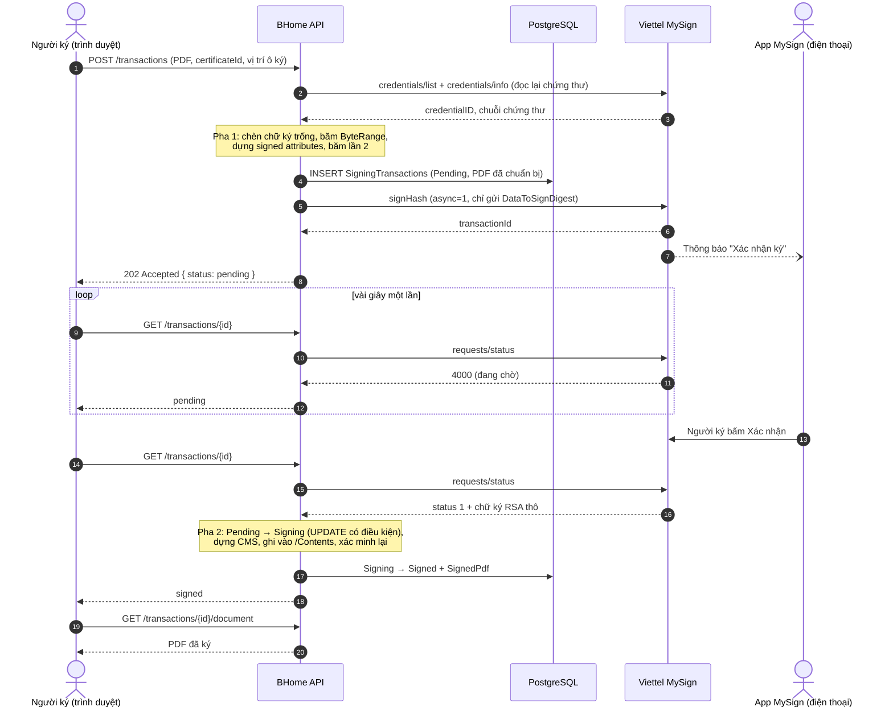
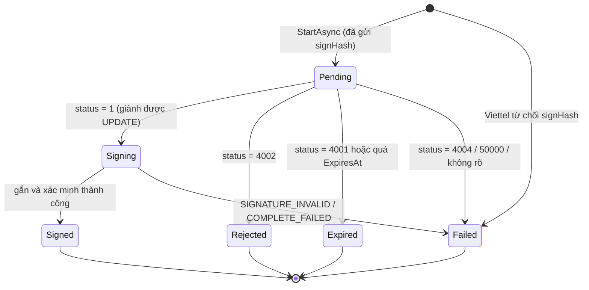

# Luồng kỹ thuật ký số từ xa (Viettel MySign)

Tài liệu này giải thích về mặt kỹ thuật chuyện gì xảy ra từ khi người dùng tải file PDF lên cho tới
khi nhận lại file đã ký: dữ liệu nào được băm, cái gì được gửi cho Viettel, chữ ký được gắn vào PDF
ra sao, và vì sao code được thiết kế như vậy. Phần hướng dẫn sử dụng và API xem ở [README.md](README.md).

## Mục lục

1. [Bài toán và các khái niệm nền](#1-bài-toán-và-các-khái-niệm-nền)
2. [Tổng quan luồng](#2-tổng-quan-luồng)
3. [Khai báo chứng thư](#3-khai-báo-chứng-thư)
4. [Pha 1: chuẩn bị file và tính mã băm](#4-pha-1-chuẩn-bị-file-và-tính-mã-băm)
5. [Gửi mã băm cho Viettel MySign](#5-gửi-mã-băm-cho-viettel-mysign)
6. [Hỏi trạng thái](#6-hỏi-trạng-thái)
7. [Pha 2: gắn chữ ký vào PDF](#7-pha-2-gắn-chữ-ký-vào-pdf)
8. [Máy trạng thái và xử lý đồng thời](#8-máy-trạng-thái-và-xử-lý-đồng-thời)
9. [Ô chữ ký hiển thị](#9-ô-chữ-ký-hiển-thị)
10. [Tài khoản Viettel và mã hóa secret](#10-tài-khoản-viettel-và-mã-hóa-secret)
11. [Bảo mật](#11-bảo-mật)
12. [Xử lý lỗi](#12-xử-lý-lỗi)
13. [Giới hạn hiện tại](#13-giới-hạn-hiện-tại)

---

## 1. Bài toán và các khái niệm nền

### Ký số từ xa (remote signing)

Với ký số bằng USB token, khóa bí mật nằm trong token cắm vào máy người ký. Với **ký số từ xa**,
khóa bí mật nằm trong thiết bị HSM ở trung tâm dữ liệu của nhà cung cấp (Viettel), và **không bao giờ
rời khỏi đó**. Muốn ký, hệ thống gửi cho Viettel một **mã băm**. Viettel đẩy thông báo tới app
MySign trên điện thoại người ký. Khi người ký xác nhận, HSM dùng khóa bí mật ký lên mã băm đó và trả
về **chữ ký thô**.

Từ đây có hai hệ quả kỹ thuật:

- **Chỉ mã băm rời khỏi BHome.** Viettel không bao giờ nhìn thấy nội dung file PDF.
- **Việc ký là bất đồng bộ.** Từ lúc gửi yêu cầu tới lúc có chữ ký mất từ vài giây tới vài phút
  (người ký còn phải mở điện thoại). Không thể giữ một HTTP request chờ lâu như vậy, nên quá trình ký
  bị tách làm **hai pha**, chạy ở hai request khác nhau.

### Chữ ký trong file PDF hoạt động thế nào

Một chữ ký số trong PDF gồm các thành phần sau:

| Thành phần                      | Ý nghĩa                                                                                                                                   |
| ------------------------------- | ----------------------------------------------------------------------------------------------------------------------------------------- |
| Trường chữ ký (signature field) | Một trường biểu mẫu trong PDF, có thể vô hình hoặc hiện thành một ô trên trang                                                            |
| Từ điển chữ ký (`/Sig`)         | Chứa `/Filter`, `/SubFilter`, `/M` (thời điểm ký), `/ByteRange`, `/Contents`                                                              |
| `/ByteRange [a b c d]`          | Hai đoạn byte của file được ký: từ đầu file tới ngay trước `/Contents`, và từ ngay sau `/Contents` tới cuối file                          |
| `/Contents <...>`               | Một chuỗi hex chứa **gói CMS** (chữ ký thật). Đây là phần duy nhất của file không nằm trong ByteRange, vì chữ ký không thể tự ký chính nó |

```text
┌──────────── byte được ký ────────────┐            ┌──── byte được ký ────┐
│ %PDF-1.7 ... /ByteRange [...] /Contents <  00000…000  > ... %%EOF        │
└──────────────────────────────────────┘ ▲ CMS ghi vào đây ▲└─────────────┘
```

**Gói CMS** (Cryptographic Message Syntax, RFC 5652) là một cấu trúc `SignedData`. Nó chứa chứng thư
của người ký, chuỗi chứng thư CA, các **thuộc tính được ký** (signed attributes), và giá trị chữ ký
RSA. Module này tạo chữ ký theo chuẩn **PAdES-BASELINE-B**, tức là PDF + CAdES detached
(`/SubFilter /ETSI.CAdES.detached`). "Detached" nghĩa là gói CMS không chứa lại nội dung tài liệu;
nội dung chính là các byte trong ByteRange.

### Hai mã băm khác nhau

Đây là điểm dễ nhầm nhất. Có **hai** mã băm SHA-256 trong luồng ký:

| Tên trong code     | Băm cái gì                                                                 | Dùng để làm gì                                  |
| ------------------ | -------------------------------------------------------------------------- | ----------------------------------------------- |
| `DocumentDigest`   | Các byte của file PDF nằm trong `/ByteRange`                               | Được ghi vào thuộc tính `messageDigest` của CMS |
| `DataToSignDigest` | Bản mã hóa DER của tập **signed attributes** (trong đó có `messageDigest`) | **Đây là mã băm gửi cho Viettel ký**            |

Viettel ký lên `DataToSignDigest`. Vì `DataToSignDigest` bao trùm `messageDigest`, và
`messageDigest` lại bao trùm toàn bộ nội dung PDF, nên chữ ký gián tiếp bảo vệ toàn bộ tài liệu.

---

## 2. Tổng quan luồng



Các lớp tham gia, theo kiến trúc phân lớp của BHome:

| Lớp                | Thành phần                                               | Trách nhiệm                                       |
| ------------------ | -------------------------------------------------------- | ------------------------------------------------- |
| Api                | `SigningTransactionsController`                          | Nhận multipart, gọi service, trả 202/200          |
| Application        | `RemoteSigningService`                                   | Điều phối hai pha, kiểm tra quyền, máy trạng thái |
| Application (port) | `ISigningProvider`, `IPdfSigner`, `IDigitalSigningStore` | Interface, không phụ thuộc thư viện cụ thể        |
| Infrastructure     | `ViettelMySignProvider`                                  | Gọi HTTP tới Viettel, cache token                 |
| Infrastructure     | `ITextPdfSigner`                                         | Mọi thao tác trên PDF và CMS (thư viện iText)     |
| Infrastructure     | `EfDigitalSigningStore`                                  | Đọc/ghi PostgreSQL qua EF Core                    |

`ISigningProvider` chỉ làm việc với **mã băm và chữ ký thô**. Mọi thứ liên quan tới PDF nằm trong
`IPdfSigner`. Nhờ tách như vậy, có thể đổi nhà cung cấp (thêm VNPT) hoặc đổi thư viện PDF mà không
phải sửa phần còn lại.

---

## 3. Khai báo chứng thư

Trước khi ký, người dùng phải khai báo chứng thư của mình một lần
(`POST /certificates { providerUserId, serialNumber? }`). `SigningCertificateService.DeclareAsync`
thực hiện các bước:

1. Gọi `ListCredentialsAsync(providerUserId, serialNumber)`: đăng nhập Viettel bằng `user_id` của
   người ký, lấy danh sách `credentialIDs`, rồi gọi `credentials/info` cho từng id để lấy chuỗi chứng
   thư (xem [mục 5](#5-gửi-mã-băm-cho-viettel-mysign)).
2. Nếu thuê bao có nhiều chứng thư mà người dùng không nhập serial, hệ thống từ chối và liệt kê các
   serial để người dùng chọn.
3. Từ chối nếu chứng thư đã hết hạn (`NotAfter`).
4. Kiểm tra cặp `(Provider, SerialNumber)`. Có unique index trong DB: **mỗi chứng thư chỉ thuộc về
   một người**. Khai báo lại cho chính mình thì trả về bản ghi cũ; khai báo chứng thư đã thuộc về
   người khác thì trả 409.
5. Lưu `SigningCertificate`. Bản ghi chỉ gồm **thông tin công khai**: subject, issuer, serial, hạn
   dùng, `CredentialId` (định danh của chứng thư phía Viettel) và `ProviderUserId`. Khóa bí mật không
   bao giờ đi qua BHome.

Mỗi lần ký, hệ thống **đọc lại chứng thư từ Viettel** chứ không dùng bản đã lưu. Nhờ vậy, chứng thư
bị gia hạn hoặc thu hồi phía Viettel sẽ được phát hiện ngay lúc ký.

---

## 4. Pha 1: chuẩn bị file và tính mã băm

`RemoteSigningService.StartAsync` → `ITextPdfSigner.Prepare`.

### 4.1. Kiểm tra đầu vào

| Kiểm tra                                                                           | Lỗi                                     |
| ---------------------------------------------------------------------------------- | --------------------------------------- |
| Người dùng đã đăng nhập và có một trong ba role Owner/Staff/Tenant                 | 401 / 403                               |
| File khác rỗng, không quá `MaxPdfMegabytes` (mặc định 10 MB), bắt đầu bằng `%PDF-` | 400                                     |
| Chứng thư tồn tại **và thuộc về người đang đăng nhập**                             | 404 (cố ý không trả 403 để không lộ id) |
| Chứng thư không bị khóa, đang trong thời hạn hiệu lực                              | 409                                     |

### 4.2. Cố định thời điểm ký

```csharp
var signingDate = now làm tròn xuống tới giây (UTC);
```

Thời điểm này được ghi vào `/M` của từ điển chữ ký và hiện trong ô "Ngày ký". Làm tròn tới giây để
hai nơi khớp nhau.

### 4.3. Tạo bản cập nhật tăng dần có chữ ký trống

```csharp
var signer = new PdfSigner(reader, output, new StampingProperties().UseAppendMode());
signer.SetSignerProperties(new SignerProperties()
    .SetFieldName("BHomeSignature_xxxxxxxxxxxx")
    .SetClaimedSignDate(signingDate)
    /* + vị trí ô ký nếu có */);
signer.SignExternalContainer(new DigestCapturingContainer(), 32_768);
```

Chuyện gì xảy ra bên trong:

1. **`UseAppendMode()` (incremental update):** iText **không viết lại** file gốc mà nối thêm một phần
   cập nhật vào cuối. Mọi byte của file gốc giữ nguyên. Đây là yêu cầu bắt buộc để sau này ký thêm
   chữ ký thứ hai mà không làm hỏng chữ ký thứ nhất.
2. **Tạo trường chữ ký** với tên ngẫu nhiên `BHomeSignature_` + 12 ký tự hex, cùng từ điển `/Sig`:
   - `/Filter /Adobe.PPKLite`
   - `/SubFilter /ETSI.CAdES.detached`
   - `/M` = thời điểm ký
3. **Chừa chỗ cho chữ ký:** `/Contents` được điền **32 768 byte 0** (65 536 ký tự hex). Chừng đó đủ
   chứa chữ ký RSA, chứng thư người ký và chuỗi CA, còn dư nhiều.
4. **Tính `/ByteRange`** = toàn bộ file trừ đúng vùng `/Contents`.
5. **Gọi `DigestCapturingContainer.Sign(stream)`:** iText đưa vào đúng các byte trong ByteRange.
   Container tính `SHA-256` của chúng, đây là **`DocumentDigest`**, và trả về mảng rỗng, nên
   `/Contents` vẫn là toàn số 0.

Kết quả là **`PreparedPdf`**: một file PDF hoàn chỉnh, có trường chữ ký nhưng chữ ký còn trống. Mọi
byte ngoài `/Contents` đã ở dạng cuối cùng.

### 4.4. Dựng signed attributes và băm lần hai

```csharp
var cms = new PdfPKCS7(null, chain, "SHA-256", false);   // chưa có khóa bí mật
byte[] attributes = cms.GetAuthenticatedAttributeBytes(
    DocumentDigest, PdfSigner.CryptoStandard.CADES, null, null);
byte[] DataToSignDigest = SHA256(attributes);
```

`attributes` là bản mã hóa **DER** của một `SET OF Attribute` gồm:

| Thuộc tính                             | OID                        | Giá trị                        |
| -------------------------------------- | -------------------------- | ------------------------------ |
| `contentType`                          | 1.2.840.113549.1.9.3       | `id-data`                      |
| `messageDigest`                        | 1.2.840.113549.1.9.4       | `DocumentDigest`               |
| `signingCertificateV2` (ESS, RFC 5035) | 1.2.840.113549.1.9.16.2.47 | SHA-256 của chứng thư người ký |

`signingCertificateV2` buộc chữ ký vào đúng chứng thư này, để không ai tráo được chứng thư khác cùng
khóa công khai. Đây là yêu cầu của chuẩn CAdES/PAdES.

**Điểm mấu chốt:** tập thuộc tính này **không có `signingTime`** (PAdES lấy thời điểm ký từ `/M`).
Vì vậy, với cùng `DocumentDigest` và cùng chuỗi chứng thư, mã hóa DER luôn ra **đúng từng byte như
nhau**. Pha 2 dựa vào tính chất này để dựng lại y hệt tập thuộc tính mà Viettel đã ký.

### 4.5. Lưu giao dịch

Hệ thống ghi một dòng `SigningTransactions` ở trạng thái `Pending`, gồm mọi thứ pha 2 cần:

| Cột                                              | Vì sao cần                                                                                      |
| ------------------------------------------------ | ----------------------------------------------------------------------------------------------- |
| `PreparedPdf`                                    | File để ghi chữ ký vào ở pha 2                                                                  |
| `FieldName`                                      | Tên trường chữ ký cần điền                                                                      |
| `DocumentDigest`                                 | Để dựng lại `messageDigest`                                                                     |
| `CertificateChain`                               | Chuỗi chứng thư (Base64 DER, mỗi dòng một chứng thư, người ký đứng đầu) để dựng CMS và xác minh |
| `DataToSignSha256`                               | Mã băm đã gửi Viettel, để tra soát                                                              |
| `SourcePdfSha256`                                | SHA-256 của file gốc, để đối chiếu về sau                                                       |
| `SigningDate`, `ExpiresAt`                       | Thời điểm ký, hạn chờ xác nhận (mặc định 300 giây)                                              |
| `ProviderUserId`, `CredentialId`, `SerialNumber` | Định danh người ký và chứng thư phía Viettel                                                    |

> **Khác với bản Java:** bản Java dùng EU DSS. Thư viện này làm việc trên bản sao của tài liệu, nên
> ở pha 2 phải **tạo lại** `dataToSign` từ file gốc với đúng mọi tham số (lệch một mili-giây là chữ
> ký sai). Bản .NET **lưu luôn file đã chuẩn bị**, nên pha 2 không phải tái tạo gì. Cách này đơn giản
> hơn và không còn rủi ro lệch byte, đổi lại tốn thêm một bản PDF trong DB.

---

## 5. Gửi mã băm cho Viettel MySign

`ViettelMySignProvider` dùng **luồng bất đồng bộ** của Viettel: `signHash` với `async: 1` trả về
`transactionId` ngay lập tức. Luồng đồng bộ (dùng SAD) giữ kết nối tới khi người ký xác nhận, nên
không phù hợp.

### 5.1. Đăng nhập và token

```http
POST {BaseUrl}/vtss/service/ras/v1/login
{ "client_id": "...", "client_secret": "...", "profile_id": "...", "user_id": "<mã thuê bao>" }

→ 200 { "access_token": "...", "expires_in": 3600 }
```

- Token cấp **theo từng người ký** (`user_id`). Mọi lời gọi sau đó đều gửi kèm
  `Authorization: Bearer <token>` của đúng người ký đó.
- `ViettelTokenCache` (singleton) giữ token theo khóa `BaseUrl|ClientId|user_id`. Khóa có cả
  `ClientId`, nên khi Owner đổi tài khoản Viettel thì token cũ không bị dùng lại.
- Token được làm mới khi còn dưới **60 giây** là hết hạn, để không hết hạn giữa lúc lấy ra và lúc dùng.
- Nếu Viettel trả **401** (token bị thu hồi sớm), provider xóa token, đăng nhập lại và **thử lại
  đúng một lần**.
- `profile_id` để trống thì không gửi (`JsonIgnoreCondition.WhenWritingNull`).

### 5.2. Đọc chứng thư

```http
POST {BaseUrl}/adss/service/ras/csc/v1/credentials/list
{ "client_id", "client_secret", "user_id", "certificates": "chain", "certInfo": true, "authInfo": false }
→ { "credentialIDs": ["cred-1", ...] }

POST {BaseUrl}/adss/service/ras/csc/v1/credentials/info
{ "client_id", "client_secret", "credentialID": "cred-1", "certificates": "chain", ... }
→ { "cert": { "certificates": ["<Base64 DER>", ...], "SerialNumber": "..." } }
```

Thực tế Viettel chỉ trả **danh sách id** ở `credentials/list`, còn chứng thư phải lấy qua
`credentials/info` (đường dẫn suy ra bằng cách thay `/list` thành `/info`). Provider cũng chấp nhận hai
dạng trả lời khác có trong tài liệu Viettel. Serial được so sánh sau khi chuẩn hóa: bỏ `:`, khoảng
trắng và số 0 đứng đầu, không phân biệt hoa thường.

### 5.3. Yêu cầu ký

```http
POST {BaseUrl}/vtss/service/signHash
Authorization: Bearer <token của người ký>
{
  "credentialID": "cred-1",
  "numSignatures": 1,
  "description": "<Base64 của mô tả đã làm sạch>",
  "documents": [{ "document_id": "bhome-<id giao dịch>", "document_name": "<Base64>" }],
  "hash": ["<Base64 của DataToSignDigest (32 byte)>"],
  "hashAlgo": "2.16.840.1.101.3.4.2.1",   // SHA-256
  "signAlgo": "1.2.840.113549.1.1.1",     // RSA
  "async": 1
}
→ { "transactionId": "..." }
```

- **`hash` là `DataToSignDigest`**, không phải mã băm của file PDF (xem
  [mục 1](#hai-mã-băm-khác-nhau)).
- Viettel ký bằng **RSA PKCS#1 v1.5** trên mã băm SHA-256. Kết quả là chữ ký thô đúng như
  `RSA.SignHash(digest, SHA256, Pkcs1)` sẽ tạo ra. Test giả lập Viettel bằng chính lệnh này.
- **Làm sạch mô tả** (`ViettelText.Plain`): Viettel chỉ nhận `A-Z a-z 0-9 _ -` và khoảng trắng, dưới
  100 ký tự. Dấu tiếng Việt bị bỏ (chuẩn hóa Unicode NFD rồi xóa dấu, `đ` → `d`), ký tự khác thành
  khoảng trắng. Ví dụ: `"Ký hợp đồng phòng 101/A"` → `"Ky hop dong phong 101 A"`.
- Chỉ nhận mã băm SHA-256 dài đúng 32 byte; sai thì từ chối trước khi gọi Viettel.

`transactionId` được lưu vào `ProviderTransactionId`, rồi API trả về `202 Accepted`.

---

## 6. Hỏi trạng thái

Màn hình gọi `GET /transactions/{id}` vài giây một lần. `RemoteSigningService.StatusAsync` xử lý như sau:

```text
không phải người yêu cầu?            → 404
trạng thái khác Pending?             → trả trạng thái hiện tại (không gọi Viettel)
đã quá ExpiresAt?                    → Expired (không gọi Viettel)
chưa có ProviderTransactionId?       → giữ Pending
gọi requests/status:
   không kết nối được Viettel        → giữ Pending, lần hỏi sau thử lại
   status "4000"                     → Pending
   status "4001"                     → Expired
   status "4002"                     → Rejected (người ký bấm Từ chối)
   status "4004" / "50000"           → Failed (kèm error_description)
   status "1" + signatures[0]        → sang Pha 2
   mã khác                           → Failed ("trạng thái không rõ")
```

```http
POST {BaseUrl}/vtss/service/requests/status
Authorization: Bearer <token của người ký>
{ "transactionId": "..." }
→ { "status": "1", "signatures": ["<Base64 chữ ký RSA>"] }
```

Vài chi tiết khi đọc kết quả:

- `status` có thể là chuỗi `"4000"` hoặc số `4000`. Code đọc cả hai dạng thành văn bản.
- Chuỗi Base64 của chữ ký **có thể chứa xuống dòng** (`\r\n`). Phải bỏ hết khoảng trắng trước khi
  giải mã, nếu không chữ ký sẽ không xác minh được.
- Lỗi mạng khi hỏi trạng thái **không** làm hỏng giao dịch. Nó chỉ làm lần hỏi này chưa có kết quả.

---

## 7. Pha 2: gắn chữ ký vào PDF

`RemoteSigningService.CompleteAsync` → `ITextPdfSigner.Complete`.

### 7.1. Giành quyền gắn chữ ký

```sql
UPDATE "SigningTransactions" SET "Status" = 'Signing', ...
WHERE "Id" = @id AND "Status" = 'Pending'
```

Chỉ request nào cập nhật được đúng **1 dòng** mới được làm tiếp. Nếu hai tab cùng hỏi trạng thái
đúng lúc Viettel trả chữ ký, chỉ một tab gắn chữ ký, tab còn lại chỉ đọc kết quả
(xem [mục 8](#8-máy-trạng-thái-và-xử-lý-đồng-thời)).

### 7.2. Dựng gói CMS

```csharp
var cms = new PdfPKCS7(null, chain, "SHA-256", false);
cms.SetExternalSignatureValue(rawSignature, null, "RSA");   // "ECDSA" nếu khóa là EC
byte[] encoded = cms.GetEncodedPKCS7(DocumentDigest, PdfSigner.CryptoStandard.CADES, null, null, null);
```

`GetEncodedPKCS7` dựng lại signed attributes từ `DocumentDigest` và chuỗi chứng thư. Theo
[mục 4.4](#44-dựng-signed-attributes-và-băm-lần-hai), kết quả **trùng từng byte** với tập mà Viettel
đã ký. Sau đó nó đóng gói thành `SignedData`:

```text
ContentInfo { contentType: signedData,
  SignedData {
    version, digestAlgorithms: { sha256 },
    encapContentInfo: { id-data, (không có nội dung → detached) },
    certificates: [ chứng thư người ký, CA trung gian, CA gốc ],
    signerInfos: [{
      sid: issuer + serial của chứng thư người ký,
      digestAlgorithm: sha256,
      signedAttrs: { contentType, messageDigest, signingCertificateV2 },
      signatureAlgorithm: rsaEncryption,
      signature: <chữ ký thô Viettel trả về>
    }]
  }
}
```

### 7.3. Ghi vào chỗ trống

```csharp
PdfSigner.SignDeferred(reader(PreparedPdf), FieldName, output, new FixedContainer(encoded));
```

`SignDeferred` tìm trường chữ ký theo tên, chuyển gói CMS sang hex và ghi đè vào vùng `/Contents`
toàn số 0 (phần thừa vẫn là 0). **Không byte nào khác bị đổi**, nên `/ByteRange` và `DocumentDigest`
vẫn đúng. Nếu gói CMS lớn hơn 32 768 byte, iText báo lỗi và giao dịch chuyển sang `Failed`
(`COMPLETE_FAILED`).

### 7.4. Xác minh trước khi lưu

```csharp
var cms = new SignatureUtil(document).ReadSignatureData(FieldName);
cms.VerifySignatureIntegrityAndAuthenticity();      // (1) và (2)
signatures.SignatureCoversWholeDocument(FieldName); // (3)
```

1. **Toàn vẹn:** băm lại các byte trong ByteRange của file vừa tạo, so với `messageDigest`.
2. **Xác thực:** dùng khóa công khai trong chứng thư để kiểm chữ ký RSA trên signed attributes, và
   kiểm `signingCertificateV2` khớp chứng thư.
3. **Phủ toàn bộ:** chữ ký bao trùm tới hết file, không có phần nào được nối thêm sau khi ký.

Sai bất kỳ điều nào (ví dụ Viettel ký bằng khóa khác, hoặc chữ ký bị hỏng trên đường truyền) thì
service ném `InvalidSignatureException`, giao dịch chuyển sang `Failed / SIGNATURE_INVALID`, và **file
không được lưu**.

### 7.5. Lưu kết quả

```sql
UPDATE ... SET "Status" = 'Signed', "SignedPdf" = @pdf WHERE "Id" = @id AND "Status" = 'Signing'
```

Người ký tải file ở `GET /transactions/{id}/document`, tên file là `<tên gốc>-da-ky.pdf`, kèm header
`Cache-Control: no-store`.

---

## 8. Máy trạng thái và xử lý đồng thời



- **Mọi lần chuyển trạng thái** đều là `UPDATE ... WHERE Id = @id AND Status = @from` thông qua
  `ExecuteUpdateAsync` của EF Core. Cơ sở dữ liệu quyết định ai thắng, nên không cần khóa trong bộ nhớ
  hay khóa phân tán. Cách này đúng cả khi chạy nhiều instance API.
- `Signing` là trạng thái trung gian để không request nào khác gắn chữ ký lần hai.
- Các trạng thái cuối (`Signed`, `Rejected`, `Expired`, `Failed`) không bao giờ thay đổi nữa.
  Muốn ký lại thì tạo giao dịch mới.
- Pha 2 chạy **trong request của chính người ký**. Không có job chạy ngầm, nên nếu người ký đóng
  trình duyệt thì giao dịch tự hết hạn. Đây là thiết kế giữ nguyên từ bản Java.

---

## 9. Ô chữ ký hiển thị

Nếu request có `page`, `x`, `y`, `width`, chữ ký sẽ hiện thành một ô trên trang. Ô này được vẽ **ở
pha 1**, nên nó nằm trong ByteRange và cũng được bảo vệ bởi chữ ký.

**Nội dung ô**, do `RemoteSigningService.AppearanceText` tạo:

```text
Ký bởi: <Common Name trong chứng thư, tối đa 60 ký tự>
Ngày ký: dd/MM/yyyy HH:mm:ss        ← giờ Việt Nam (UTC+7)
```

Tên lấy từ chứng thư chứ không lấy từ tài khoản BHome, nên luôn đúng với người thực sự sở hữu khóa.

**Font:** Tinos (tương thích kích thước với Times New Roman, có đủ dấu tiếng Việt), được nhúng vào
PDF với mã hóa `Identity-H`. Font nhúng là bắt buộc: font chuẩn của PDF (Helvetica…) không có dấu
tiếng Việt. Cỡ chữ **14pt** (`SignatureFontSize`), màu đỏ.

**Đổi tọa độ:** client gửi tỉ lệ tính từ góc **trên-trái**, còn PDF tính tọa độ từ góc
**dưới-trái**:

```text
W, H     = kích thước trang (point, 1 pt = 1/72 inch)
width    = width_tỉ_lệ × W
height   = số_dòng × cỡ_chữ × 1.35 + 2 × 6      (tự tính theo nội dung)
left     = x × W
top      = y × H
Rectangle(left, H − top − height, width, height)
```

Ô bị **từ chối** (400) nếu số trang không tồn tại, trang bị xoay, hoặc ô tràn ra ngoài trang. Hệ
thống không tự cắt ô.

---

## 10. Tài khoản Viettel và mã hóa secret

### Cấu hình theo hai lớp

```text
Giá trị dùng = giá trị Owner đã lưu trong DB (nếu khác rỗng)
               ?? giá trị cấu hình DigitalSigning:Viettel:* (appsettings / biến môi trường)
```

- Hai lớp được gộp **theo từng trường**: Owner có thể chỉ đổi `ClientId` mà vẫn giữ `BaseUrl` của
  cấu hình.
- Bảng `SigningSettings` chỉ có **một dòng** (`Id = 1`), được ràng buộc bằng `CHECK`.
- `SigningAccountCache` (singleton) giữ tài khoản đang dùng trong **10 giây**. Lưu thay đổi thì xóa
  cache trên máy chủ hiện tại; các instance khác nhận thay đổi trong tối đa 10 giây.
- API xem cấu hình cho biết mỗi trường đang lấy từ đâu (`DATABASE`, `CONFIGURATION`, `NONE`). Secret
  **không bao giờ** được trả về; API chỉ cho biết đã có secret hay chưa, và 4 ký tự cuối nếu secret
  dài hơn 8 ký tự.
- Để trống ô secret khi lưu nghĩa là **giữ secret cũ**. Muốn xóa phải gửi `ClearSecret: true`.

### Mã hóa client secret (AES-256-GCM)

```text
key     = SHA-256( DigitalSigning:SecretKey + ".signing.v1" )     // 32 byte
nonce   = 12 byte ngẫu nhiên (mỗi lần mã hóa một nonce mới)
lưu     = Base64( nonce[12] ‖ ciphertext ‖ tag[16] )
```

- GCM vừa mã hóa vừa xác thực: dữ liệu bị sửa trong DB sẽ giải mã thất bại, không ra giá trị sai.
- Hậu tố `.signing.v1` tách khóa này khỏi các khóa khác có thể sinh từ cùng `SecretKey`.
- Định dạng giống hệt bản Java, nên secret lưu ở hệ thống cũ giải mã được ở đây nếu dùng cùng `SecretKey`.
- **Không có khóa mặc định:** thiếu `SecretKey` (hoặc ngắn hơn 32 ký tự) thì không lưu được secret.
- Nếu `SecretKey` bị đổi, secret cũ không giải mã được. Hệ thống báo `SecretUnreadable` để Owner nhập
  lại, trong lúc đó vẫn dùng secret trong cấu hình (nếu có).

---

## 11. Bảo mật

| Rủi ro                                 | Biện pháp                                                                                 |
| -------------------------------------- | ----------------------------------------------------------------------------------------- |
| Lộ nội dung tài liệu                   | Chỉ gửi mã băm 32 byte cho Viettel                                                        |
| Lộ khóa bí mật                         | Khóa nằm trong HSM của Viettel, BHome không bao giờ chạm tới                              |
| Ký bằng chứng thư của người khác       | Chứng thư gắn với `OwnerUserId`; mỗi chứng thư một chủ (unique index)                     |
| Dò id của người khác                   | Chứng thư hay giao dịch không phải của mình đều trả **404**, không phải 403               |
| Chứng thư bị thu hồi hoặc gia hạn      | Đọc lại từ Viettel ở mỗi lần ký; có thể **khóa** chứng thư khi mất điện thoại             |
| Chữ ký sai hoặc bị tráo                | Xác minh đầy đủ trước khi lưu ([mục 7.4](#74-xác-minh-trước-khi-lưu))                     |
| Gắn chữ ký hai lần                     | `UPDATE` có điều kiện theo trạng thái                                                     |
| Tấn công giữa đường (MITM) tới Viettel | Luôn kiểm chứng thư TLS. Code mẫu của Viettel tắt kiểm tra này; bản này **không** làm vậy |
| Lộ secret qua log                      | Log không bao giờ chứa `client_secret` hay token; `user_id` chỉ ghi 4 ký tự cuối          |
| Lộ secret qua API hay DB               | AES-256-GCM khi lưu; API chỉ trả 4 ký tự cuối                                             |
| Lộ thông tin lỗi nội bộ                | Lỗi gốc của Viettel chỉ ghi log; người dùng nhận câu tiếng Việt đã soạn sẵn               |
| Treo request do Viettel chậm           | Mỗi lời gọi có timeout riêng (`TimeoutSeconds`, mặc định 15 giây)                         |
| File quá lớn                           | Giới hạn 12 MB ở tầng HTTP, `MaxPdfMegabytes` ở tầng service                              |

---

## 12. Xử lý lỗi

Service ném `DigitalSigningException` với một loại lỗi. `DigitalSigningExceptionHandler` chuyển nó
thành ProblemDetails, có `title` là câu tiếng Việt.

| Loại lỗi              | HTTP | Ví dụ                                                                      |
| --------------------- | ---- | -------------------------------------------------------------------------- |
| `Invalid`             | 400  | File không phải PDF, ô ký ngoài trang, thuê bao có nhiều chứng thư         |
| `Unauthenticated`     | 401  | Chưa đăng nhập                                                             |
| `Forbidden`           | 403  | Role không được ký; không phải Owner mà sửa cấu hình                       |
| `NotFound`            | 404  | Chứng thư hoặc giao dịch không tồn tại, hay không phải của mình            |
| `Conflict`            | 409  | Chứng thư bị khóa hoặc hết hạn, đã thuộc người khác, tài liệu chưa ký xong |
| `ProviderUnavailable` | 502  | Viettel không nhận yêu cầu ký hoặc không đọc được chứng thư                |

Lỗi xảy ra **sau** khi giao dịch đã được tạo không ném ra ngoài, mà được ghi vào giao dịch
(`ErrorCode`, `ErrorMessage`) để màn hình hiển thị:

| `ErrorCode`         | Khi nào                               |
| ------------------- | ------------------------------------- |
| `PROVIDER_REFUSED`  | `signHash` bị Viettel từ chối         |
| `4004`, `50000`, …  | Mã lỗi Viettel trả khi hỏi trạng thái |
| `SIGNATURE_INVALID` | Chữ ký trả về không xác minh được     |
| `COMPLETE_FAILED`   | Không ghi được chữ ký vào PDF         |

---

## 13. Giới hạn hiện tại

- **Chỉ đạt mức PAdES-BASELINE-B:** không có timestamp từ TSA, không nhúng thông tin thu hồi
  (OCSP/CRL). Khi kiểm tra về sau, phần mềm đọc PDF sẽ đánh giá chứng thư **tại thời điểm kiểm tra**,
  chứ không chứng minh được chứng thư còn hiệu lực **tại thời điểm ký**. Muốn lưu trữ lâu dài cần
  nâng lên B-T (có timestamp) hoặc B-LT/B-LTA (có thông tin thu hồi).
- **Chỉ biết kết quả khi có người hỏi:** nếu không ai gọi `GET /transactions/{id}` thì giao dịch tự
  hết hạn. Có thể chuyển việc hỏi sang `IBackgroundJobQueue` của BHome.
- **PDF lưu trong cột `bytea`:** mỗi giao dịch giữ hai bản PDF (đã chuẩn bị và đã ký). Khi gắn vào
  BHome nên chuyển sang MinIO (`IObjectStorage`).
- **Chỉ ký RSA:** `signAlgo` gửi cho Viettel cố định là RSA, đúng như bản Java. Phía PDF đã hỗ trợ
  ECDSA, nhưng phía Viettel chưa.
- **Chưa chạy với Viettel thật:** provider được viết theo bản Java (đã chạy với Viettel ngày
  06/10/2026) và được test bằng HTTP giả lập. Các đường dẫn API nằm trong cấu hình vì tài liệu của
  Viettel mâu thuẫn nhau.
- **Giấy phép iText là AGPL-3.0:** xem [README](README.md#lưu-ý-quan-trọng).
